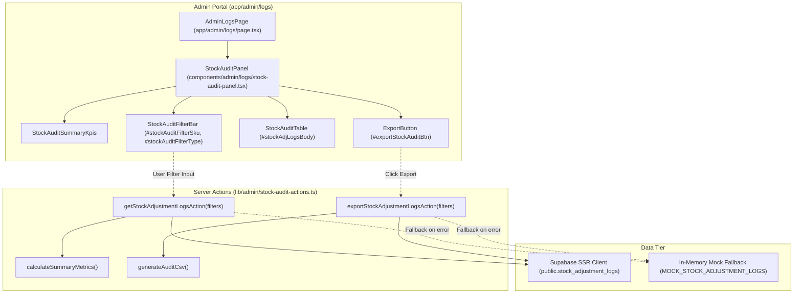

# Implementation Plan: Stock Adjustment Audit Trail Ledger & Shrinkage Analytics

**Feature**: Stock Adjustment Audit Trail Ledger Query Engine & Shrinkage Analytics Action  
**Jira Issue**: [SIAA-65](https://the-three-devsketeers.atlassian.net/browse/SIAA-65) (STORY-7.10)  
**Spec Reference**: [`specs/031-stock-adjustment-audit-trail-ledger/spec.md`](spec.md)  

---

## 1. Technical Architecture & Scope Summary

The feature provides an administrative query engine, shrinkage aggregation analytics, and compliance CSV export over the immutable ledger `public.stock_adjustment_logs`.

### Component & Data Boundary Diagram



---

## 2. File Directory & Artifact Layout

```text
swift/
├── app/
│   └── admin/
│       └── logs/
│           └── page.tsx                     # Updates placeholder with StockAuditPanel
├── components/
│   └── admin/
│       └── logs/
│           ├── stock-audit-panel.tsx         # Client interactive container (filters, KPIs, export)
│           ├── stock-audit-summary-kpis.tsx  # KPI cards: Total Adjustments, Net Delta, Shrinkage
│           ├── stock-audit-table.tsx         # Table with id="stockAdjLogsBody" and color delta pills
│           └── __tests__/
│               └── stock-audit-panel.test.tsx # Component interaction and filtering tests
├── lib/
│   └── admin/
│       ├── stock-audit-actions.ts           # Server Actions: getStockAdjustmentLogsAction, exportStockAdjustmentLogsAction
│       ├── stock-audit-utils.ts             # CSV generator & metric calculation utilities
│       ├── mock-data/
│       │   └── stock-adjustments.ts         # Mock ledger items for fallback & offline testing
│       └── __tests__/
│           ├── stock-audit-actions.test.ts  # Server actions & filtering unit tests
│           └── stock-audit-utils.test.ts    # Aggregator & CSV formatting unit tests
└── specs/
    └── 031-stock-adjustment-audit-trail-ledger/ # SpecKit documentation artifacts
```

---

## 3. Implementation Steps & TDD Strategy

### Phase 1: Domain Schemas, Mock Data & Utilities (Red-Green-Refactor)
1. Define TypeScript types and Zod schemas in `contracts/stock-audit.contract.ts` and `lib/types/stock-audit.ts`.
2. Create realistic mock ledger entries in `lib/admin/mock-data/stock-adjustments.ts` reflecting real shop scenarios (damaged goods, physical count reconciliation, POS sale decrement).
3. Implement pure utility functions in `lib/admin/stock-audit-utils.ts`:
   - `calculateSummaryMetrics(logs)`
   - `generateAuditCsv(logs)`
   - `formatAuditDate(dateString)`
4. Write unit tests in `lib/admin/__tests__/stock-audit-utils.test.ts` covering edge cases (empty array, zero deltas, multiline reason escaping in CSV).

### Phase 2: Server Actions Query Engine
1. Implement `getStockAdjustmentLogsAction(filters)` in `lib/admin/stock-audit-actions.ts`:
   - Validates input filters via `StockAuditFilterSchema`
   - Executes Supabase query on `public.stock_adjustment_logs`
   - Computes summary metrics
   - Falls back gracefully to mock ledger when disconnected
2. Implement `exportStockAdjustmentLogsAction(filters)` in `lib/admin/stock-audit-actions.ts`:
   - Fetches full matching result set
   - Encodes standard RFC 4180 CSV
   - Returns filename with UTC date stamp
3. Write test suite in `lib/admin/__tests__/stock-audit-actions.test.ts` testing SKU filter, type filter, search filter, and CSV generation.

### Phase 3: UI Components & Theme Token Wiring
1. Implement `StockAuditSummaryKpis`: renders cards for Total Logs, Net Delta, and Shrinkage with semantic badge tokens.
2. Implement `StockAuditTable`: renders table with `id="stockAdjLogsBody"`, color-coded delta pills (`+Units` in `text-success` / `bg-success-light`, `-Units` in `text-danger` / `bg-danger-light`), reason, and user.
3. Implement `StockAuditPanel`: manages filter state, search debounce, CSV download trigger, and loading states.
4. Update `app/admin/logs/page.tsx` integrating the panel into the Admin Portal shell.
5. Write React Testing Library tests in `components/admin/logs/__tests__/stock-audit-panel.test.tsx`.

---

## 4. Verification Checkpoints

1. `npm run test` passes with 100% green tests on stock audit utilities, server actions, and UI panel.
2. `npx tsc --noEmit` verifies strict TypeScript compilation.
3. `npm run lint` satisfies ESLint rules without warnings.
4. Interactive verification in `/admin/logs` confirms filter responsiveness, CSV export trigger, and color-coded delta display.
