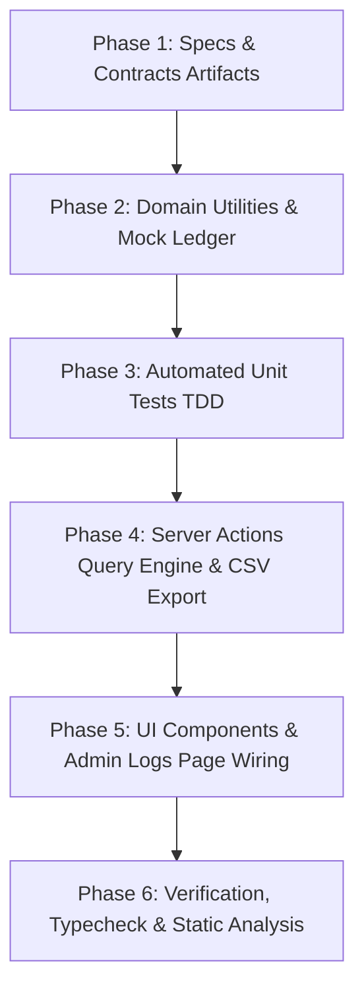

# Implementation Tasks: Stock Adjustment Audit Trail Ledger & Shrinkage Analytics

**Feature**: `031-stock-adjustment-audit-trail-ledger`  
**Jira Issue**: [SIAA-65](https://the-three-devsketeers.atlassian.net/browse/SIAA-65) (STORY-7.10)  
**Parent Epic**: [SIAA-7](https://the-three-devsketeers.atlassian.net/browse/SIAA-7) (EPIC-7: System Admin, Labor Rates Matrix & Auditing)  
**Spec Reference**: [`specs/031-stock-adjustment-audit-trail-ledger/spec.md`](spec.md)  
**Plan Reference**: [`specs/031-stock-adjustment-audit-trail-ledger/plan.md`](plan.md)  

---

## Task Matrix & Dependency Graph

---

## Phase 1: Specifications, Contracts & Architecture Artifacts

- [x] **TASK-1.1**: Author canonical 8-artifact SpecKit documentation for SIAA-65 (`specs/031-stock-adjustment-audit-trail-ledger/spec.md`, `research.md`, `data-model.md`, `contracts/stock-audit.contract.ts`, `checklists/requirements.md`, `plan.md`, `quickstart.md`, `tasks.md`).
- [x] **TASK-1.2**: Update `.specify/feature.json` targeting `specs/031-stock-adjustment-audit-trail-ledger`.

---

## Phase 2: Domain Utilities & Mock Ledger

- [x] **TASK-2.1**: Define TypeScript interfaces and Zod schemas in `lib/types/stock-audit.ts` corresponding to `contracts/stock-audit.contract.ts`:
  - `StockAdjustmentLogEntry`
  - `StockAuditFilterOptions`
  - `StockAuditSummaryMetrics`
  - `StockAuditLogsResponse`
  - `StockAuditExportResult`
- [x] **TASK-2.2**: Create mock audit ledger records in `lib/admin/mock-data/stock-adjustments.ts` seeded from `mockup/app.js` (`SWIFT_DB.stockAdjustmentLogs`) with diverse adjustment scenarios (`Physical Count`, `Damaged Goods`, `Supplier Return`, `POS Sale`).
- [x] **TASK-2.3**: Implement pure mathematical and formatting utilities in `lib/admin/stock-audit-utils.ts`:
  - `calculateSummaryMetrics(logs)`: aggregates `totalCount`, `netDelta`, `totalShrinkage`, and `totalIntake`.
  - `generateAuditCsv(logs)`: generates standard RFC 4180 CSV string with header and escaped values.
  - `formatAuditTimestamp(isoDate)`: formats UTC timestamp for audit display and CSV exports.

---

## Phase 3: Automated Unit & Integration Tests (TDD)

- [x] **TASK-3.1**: Create `lib/admin/__tests__/stock-audit-utils.test.ts`:
  - Test `calculateSummaryMetrics` with positive, negative, and mixed unit deltas.
  - Test `calculateSummaryMetrics` with empty logs list.
  - Test `generateAuditCsv` verifies headers, row formatting, and quote escaping for reasons containing commas or quotes.
- [x] **TASK-3.2**: Create `lib/admin/__tests__/stock-audit-actions.test.ts`:
  - Test `getStockAdjustmentLogsAction` filters by exact SKU (`YAM-NMAX-BL01`).
  - Test `getStockAdjustmentLogsAction` filters by adjustment type (`Damaged Goods`).
  - Test `getStockAdjustmentLogsAction` computes accurate aggregate metrics.
  - Test `exportStockAdjustmentLogsAction` returns RFC 4180 CSV payload and timestamped filename.
  - Test fallback to in-memory mock ledger when Supabase client is unconfigured.

---

## Phase 4: Server Actions Query Engine & CSV Export

- [x] **TASK-4.1**: Implement `getStockAdjustmentLogsAction` in `lib/admin/stock-audit-actions.ts`:
  - Validate query filters using `StockAuditFilterSchema`.
  - Query `public.stock_adjustment_logs` with chained filters (`sku`, `adjustment_type`, `created_at` range).
  - Enforce deterministic ordering (`created_at DESC`, `id DESC`).
  - Compute and attach `StockAuditSummaryMetrics`.
  - Provide safe fallback to mock ledger during test/offline execution.
- [x] **TASK-4.2**: Implement `exportStockAdjustmentLogsAction` in `lib/admin/stock-audit-actions.ts`:
  - Query matching records.
  - Convert to RFC 4180 CSV using `generateAuditCsv`.
  - Return `{ success: true, csvContent, filename, recordCount }`.

---

## Phase 5: UI Components & Admin Logs Page Wiring

- [x] **TASK-5.1**: Implement `components/admin/logs/stock-audit-summary-kpis.tsx`:
  - KPI cards for Total Adjustments, Net Unit Delta, and Total Shrinkage.
  - Adhere strictly to semantic design tokens (`bg-bg-card`, `border-border`, `text-success`, `text-danger`).
- [x] **TASK-5.2**: Implement `components/admin/logs/stock-audit-table.tsx`:
  - Render table structure with `<tbody id="stockAdjLogsBody">`.
  - High-contrast color-coded change pills: positive deltas in `text-success` / `bg-success-light`, negative deltas in `text-danger` / `bg-danger-light`.
  - Adjustment type badges (`badge badge-warning` for Damaged Goods, `badge badge-info` for Physical Count).
  - Empty state when query produces 0 records.
  - Enforce 100% read-only display with zero edit/delete controls.
- [x] **TASK-5.3**: Implement `components/admin/logs/stock-audit-panel.tsx`:
  - Search input `#stockAuditFilterSku` with debounced query update.
  - Adjustment type select `#stockAuditFilterType`.
  - Export button `#exportStockAuditBtn` triggering browser CSV download.
- [x] **TASK-5.4**: Wire `StockAuditPanel` into `app/admin/logs/page.tsx`:
  - Replace the EPIC-7 placeholder with active Stock Adjustment Audit Trail ledger.
  - Ensure theme toggle and dark mode compatibility.

---

## Phase 6: Verification, Typecheck & Static Analysis

- [x] **TASK-6.1**: Run `npm test` verifying all unit and component tests pass.
- [x] **TASK-6.2**: Run `npx tsc --noEmit` verifying zero TypeScript compilation errors.
- [x] **TASK-6.3**: Run `npm run lint` verifying compliance with Next.js and project style standards.
- [x] **TASK-6.4**: Run `git status` and prepare atomic commits following Conventional Commits format with Jira key `[SIAA-65]`.
