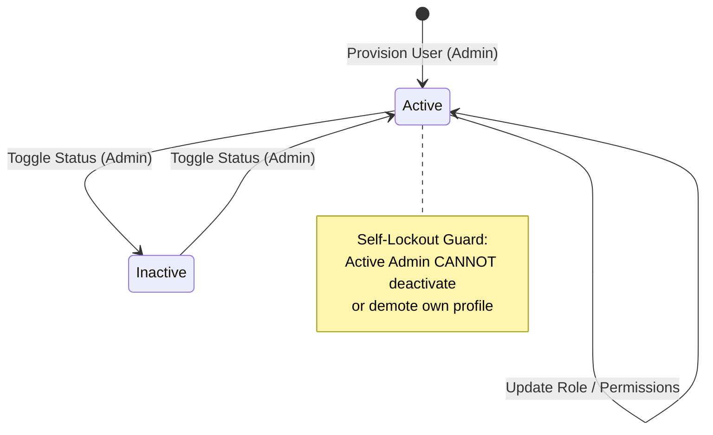

# Data Model: User Account Provisioning & RBAC Management

**Feature**: SIAA-38 (STORY-7.1)  
**Spec Directory**: `specs/031-user-account-provisioning-rbac-management/`

---

## 1. Entity Models & Types

### 1.1 System User Role Enum
```typescript
export type DbUserRole = 'admin' | 'cashier' | 'mechanic' | 'inventory_clerk' | 'staff';
export type UserRoleDisplay = 'Admin' | 'Cashier' | 'Mechanic' | 'Inventory Clerk' | 'Staff';
```

### 1.2 Granular Operational Permissions
```typescript
export interface StaffPermissions {
  can_adjust_stock: boolean;     // Warehouse stock adjustment rights
  can_override_discount: boolean; // Authorization to apply higher custom/senior discounts
  can_manage_pricing: boolean;    // Authorization to edit wholesale/retail base rates
  can_view_reports: boolean;      // Access to forensic logs and financial KPI exports
}
```

### 1.3 Staff User Summary (DTO for UI Ledger)
```typescript
export interface StaffUserSummary {
  id: string;
  email: string;
  fullName: string;
  role: DbUserRole;
  roleDisplay: UserRoleDisplay;
  status: 'Active' | 'Inactive' | 'Suspended';
  permissions: StaffPermissions;
  createdAt: string;
  updatedAt: string;
}
```

### 1.4 Audit Event Metadata for User Lifecycle
```typescript
export interface UserAuditEventMetadata {
  targetUserId: string;
  targetUserEmail: string;
  previousRole?: DbUserRole;
  newRole?: DbUserRole;
  previousPermissions?: Partial<StaffPermissions>;
  newPermissions?: Partial<StaffPermissions>;
  statusChange?: {
    from: string;
    to: string;
  };
  reason?: string;
}
```

---

## 2. State Machine: Account Status & Role Lifecycle



---

## 3. Database Schema Mapping (Supabase / PostgreSQL)

```sql
-- Existing profiles table schema reference
CREATE TABLE IF NOT EXISTS public.profiles (
  id UUID PRIMARY KEY REFERENCES auth.users(id) ON DELETE CASCADE,
  email TEXT UNIQUE NOT NULL,
  full_name TEXT NOT NULL,
  role public.user_role NOT NULL DEFAULT 'staff',
  permissions JSONB NOT NULL DEFAULT '{"can_adjust_stock": false, "can_override_discount": false, "can_manage_pricing": false, "can_view_reports": false}'::jsonb,
  status TEXT NOT NULL DEFAULT 'Active' CHECK (status IN ('Active', 'Inactive', 'Suspended')),
  created_at TIMESTAMPTZ NOT NULL DEFAULT timezone('utc'::text, now()),
  updated_at TIMESTAMPTZ NOT NULL DEFAULT timezone('utc'::text, now())
);
```
