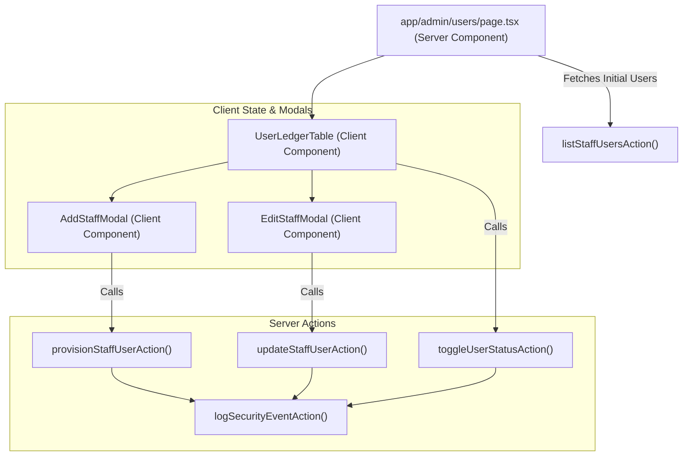

# Implementation Plan: User Account Provisioning & RBAC Management

**Feature**: SIAA-38 (STORY-7.1)  
**Spec Directory**: `specs/031-user-account-provisioning-rbac-management/`

---

## 1. Technical Architecture & Boundary Mapping

---

## 2. Component Hierarchy & File Responsibilities

1. **`app/admin/users/page.tsx`**:
   - Container with `id="view-users"`.
   - Server Component prefetching staff users from `listStaffUsersAction`.
   - Renders header banner, KPI statistics summary, and passes initial users to `UserLedgerTable`.

2. **`components/admin/users/user-ledger-table.tsx`**:
   - Client Component managing search query, role filter, active staff state, and modal open states.
   - Table body with `id="usersTableBody"`.
   - Header with "+ Add Staff User" trigger (`id="btnAddStaffUser"`).
   - Renders each user row with avatar, name, email, role badge, permission chips, status pill, and action buttons:
     - "Edit" button (`data-testid="btn-edit-user-${user.id}"`, `#btnEditUser-${user.id}`) opens `EditStaffModal`.
     - "Toggle Status" button toggles active/inactive.

3. **`components/admin/users/edit-staff-modal.tsx`**:
   - Client Component modal for editing an existing staff member's Full Name, Role, and Granular Permission Flags (`can_adjust_stock`, `can_override_discount`, `can_manage_pricing`, `can_view_reports`).
   - Validates input, dispatches `updateStaffUserAction`, updates ledger state on success, and handles self-demotion errors.

4. **`components/admin/users/add-staff-modal.tsx`**:
   - Provisions new staff member, assigns role & permissions, logs audit event, prepends to table.

5. **`lib/admin/user-actions.ts`**:
   - Implements `updateStaffUserAction`: validates payload, enforces admin caller privileges, enforces self-demotion prevention (logged-in admin cannot strip their own admin role), persists changes to Supabase or in-memory fallback, logs security audit event via `logSecurityEventAction`.
   - Enriches `provisionStaffUserAction` and `toggleUserStatusAction` with security audit event recording.

6. **`lib/admin/__tests__/user-actions.test.ts`**:
   - Comprehensive unit test suite covering provisioning, permission modification, role assignment, duplicate email prevention, self-lockout prevention, and audit event dispatch.

---

## 3. Design Token Verification Gate

- All modals, tables, badges, chips, and buttons use SWIFT semantic tokens:
  - Surface: `bg-bg-surface`, `bg-bg-card`, `bg-bg-muted`
  - Text: `text-text-primary`, `text-text-secondary`, `text-text-muted`, `text-text-light`
  - Primary / Brand: `bg-primary`, `bg-primary-hover`, `text-primary`, `bg-primary-light`
  - Status: `bg-success-light`, `text-success`, `bg-danger-light`, `text-danger`, `bg-info-light`, `text-info`, `bg-accent-light`, `text-accent`
  - Borders: `border-border`
- Strict prohibition of raw hex/RGB or default Tailwind non-token palette colors.
