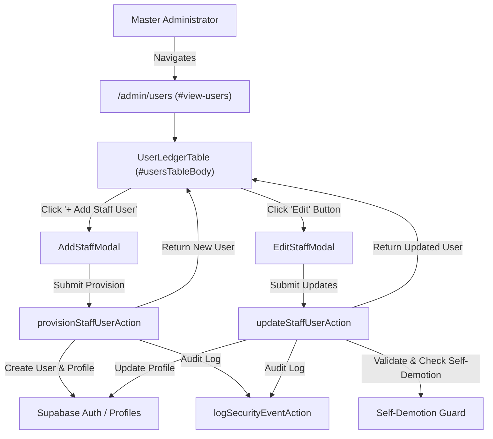

# Research & Technical Architecture: User Account Provisioning & RBAC Management

**Feature**: SIAA-38 (STORY-7.1)  
**Spec Directory**: `specs/031-user-account-provisioning-rbac-management/`

---

## 1. Technical Stack & Architectural Constraints

- **Framework**: Next.js 15 (App Router) with React 19 Server/Client Components.
- **Styling**: Tailwind CSS v4 with SWIFT Semantic Design Tokens (`lib/tokens.ts`, `app/globals.css`). Zero hardcoded hex or default palette classes.
- **Database & Auth**: Supabase PostgreSQL with `public.profiles` table (enriched with `role: public.user_role` and `permissions: JSONB`), Supabase Admin Auth API (`supabase.auth.admin.createUser`), and an in-memory fallback store (`memoryStaffUsers`) for resilience and isolated unit testing.
- **Audit Logging**: Forensic Security Audit Log engine (`lib/admin/audit-actions.ts`, stored procedure `log_security_event`) from SIAA-62. All user lifecycle actions (provision, update, status toggle) must trigger an audit entry.

---

## 2. Existing Baseline Analysis

In SIAA-56, the foundational schema migration (`20261019000000_rbac_permissions.sql`), server actions (`lib/admin/user-actions.ts`), and baseline UI (`UserLedgerTable`, `AddStaffModal`) were established.

### Identified Gap Analysis for SIAA-38 Requirements:

1. **DOM Identifiers & AC Alignment**:
   - Acceptance Criteria specifically require `#view-users` as the outer container, `#usersTableBody` for the table tbody, and "+ Add Staff User" trigger button.
   - Current table had generic markup without these specific identifiers.

2. **Missing Edit User Flow**:
   - Scenario 1 & 3 require an "Edit" action button in the ledger table rows.
   - Currently, rows only contain a "Toggle Status" (Power icon) action button.
   - A dedicated `EditStaffModal` (`components/admin/users/edit-staff-modal.tsx`) is needed to allow editing Name, Role, and Granular Permission toggles with immediate UI update and server persistence.

3. **Unified User Update Server Action (`updateStaffUserAction`)**:
   - Existing `updateUserPermissionsAction` only modifies permissions. SIAA-38 requires editing Name, Role, and Granular Permissions together in one atomic flow, with self-lockout/self-demotion protection for administrators.

4. **Security Audit Event Integration**:
   - SIAA-38 Scenario 2 requires: *"And a security audit log event is recorded documenting the account creation."*
   - Scenario 3 requires audit tracking for permission/role updates.
   - Wire `logSecurityEventAction` directly into `provisionStaffUserAction`, `updateStaffUserAction`, and `toggleUserStatusAction`.

---

## 3. Architecture Decisions & State Lifecycle

---

## 4. Design Tokens & Accessibility Guidelines

- Modal dialogs use `bg-bg-card`, `border-border`, and `shadow-2xl`.
- Badges use semantic classes:
  - Admin: `bg-primary-light text-primary border-primary/20`
  - Cashier: `bg-accent-light text-accent border-accent/30`
  - Inventory Clerk: `bg-info-light text-info border-info/30`
  - Mechanic: `bg-secondary text-text-secondary border-border`
- All buttons and inputs feature explicit ARIA attributes (`aria-label`, `role="dialog"`, `aria-modal="true"`, focus management).
