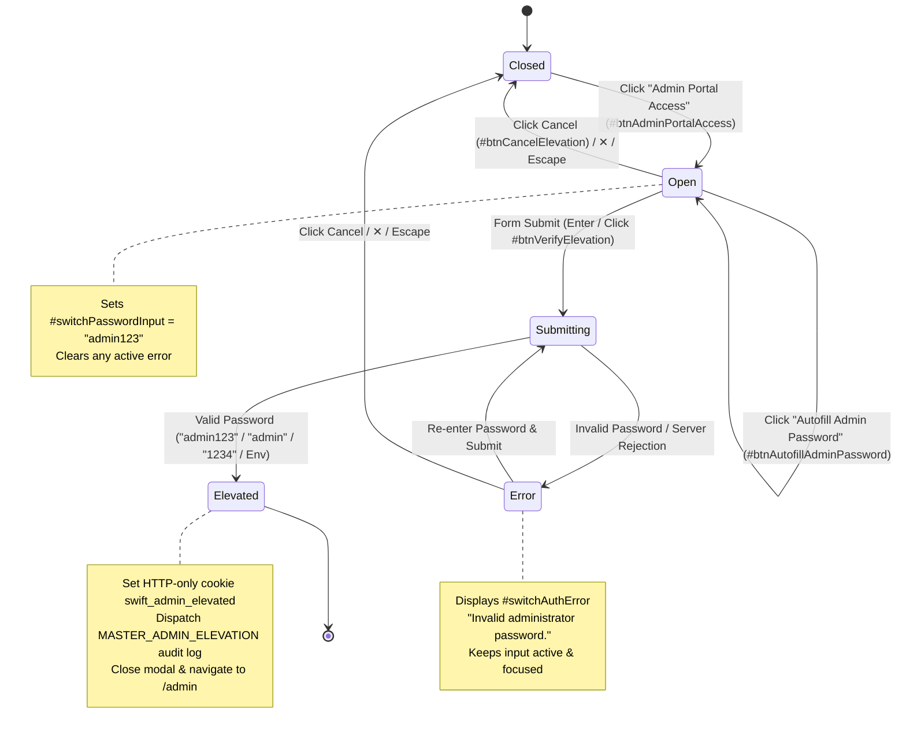

# Data Model & State Architecture: Secure Master Admin Elevation Modal

**Feature**: `032-secure-master-admin-elevation-modal`  
**Jira Ticket**: [SIAA-32](https://the-three-devsketeers.atlassian.net/browse/SIAA-32)  

---

## 1. Entity & Interface Models

### 1.1 Elevation Request & Result DTOs

```typescript
export interface AdminElevationInput {
  /** Master administrator password or security PIN */
  password: string;
  /** Target portal destination (defaults to 'admin') */
  targetPortal?: 'admin' | 'staff';
  /** Originating shop floor terminal identifier */
  terminalId?: string;
}

export interface AdminElevationResult {
  /** Indicates whether master authorization was granted */
  success: boolean;
  /** Unix timestamp (milliseconds) until which the session remains elevated */
  elevatedUntil?: number;
  /** Error code if authentication failed */
  code?: 'INVALID_PASSWORD' | 'EMPTY_PASSWORD' | 'UNAUTHORIZED' | 'SERVER_ERROR';
  /** Human-readable error message */
  error?: string;
}
```

### 1.2 Forensic Audit Trail Event Model

```typescript
export interface ElevationAuditEvent {
  action: 'MASTER_ADMIN_ELEVATION' | 'ELEVATION_FAILED';
  user: string;
  timestamp: string; // ISO 8601
  ip: string; // Terminal station description (e.g., 'Terminal #01 (Shop Floor)')
  severity?: 'info' | 'warning' | 'security_alert';
  details?: {
    terminalId: string;
    attemptedUser: string;
    reason?: string;
  };
}
```

---

## 2. Elevation Modal Client State Machine



---

## 3. Storage & Session Persistence Specifications

| Layer | Key / Identifier | Storage Location | Lifetime | Security Controls |
| :--- | :--- | :--- | :--- | :--- |
| **Session Cookie** | `swift_admin_elevated` | Browser HTTP-Only Cookie | 1 Hour (3,600s) | `HttpOnly`, `SameSite=Lax`, `Secure` (in prod), `Path=/` |
| **Audit Log** | `public.audit_logs` | Supabase PostgreSQL / In-Memory Mock | Immutable (Append-Only) | Forensic audit trail, tamper-resistant RPC logging |
| **Client UI State** | React State (`useState`) | Component Memory | Ephemeral (Mount to Unmount) | Never cached in localStorage; wiped on modal close |
