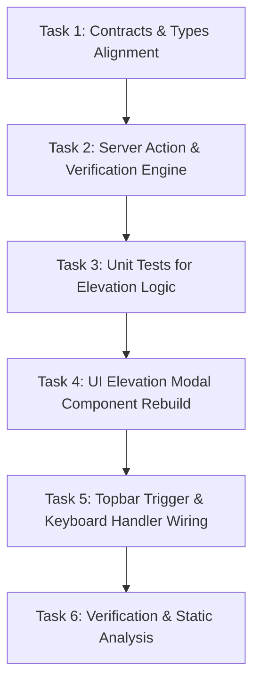

# Implementation Tasks: Secure Master Admin Elevation Modal & Shop Floor Session Guard

**Feature**: `032-secure-master-admin-elevation-modal`  
**Feature Branch**: `feat/SIAA-32-secure-master-admin-elevation-modal`  
**Jira Ticket**: [SIAA-32](https://the-three-devsketeers.atlassian.net/browse/SIAA-32)  
**Parent Epic**: [SIAA-5](https://the-three-devsketeers.atlassian.net/browse/SIAA-5)  

---

## Task Matrix & Dependency Order

---

### Phase 1: Contracts & Type Definitions

- [ ] **Task 1.1**: Define validation contracts and Zod schemas in `specs/032-secure-master-admin-elevation-modal/contracts/elevation.ts` (`AdminElevationInputSchema`, `AdminElevationResultSchema`, `ElevationAuditEventSchema`).
- [ ] **Task 1.2**: Update `lib/staff/types.ts` to export type definitions for elevation actions and error codes (`INVALID_PASSWORD`, `EMPTY_PASSWORD`, `UNAUTHORIZED`, `SERVER_ERROR`).

---

### Phase 2: Server Action & Business Logic Implementation

- [ ] **Task 2.1**: Enhance `verifyAdminElevationAction` in `lib/staff/actions.ts`:
  - Validate master password against `ADMIN_ELEVATION_PASSWORD`, `ADMIN_ELEVATION_PIN`, or fallback demo credentials (`admin123`, `admin`, `1234`, `8888`).
  - Enforce whitespace trimming and empty password rejection.
  - Set HTTP-only session elevation cookie `swift_admin_elevated` with 1-hour expiration.
  - Record audit log entry: `MASTER_ADMIN_ELEVATION` upon authorization, and `ELEVATION_FAILED` upon invalid attempt.
- [ ] **Task 2.2**: Implement automated unit test suite in `lib/staff/__tests__/admin-elevation-modal.test.ts` covering:
  - Scenario 1: Successful elevation with `admin123`.
  - Scenario 2: Successful elevation with alternative demo passwords (`admin`, `1234`, `8888`).
  - Scenario 3: Rejection of incorrect password (`"Invalid administrator password."`).
  - Scenario 4: Rejection of empty or whitespace-only password.
  - Scenario 5: Audit log event recording on success and failure.

---

### Phase 3: UI Elevation Modal Component Implementation

- [ ] **Task 3.1**: Rebuild `components/staff/admin-switch-modal.tsx`:
  - Conform strictly to `mockup/staff.html` lines 382–420.
  - Assign canonical IDs: `#switchPortalModal`, `#switchUsernameInput`, `#switchPasswordInput`, `#switchAuthError`.
  - Display Target Account as readonly input pre-filled with `admin@swift.local`.
  - Include Demo Admin Credential box with 1-click "Autofill Admin Password" button (`#btnAutofillAdminPassword`).
  - Render action buttons: "Cancel" (`#btnCancelElevation`) and "Verify & Access Admin Portal" (`#btnVerifyElevation`).
- [ ] **Task 3.2**: Add interactive behaviors and accessibility to `AdminSwitchModal`:
  - Autofocus on `#switchPasswordInput` on dialog open.
  - Handle `Escape` key event listener for safe dismissal.
  - Handle backdrop click dismissal.
  - Ensure zero terminal state disruption on close.
- [ ] **Task 3.3**: Ensure `StaffTopbar` in `components/staff/staff-topbar.tsx` properly binds `onOpenAdminSwitch` to `#btnAdminPortalAccess`.

---

### Phase 4: Verification, Convergence & Atomic Commits

- [ ] **Task 4.1**: Execute automated test suite: `node --env-file=.env.local --experimental-strip-types --test lib/staff/__tests__/admin-elevation-modal.test.ts`.
- [ ] **Task 4.2**: Execute TypeScript verification: `npx tsc --noEmit`.
- [ ] **Task 4.3**: Execute ESLint check: `npm run lint`.
- [ ] **Task 4.4**: Verify SWIFT design token compliance (zero hardcoded hex/RGB colors).
- [ ] **Task 4.5**: Commit changes following the `atomic-commit` rule and Jira key `[SIAA-32]`.
