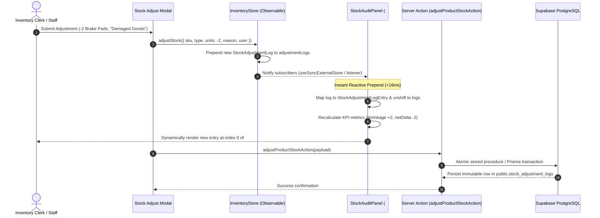

# Data Model & State Architecture: Immutable Stock Adjustment Audit Trail & Shrinkage Logging

**Feature**: `033-immutable-stock-adjustment-audit-trail-shrinkage-logging`  
**Jira Issue**: [SIAA-41](https://the-three-devsketeers.atlassian.net/browse/SIAA-41) (STORY-7.4)  
**Parent Epic**: [SIAA-7](https://the-three-devsketeers.atlassian.net/browse/SIAA-7) (EPIC-7: System Admin, Labor Rates Matrix & Auditing)  

---

## 1. Entity Models & DTOs

### Client Domain Entity: `StockAdjustmentLog`
Centralized in `lib/types/logs.ts`, consumed across `inventoryStore` and mock datasets:

```typescript
export interface StockAdjustmentLog {
  id: string;                                          // e.g. "ADJ-4821" or UUID
  timestamp: string;                                   // e.g. "2026-09-28 14:22" or ISO string
  sku: string;                                         // Motorcycle part SKU code (e.g. "YAM-NMAX-BL01")
  type: 'Restock Inbound' | 'Damaged Goods' | 'Audit Adjustment' | 'Physical Count' | 'Supplier Return' | 'Internal Use' | 'POS Sale' | string;
  change: string;                                      // Formatted delta, e.g. "+24 Units", "-2 Units"
  reason: string;                                      // Justification, reference PO or damage cause
  user: string;                                        // Authorized staff attribution name
}
```

### Query & Presentation DTO: `StockAdjustmentLogEntry`
Centralized in `lib/types/stock-audit.ts`, typed for tabular rendering and aggregation:

```typescript
export interface StockAdjustmentLogEntry {
  id: string;                                          // Unique identifier
  sku: string;                                         // Part SKU identifier
  adjustmentType: string;                              // Standard adjustment category
  quantityDelta: number;                               // Non-zero integer delta (+12, -2)
  previousStock?: number;                              // On-hand balance before adjustment
  newStock?: number;                                   // On-hand balance after adjustment
  reason: string;                                      // Operational explanation
  userId?: string | null;                              // Staff UUID (if authenticated)
  userName: string;                                    // Staff display name
  createdAt: string;                                   // ISO 8601 UTC timestamp
}
```

### Aggregated Shrinkage Metrics DTO: `StockAuditSummaryMetrics`

```typescript
export interface StockAuditSummaryMetrics {
  totalCount: number;                                  // Total matched audit records
  netDelta: number;                                    // Net sum of all quantity deltas
  totalShrinkage: number;                              // Absolute sum of negative deltas (losses/damages)
  totalIntake: number;                                 // Sum of positive deltas (intake/restock)
}
```

---

## 2. Reactive State Flow & Append Architecture



---

## 3. Database Schema Mapping (`public.stock_adjustment_logs`)

| Column Name | Postgres Type | Nullable | Default | Description |
| :--- | :--- | :--- | :--- | :--- |
| `id` | `uuid` | NO | `gen_random_uuid()` | Primary Key |
| `sku` | `text` | NO | — | Part SKU foreign reference |
| `adjustment_type` | `text` | NO | — | Categorical type (`Damaged Goods`, `Restock Inbound`, etc.) |
| `quantity_delta` | `integer` | NO | — | Non-zero signed quantity |
| `previous_stock` | `integer` | NO | — | On-hand quantity prior to execution |
| `new_stock` | `integer` | NO | — | On-hand quantity post execution |
| `reason` | `text` | NO | `''` | Auditor / clerk justification |
| `user_id` | `uuid` | YES | `auth.uid()` | Authenticated Supabase profile reference |
| `user_name` | `text` | NO | `'Staff Member'` | Snapshot of operator display name |
| `created_at` | `timestamptz` | NO | `now()` | Append timestamp (strictly immutable) |
