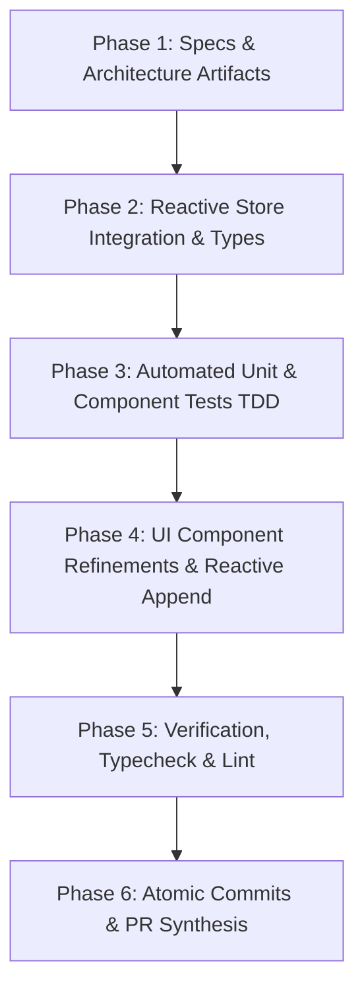

# Implementation Tasks: Immutable Stock Adjustment Audit Trail & Shrinkage Logging

**Feature**: `033-immutable-stock-adjustment-audit-trail-shrinkage-logging`  
**Jira Issue**: [SIAA-41](https://the-three-devsketeers.atlassian.net/browse/SIAA-41) (STORY-7.4)  
**Parent Epic**: [SIAA-7](https://the-three-devsketeers.atlassian.net/browse/SIAA-7) (EPIC-7: System Admin, Labor Rates Matrix & Auditing)  
**Spec Reference**: [`specs/033-immutable-stock-adjustment-audit-trail-shrinkage-logging/spec.md`](spec.md)  
**Plan Reference**: [`specs/033-immutable-stock-adjustment-audit-trail-shrinkage-logging/plan.md`](plan.md)  

---

## Task Matrix & Dependency Graph

---

## Phase 1: Specifications, Contracts & Architecture Artifacts

- [x] **TASK-1.1**: Author canonical 8-artifact SpecKit documentation for SIAA-41 (`specs/033-immutable-stock-adjustment-audit-trail-shrinkage-logging/spec.md`, `research.md`, `data-model.md`, `contracts/stock-audit.contract.ts`, `checklists/requirements.md`, `plan.md`, `quickstart.md`, `tasks.md`).
- [x] **TASK-1.2**: Update `.specify/feature.json` targeting `specs/033-immutable-stock-adjustment-audit-trail-shrinkage-logging`.

---

## Phase 2: Domain Types & Reactive Store Integration

- [ ] **TASK-2.1**: Update `lib/types/stock-audit.ts` to support optional previous/new stock and flexible UUID/string identifiers for client mock sync.
- [ ] **TASK-2.2**: Implement helper function in `lib/admin/stock-audit-utils.ts` to convert a client `StockAdjustmentLog` (from `inventoryStore`) into `StockAdjustmentLogEntry`.

---

## Phase 3: Automated Unit & Component Tests (TDD)

- [ ] **TASK-3.1**: Create `components/admin/logs/__tests__/stock-audit-reactive.test.tsx` testing:
  - Scenario 1: Ledger rendering inside `#stockAdjLogsBody` with canonical 6 columns.
  - Scenario 2: Live reactive append at index 0 when `inventoryStore.adjustStock` is executed.
  - Scenario 3: Real-time search and filter by SKU and adjustment type with KPI metric recalculation.
  - Scenario 4: Immutability guard asserting zero inline edit or delete controls.

---

## Phase 4: UI Component Refinements & Reactive Append

- [ ] **TASK-4.1**: Standardize `StockAuditTable` in `components/admin/logs/stock-audit-table.tsx` to render the canonical 6 columns matching `mockup/admin.html:580-595` and SIAA-41 Scenario 1.
- [ ] **TASK-4.2**: Wire reactive subscription to `inventoryStore` in `StockAuditPanel` (`components/admin/logs/stock-audit-panel.tsx`) to dynamically prepend new stock adjustments to the visible ledger and recompute summary metrics in real-time.

---

## Phase 5: Verification, Typecheck & Static Analysis

- [ ] **TASK-5.1**: Run `npm test` verifying all test suites pass.
- [ ] **TASK-5.2**: Run `npx tsc --noEmit` verifying zero TypeScript compilation errors.
- [ ] **TASK-5.3**: Run `npm run lint` verifying compliance with Next.js and Tailwind standards.

---

## Phase 6: Git Atomic Commits & PR Synthesis

- [ ] **TASK-6.1**: Create atomic commit for specifications and architectural artifacts (`docs(specs): [SIAA-41] ...`).
- [ ] **TASK-6.2**: Create atomic commit for domain models and test suites (`test(admin): [SIAA-41] ...`).
- [ ] **TASK-6.3**: Create atomic commit for UI components and reactive ledger wiring (`feat(admin): [SIAA-41] ...`).
- [ ] **TASK-6.4**: Mark all tasks complete and synthesize PR description following `.github/pull_request_template.md`.
