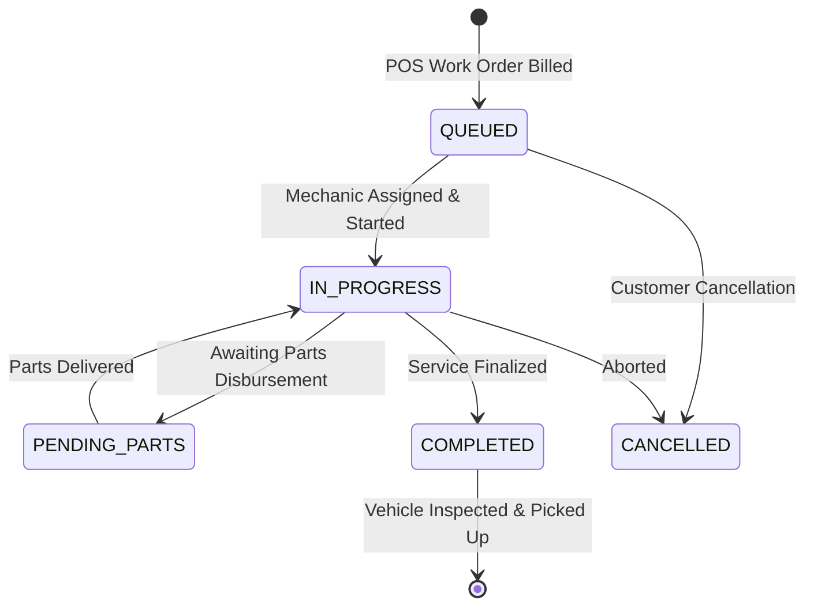

# Data Model: Live Service Bay Queue & Mechanic Monitor

**Feature**: `035-live-service-bay-queue-mechanic-utilization`  
**Jira Issue**: [SIAA-35](https://the-three-devsketeers.atlassian.net/browse/SIAA-35)  

---

## 1. Domain Entities & Display Interfaces

```typescript
import type { WorkOrderStatus, ServiceBayStatus } from "@/lib/types/service";

/**
 * Visual representation of an active repair bay entry on the dashboard
 */
export interface ServiceBayDisplayItem {
  id: string;
  bayName: string;
  status: WorkOrderStatus;
  vehicleService: string;
  mechanicInfo: string;
  mechanicName?: string;
  estimatedMinutesLeft?: number;
}

/**
 * Queue summary state computed for the service bay widget header
 */
export interface ServiceBayQueueSummary {
  totalBays: number;
  activeBaysCount: number;
  capacityBadgeText: string; // e.g. "4 Bays Active"
}
```

---

## 2. Work Order Lifecycle & Status Badge Mapping



### Status Badge Presentation Contract

| Status Enum | Badge Label | Background Token | Text Token | Border Token |
|---|---|---|---|---|
| `IN PROGRESS` | `In Progress` | `bg-accent-light` | `text-accent` | `border-accent/30` |
| `QUEUED` | `Queued` | `bg-bg-muted` | `text-text-secondary` | `border-border-subtle` |
| `COMPLETED` | `Ready for Inspection / Pickup` | `bg-success-light` | `text-success` | `border-success/30` |
| `PENDING_PARTS` | `Waiting for Parts` | `bg-accent-light` | `text-accent` | `border-accent/30` |
| `CANCELLED` | `Cancelled` | `bg-danger-light` | `text-danger` | `border-danger/30` |

---

## 3. Formatting & Utility Functions Contract

```typescript
export function formatWorkOrderStatusLabel(status: WorkOrderStatus): string {
  switch (status) {
    case 'IN PROGRESS':
      return 'In Progress';
    case 'COMPLETED':
      return 'Ready for Inspection / Pickup';
    case 'PENDING_PARTS':
      return 'Waiting for Parts';
    case 'CANCELLED':
      return 'Cancelled';
    case 'QUEUED':
    default:
      return 'Queued';
  }
}

export function formatMechanicInfo(
  mechanicName: string | null | undefined,
  status: WorkOrderStatus,
  minutesLeft?: number | null
): string {
  if (status === 'QUEUED') {
    return 'Waiting for Bay clearance';
  }
  const name = mechanicName || 'Dante Reyes';
  if (status === 'COMPLETED') {
    return `Mechanic: ${name} (Ready for pickup)`;
  }
  if (status === 'PENDING_PARTS') {
    return `Mechanic: ${name} (Waiting for counter parts)`;
  }
  if (typeof minutesLeft === 'number' && minutesLeft > 0) {
    return `Mechanic: ${name} (~${minutesLeft} mins left)`;
  }
  return `Mechanic: ${name} (In Progress)`;
}
```
