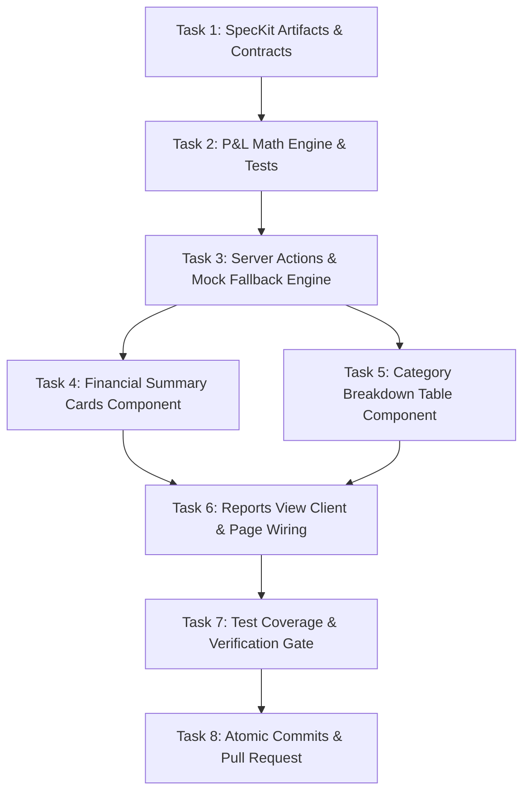

# Implementation Tasks: SIAA-36 Categorized Profit & Loss (P&L) Breakdown & COGS Engine

**Feature**: SIAA-36 (Categorized P&L Breakdown & COGS Engine)  
**Parent Epic**: SIAA-6 (Executive Analytics, Revenue & Profit Margins)  
**Date**: 2026-10-15  

---

## Task Overview & Dependencies

---

## Phase 1: Setup & Contracts

- [ ] **Task 1.1**: Define validation contracts and schemas in `contracts/pnl-cogs.ts` and verify alignment with `lib/types/analytics.ts`.
- [ ] **Task 1.2**: Commit design specification artifacts following Conventional Commits (`docs(specs): [SIAA-36] define categorized pnl breakdown cogs engine specifications`).

---

## Phase 2: Domain Logic & Mathematics (TDD)

- [ ] **Task 2.1**: Write unit tests in `lib/admin/__tests__/pnl-cogs-utils.test.ts` covering:
  - `calculateNetProfit(grossRevenue, cogs)`
  - `calculateMarginPct(grossRevenue, cogs)` with zero and negative revenue edge cases
  - `isHighYieldMargin(marginPct, targetThreshold)`
  - `formatCurrencyPhp(amount)`
  - `formatUnitCount(category, units)`
- [ ] **Task 2.2**: Implement `lib/admin/pnl-cogs-utils.ts` and ensure all tests pass cleanly.

---

## Phase 3: Server Actions & Resilient Data Engine

- [ ] **Task 3.1**: Write unit tests in `lib/admin/__tests__/pnl-actions.test.ts` verifying data retrieval and fallback handling.
- [ ] **Task 3.2**: Implement Server Action `getCategoryPnlBreakdown(period)` in `lib/admin/pnl-actions.ts` calling Supabase RPC `get_category_pnl` with seeded mock fallback.
- [ ] **Task 3.3**: Commit domain logic and actions (`feat(analytics): [SIAA-36] implement pnl cogs calculation engine and server actions`).

---

## Phase 4: UI Components & Visual Token Compliance

- [ ] **Task 4.1**: Implement `components/admin/reports/financial-summary-cards.tsx` displaying the 4 aggregate KPI cards (Gross Revenue, COGS, Net Profit, Margin %) strictly adhering to SWIFT design tokens (`bg-bg-card`, `border-border`, `text-success`, etc.).
- [ ] **Task 4.2**: Implement `components/admin/reports/category-pnl-table.tsx` rendering category breakdown rows with high-yield green highlighting (`text-success font-semibold`).
- [ ] **Task 4.3**: Write component test `components/admin/reports/__tests__/category-pnl-table.test.tsx` verifying table column headers, row computations, and high-yield visual badges.

---

## Phase 5: Page Integration & Wiring

- [ ] **Task 5.1**: Implement `components/admin/reports/reports-view-client.tsx` with period switcher (`Daily Sales`, `Weekly Sales`, `Monthly Sales`) and container `id="view-reports"`.
- [ ] **Task 5.2**: Update `app/admin/reports/page.tsx` Server Component to fetch initial data and render `ReportsViewClient`.
- [ ] **Task 5.3**: Commit UI components and page wiring (`feat(ui): [SIAA-36] render category revenue margin breakdown table and financial stat cards in reports`).

---

## Phase 6: Automated Verification & Atomic Commits

- [ ] **Task 6.1**: Run `npx tsc --noEmit` and confirm zero TypeScript errors.
- [ ] **Task 6.2**: Run `npm test` and confirm all test suites pass.
- [ ] **Task 6.3**: Run `npm run lint` and verify zero ESLint errors.
- [ ] **Task 6.4**: Commit final tasks completion (`docs(specs): [SIAA-36] complete all tasks and converge feature specification`).
- [ ] **Task 6.5**: Push branch and create Pull Request using `gh pr create` linked to [SIAA-36](https://the-three-devsketeers.atlassian.net/browse/SIAA-36).
