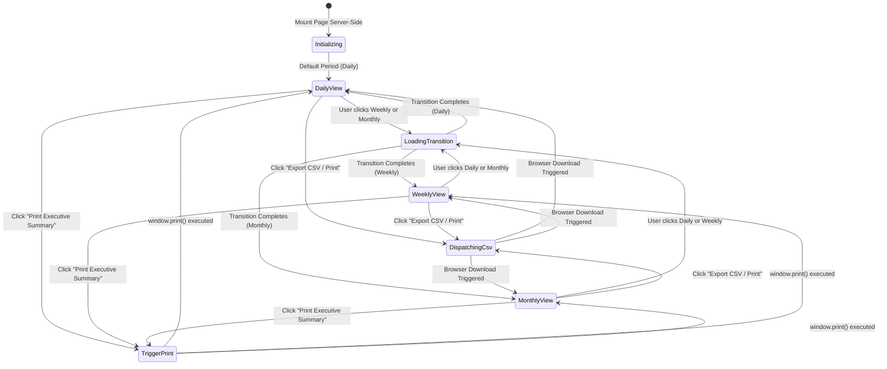

# Domain Data Models: Multi-Period Sales Filter & Accounting CSV Export Dispatcher

**Feature Directory**: `specs/037-multi-period-sales-filter-accounting-csv-export-dispatcher`  
**Jira Issue**: [SIAA-37](https://the-three-devsketeers.atlassian.net/browse/SIAA-37) (STORY-6.5)  

---

## 1. Domain Types & Entities

### 1.1 Analytics Period
```typescript
export type AnalyticsPeriod = 'daily' | 'weekly' | 'monthly';

export interface PeriodFilterConfig {
  id: AnalyticsPeriod;
  label: string;
  description: string;
  ariaLabel: string;
}

export const PERIOD_FILTERS: PeriodFilterConfig[] = [
  { id: 'daily', label: 'Daily Sales', description: 'Current calendar day', ariaLabel: 'Filter by Daily Sales' },
  { id: 'weekly', label: 'Weekly Sales', description: 'Rolling 7-day window', ariaLabel: 'Filter by Weekly Sales' },
  { id: 'monthly', label: 'Monthly Sales', description: 'Current month to date', ariaLabel: 'Filter by Monthly Sales' },
];
```

### 1.2 Category P&L and Financial Summary
```typescript
export interface CategoryPnlItem {
  category: string;
  units_sold: number;
  gross_revenue: number;
  cogs: number;
  net_profit: number;
  margin_pct: number;
}

export interface FinancialReportSummary {
  total_units_sold: number;
  total_gross_revenue: number;
  total_cogs: number;
  total_net_profit: number;
  overall_margin_pct: number;
  completed_invoices_count: number;
}

export interface MultiPeriodReportData {
  period: AnalyticsPeriod;
  date_range_label: string;
  summary: FinancialReportSummary;
  categories: CategoryPnlItem[];
  generated_at: string;
}
```

### 1.3 CSV Export Payloads & DTOs
```typescript
export interface AccountingCsvExportOptions {
  period: AnalyticsPeriod;
  includeSummaryRow?: boolean;
  filenamePrefix?: string;
}

export interface AccountingCsvExportResult {
  success: boolean;
  filename: string;
  csvContent: string;
  rowCount: number;
  period: AnalyticsPeriod;
  generatedAt: string;
  error?: string;
}
```

### 1.4 State Machine: Multi-Period Reports View


---

## 2. Invariants & Zero-Denominator Guarantees
1. `units_sold >= 0` (integer).
2. `gross_revenue >= 0` and `cogs >= 0`.
3. `net_profit = gross_revenue - cogs`.
4. `margin_pct = gross_revenue > 0 ? (net_profit / gross_revenue) * 100 : 0.0`.
5. When `completed_invoices_count == 0`:
   - `total_gross_revenue = 0.0`
   - `total_cogs = 0.0`
   - `total_net_profit = 0.0`
   - `overall_margin_pct = 0.0`
