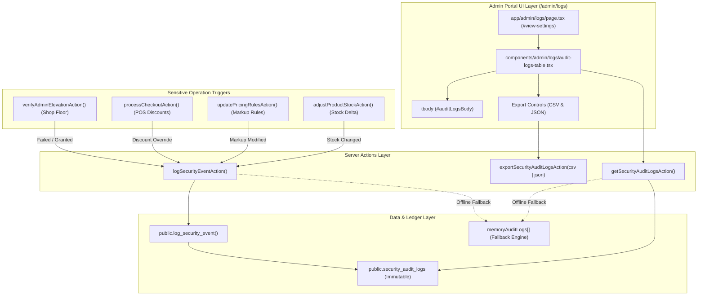

# Implementation Plan: System Security Activity Logging & Terminal Session Audit

**Feature**: `specs/042-system-security-activity-logging-terminal-session-audit`  
**Jira Ticket**: [SIAA-42](https://the-three-devsketeers.atlassian.net/browse/SIAA-42)  
**Parent Epic**: [SIAA-7](https://the-three-devsketeers.atlassian.net/browse/SIAA-7)  

---

## 1. Architecture & Layer Mapping

---

## 2. File Implementation Blueprint

### 2.1 Contracts & Types
- **Files**:
  - `lib/types/audit.ts`: Add `exportFormat?: 'csv' | 'json'` to `GetAuditLogsOptions` or export options interface.
  - `lib/contracts/audit.ts`: Add `ExportAuditLogsOptionsSchema` supporting `format: z.enum(['csv', 'json']).default('csv')`.

### 2.2 Server Actions Enhancement
- **`lib/admin/audit-actions.ts`**:
  - Update `exportSecurityAuditLogsAction` to accept `{ format?: 'csv' | 'json' } & GetAuditLogsOptions`.
  - Implement JSON serialization with 2-space indentation alongside RFC 4180 CSV generation.
- **`lib/staff/actions.ts`**:
  - In `verifyAdminElevationAction`:
    - On invalid PIN/password: call `logSecurityEventAction` with `action: 'Failed Master Admin elevation attempt (Invalid Password/PIN)'`, `severity: 'security_alert'`, `terminalIp: 'Terminal #01 (Shop Floor)'`, `userEmail: 'security@swift.ph'`.
    - On successful elevation: call `logSecurityEventAction` with `action: 'Master Admin elevation granted for 1-hour administrative session'`, `severity: 'warning'`, `terminalIp: 'Terminal #01 (Shop Floor)'`.
- **`lib/pos/actions.ts`**:
  - In `processCheckoutAction`:
    - If `validPayload.discountRate > 0` or `validPayload.discountType !== 'none'`, call `logSecurityEventAction` with:
      - `action`: `Applied ${discountPct}% ${discountLabel} on ${receiptNumber}`
      - `severity`: `'info'`
      - `terminalIp`: `'192.168.1.102 (Terminal 1)'`
      - `userEmail`: `validPayload.cashierName || 'cashier@swift.ph'`
      - `metadata`: `{ receiptNumber, discountType, discountRate, discountAmount, totalDue }`
- **`lib/admin/pricing-actions.ts`**:
  - In `updatePricingRulesAction`:
    - Call `logSecurityEventAction` with:
      - `action`: `actionDescription`
      - `severity`: `'warning'`
      - `terminalIp`: `'192.168.1.100 (Admin Portal)'`
      - `userEmail`: `userName`

### 2.3 UI Components Refinement
- **`components/admin/logs/audit-logs-table.tsx`**:
  - Add dual export buttons or segmented menu: "Export CSV" and "Export JSON".
  - Ensure table body has `id="auditLogsBody"`.
  - Format user account with `font-semibold text-text-primary`.
  - Monospaced fonts for timestamps and terminal IPs.
  - High-visibility badges for `security_alert` and `warning`.
  - SWIFT tokens exclusively.

### 2.4 Verification & Automated Testing
- Unit tests:
  - `lib/admin/__tests__/audit-actions.test.ts`: test JSON and CSV export logic, filtering, search.
  - `lib/staff/__tests__/admin-elevation-modal.test.ts`: verify elevation attempts log security alert.
  - `lib/pos/__tests__/discount-logging.test.ts`: verify discount checkout triggers security logging.
  - `lib/admin/__tests__/pricing-audit-logging.test.ts`: verify markup rule updates trigger audit logging.
- Lint & Typecheck:
  - `npm run typecheck`
  - `npm run lint`
