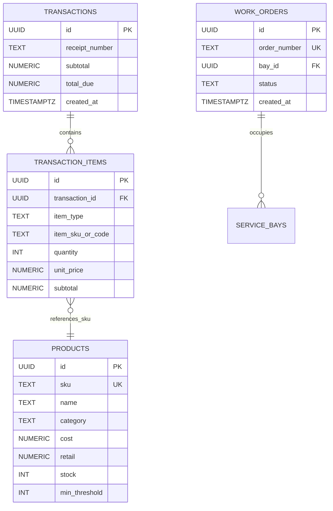

# Data Model: Supabase Executive Analytics, 7-Day Trend & Categorized P&L COGS RPCs

**Feature**: `067-supabase-executive-analytics-trend-pnl-cogs-rpcs`  
**Jira Issue**: [SIAA-67](https://the-three-devsketeers.atlassian.net/browse/SIAA-67) (STORY-6.7)  

---

## 1. Entity Overview & Storage Relationships



---

## 2. Stored Procedure Payloads & Contract Models

### 2.1 Executive KPIs Payload (`ExecutiveKpiData`)

Calculated by `public.get_executive_kpis(p_date DATE DEFAULT CURRENT_DATE)`.

```typescript
export interface ExecutiveKpiData {
  gross_revenue_today: number;        // e.g. 45230.00 (sum of sales on p_date)
  gross_revenue_yesterday: number;    // e.g. 38400.00 (sum of sales on p_date - 1)
  revenue_growth_pct: number;         // e.g. +17.79% ((today - yesterday) / yesterday * 100)
  active_work_orders_count: number;   // e.g. 3 (count with status = 'IN PROGRESS')
  pending_parts_count: number;        // e.g. 1 (count with status = 'PENDING_PARTS')
  net_profit_margin_pct: number;      // e.g. 34.20% (MTD (revenue - COGS) / revenue * 100)
  gross_profit_amount: number;        // e.g. 15468.66 (MTD revenue - COGS)
  critical_low_stock_count: number;   // e.g. 5 (count of products where stock <= min_threshold)
}
```

### 2.2 Rolling 7-Day Revenue Trend Payload (`WeeklyRevenueData`)

Calculated by `public.get_revenue_trend_7d(p_end_date DATE DEFAULT CURRENT_DATE)`.

```typescript
export interface RevenueTrendDay {
  date: string;                       // ISO date 'YYYY-MM-DD'
  day_label: string;                  // 'Mon', 'Tue', 'Wed', 'Thu', 'Fri', 'Sat', 'Sun'
  parts_amount: number;               // Parts sales in PHP
  parts_display: string;              // Formatted PHP, e.g. '₱28.5k'
  labor_amount: number;               // Service labor in PHP
  labor_display: string;              // Formatted PHP, e.g. '₱12.0k'
  total_amount: number;               // parts_amount + labor_amount
  parts_height_percent: number;       // 0-100% normalized against max weekly daily_total
  labor_height_percent: number;       // 0-100% normalized against max weekly daily_total
}

export interface WeeklyRevenueData {
  days: RevenueTrendDay[];            // 7 chronological days
  peak_day_amount: number;            // Highest daily total in the 7-day period
  total_parts_weekly: number;         // Total parts revenue for the 7 days
  total_labor_weekly: number;         // Total labor revenue for the 7 days
  total_weekly_revenue: number;       // Sum of all parts and labor revenue
}
```

### 2.3 Categorized P&L & COGS Payload (`CategoryPnlData`)

Calculated by `public.get_category_pnl(p_start_date TIMESTAMPTZ, p_end_date TIMESTAMPTZ)`.

```typescript
export interface CategoryPnlItem {
  category: string;                   // 'Fluids', 'Drivetrain', 'Brakes', 'Ignition', 'Engine', 'Tires', 'Accessories', 'Workshop Labor'
  units_sold: number;                 // Total quantity of units sold
  gross_revenue: number;              // Total subtotal for this category
  cogs: number;                       // Total product cost (0.00 for labor)
  net_profit: number;                 // gross_revenue - cogs
  margin_pct: number;                 // (net_profit / gross_revenue) * 100
}

export interface CategoryPnlSummary {
  total_units_sold: number;           // Total items and services delivered
  total_gross_revenue: number;        // Sum of all gross revenue
  total_cogs: number;                 // Sum of all product costs
  total_net_profit: number;           // Sum of all net profits
  overall_margin_pct: number;         // (total_net_profit / total_gross_revenue) * 100
}

export interface CategoryPnlData {
  categories: CategoryPnlItem[];
  summary: CategoryPnlSummary;
}
```

---

## 3. Database State Machines & Calculation Invariants

1. **Revenue Growth Invariant**:
   - If `gross_revenue_yesterday == 0` and `gross_revenue_today > 0`, `revenue_growth_pct` = `100.00`.
   - If `gross_revenue_yesterday == 0` and `gross_revenue_today == 0`, `revenue_growth_pct` = `0.00`.
2. **COGS Mapping Invariant**:
   - Line items with `item_type = 'part'` join `public.products` on `sku = item_sku_or_code`. COGS = `SUM(ti.quantity * COALESCE(p.cost, 0))`.
   - Line items with `item_type = 'service'` have COGS = `0.00`.
3. **Bar Height Invariant**:
   - For any day $i$, `parts_height_percent` = $\text{ROUND}((\text{parts\_amount}_i / \text{NULLIF}(\text{peak\_total}, 0)) \times 100, 2)$.
   - Sum of `parts_height_percent` + `labor_height_percent` on peak day equals $100.00\%$.
   - If all 7 days have zero sales, all height percentages equal $0.00\%$.
