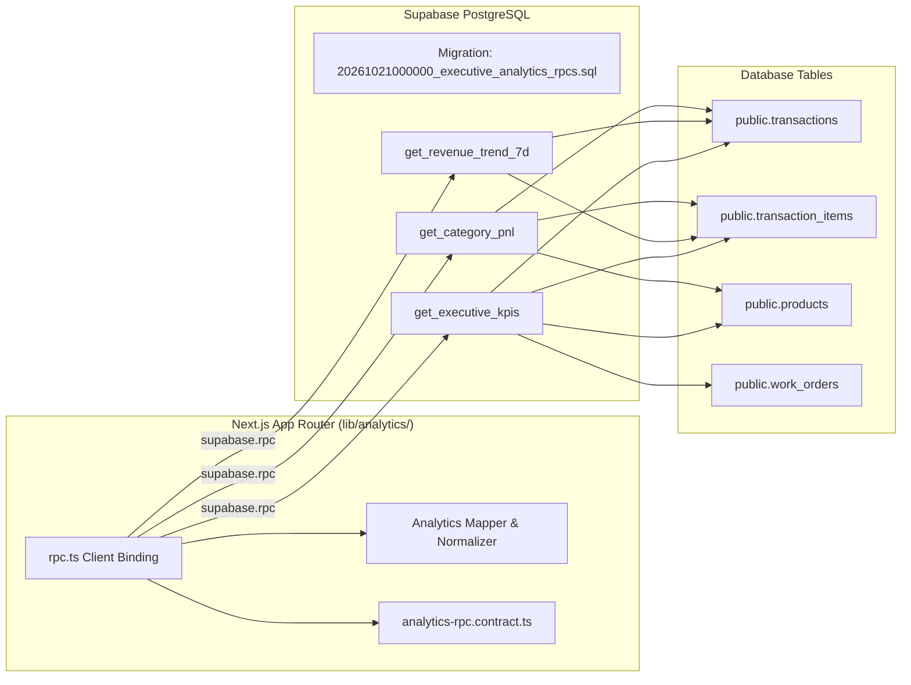

# Implementation Plan: Supabase Executive Analytics, 7-Day Trend & Categorized P&L COGS RPCs

**Feature**: `067-supabase-executive-analytics-trend-pnl-cogs-rpcs`  
**Jira Issue**: [SIAA-67](https://the-three-devsketeers.atlassian.net/browse/SIAA-67) (STORY-6.7)  
**Parent Epic**: [SIAA-6](https://the-three-devsketeers.atlassian.net/browse/SIAA-6) (EPIC-6: Executive Analytics, Revenue & Profit Margins)  
**Branch**: `feat/SIAA-67-supabase-executive-analytics-trend-pnl-cogs-rpcs`  

---

## 1. Executive Summary & Architecture Boundary

This feature implements high-performance server-side PostgreSQL stored procedures (`get_executive_kpis`, `get_revenue_trend_7d`, and `get_category_pnl`) in Supabase. It eliminates high-latency client-side aggregation by running calculations directly inside the database engine, protected by safe division guards (`NULLIF`), sub-50ms index access, and type-safe client RPC bindings.

---

## 2. Technical Stack & Governance Adherence

- **PostgreSQL 15+ (Supabase)**: Stored procedures with `SECURITY DEFINER`, search path set to `public`, CTE optimizations, aggregate window functions, and `json_build_object`.
- **TypeScript 5**: Strict contracts with zero `any` types.
- **Zod**: Runtime validation schemas in `contracts/analytics-rpc.contract.ts` and `lib/analytics/contracts.ts`.
- **Testing**: Node.js built-in test runner (`node --test`) for zero external test harness overhead.
- **SWIFT Design Tokens**: Reusable currency and percentage formatters; zero hardcoded colors or ad-hoc styles.
- **Atomic Commits**: Structured into layer-by-layer architectural units linked to `[SIAA-67]`.

---

## 3. Implementation Steps & Layer Breakdown

### Unit 1: Database Stored Procedures Migration
- Create `supabase/migrations/20261021000000_executive_analytics_rpcs.sql`:
  - `public.get_executive_kpis(p_date DATE DEFAULT CURRENT_DATE)`
  - `public.get_revenue_trend_7d(p_end_date DATE DEFAULT CURRENT_DATE)`
  - `public.get_category_pnl(p_start_date TIMESTAMPTZ, p_end_date TIMESTAMPTZ)`
  - Permissions: `GRANT EXECUTE ... TO authenticated, service_role`.
  - Zero-division resilience using `NULLIF`.

### Unit 2: TypeScript Types & Contracts
- Export domain interfaces in `lib/types/analytics.ts`:
  - `ExecutiveKpiData`
  - `RevenueTrendDay`, `WeeklyRevenueData`
  - `CategoryPnlItem`, `CategoryPnlSummary`, `CategoryPnlData`
- Export validation contracts in `lib/analytics/contracts.ts`.

### Unit 3: TDD Test Harness (Red Phase)
- Author unit tests in `lib/analytics/__tests__/rpc.test.ts`:
  - Test validation of executive KPI responses.
  - Test 7-day revenue trend normalization and height calculation.
  - Test categorized P&L margin and COGS arithmetic.
  - Test boundary zero-data scenarios (empty days, zero revenue, division by zero resilience).
- Author unit tests in `lib/analytics/__tests__/mapper.test.ts`:
  - Test currency formatting helpers and percentage formatting.

### Unit 4: RPC Client Binding & Mapper Implementation (Green Phase)
- Implement `lib/analytics/rpc.ts`:
  - `fetchExecutiveKpis(client, date?)`
  - `fetchRevenueTrend7d(client, endDate?)`
  - `fetchCategoryPnl(client, startDate, endDate)`
- Implement `lib/analytics/mapper.ts`:
  - Formatters (`formatCurrency`, `formatGrowth`, `formatMargin`).
  - Safe fallbacks for empty datasets.

### Unit 5: Verification & Verification Gate
- Run `npm test` across all analytics test suites.
- Run `npm run lint` and TypeScript compilation (`npx tsc --noEmit`).
