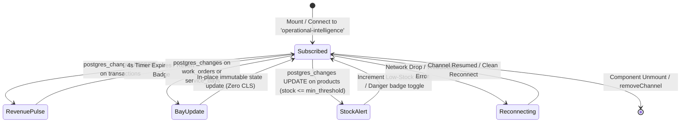

# Data Model: Supabase Realtime Operational Broadcast for Executive KPIs & Service Bays

**Feature**: Supabase Realtime Operational Broadcast for Executive KPIs & Service Bays  
**Feature Branch**: `feat/SIAA-68-realtime-operational-broadcast-kpis-service-bays`  
**Ticket**: [SIAA-68](https://the-three-devsketeers.atlassian.net/browse/SIAA-68) (STORY-6.8)  
**Parent Epic**: [SIAA-6](https://the-three-devsketeers.atlassian.net/browse/SIAA-6)  

---

## 1. Database Schema & Publications

### 1.1 Registered Tables in `supabase_realtime` Publication
```sql
DO $$
BEGIN
    IF NOT EXISTS (
        SELECT 1 FROM pg_publication_tables 
        WHERE pubname = 'supabase_realtime' AND tablename = 'work_orders'
    ) THEN
        ALTER PUBLICATION supabase_realtime ADD TABLE public.work_orders;
    END IF;

    IF NOT EXISTS (
        SELECT 1 FROM pg_publication_tables 
        WHERE pubname = 'supabase_realtime' AND tablename = 'service_bays'
    ) THEN
        ALTER PUBLICATION supabase_realtime ADD TABLE public.service_bays;
    END IF;

    IF NOT EXISTS (
        SELECT 1 FROM pg_publication_tables 
        WHERE pubname = 'supabase_realtime' AND tablename = 'transactions'
    ) THEN
        ALTER PUBLICATION supabase_realtime ADD TABLE public.transactions;
    END IF;
END
$$;

-- Configure Full Replica Identity for rich UPDATE event payloads
ALTER TABLE public.work_orders REPLICA IDENTITY FULL;
ALTER TABLE public.service_bays REPLICA IDENTITY FULL;
ALTER TABLE public.transactions REPLICA IDENTITY FULL;
```

---

## 2. Realtime Change Data Capture (CDC) Event Models

```typescript
export type RealtimeEventType = 'INSERT' | 'UPDATE' | 'DELETE' | '*';

export interface RealtimePostgresChangesPayload<T> {
  schema: string;
  table: string;
  commit_timestamp: string;
  eventType: RealtimeEventType;
  new: T;
  old: Partial<T>;
  errors?: string[];
}

export interface DbTransactionBroadcast {
  id: string;
  receipt_number: string;
  cashier_name: string;
  pricing_mode: string;
  total_due: number;
  subtotal: number;
  discount_amount: number;
  payment_method: string;
  created_at: string;
}

export interface DbWorkOrderBroadcast {
  id: string;
  order_number: string;
  bay_id: string | null;
  customer_name: string;
  vehicle_model: string;
  plate_number: string;
  service_name: string;
  service_code: string;
  mechanic_id: string | null;
  status: 'QUEUED' | 'IN PROGRESS' | 'PENDING_PARTS' | 'COMPLETED' | 'CANCELLED';
  estimated_duration_minutes: number;
  started_at: string | null;
  completed_at: string | null;
  notes: string | null;
  created_at: string;
  updated_at: string;
}

export interface DbServiceBayBroadcast {
  id: string;
  name: string;
  bay_type: string;
  status: 'AVAILABLE' | 'OCCUPIED' | 'MAINTENANCE' | 'QUEUED';
  display_order: number;
  created_at: string;
  updated_at: string;
}

export interface DbProductStockBroadcast {
  id: string;
  sku: string;
  name: string;
  stock: number;
  min_threshold: number;
  updated_at: string;
}
```

---

## 3. Executive Realtime Hook & State Models

```typescript
export type RealtimeChannelStatus =
  | 'SUBSCRIBED'
  | 'TIMED_OUT'
  | 'CLOSED'
  | 'CHANNEL_ERROR'
  | 'CONNECTING';

export interface UseExecutiveRealtimeOptions {
  enabled?: boolean;
  channelName?: string; // defaults to 'operational-intelligence'
  onTransaction?: (transaction: DbTransactionBroadcast) => void;
  onWorkOrderChange?: (workOrder: DbWorkOrderBroadcast, eventType: RealtimeEventType) => void;
  onServiceBayChange?: (bay: DbServiceBayBroadcast, eventType: RealtimeEventType) => void;
  onStockAlert?: (product: DbProductStockBroadcast) => void;
  onStatusChange?: (status: RealtimeChannelStatus) => void;
}

export interface UseExecutiveRealtimeResult {
  isConnected: boolean;
  status: RealtimeChannelStatus;
  lastEventTimestamp: string | null;
}
```

---

## 4. UI Reactive State Transitions


