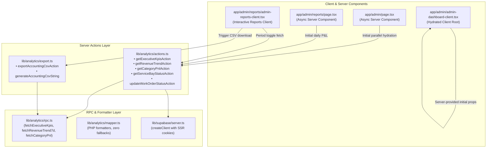

# Technical Implementation Plan: Executive Analytics Next.js Server Actions, Accounting CSV Dispatcher & UI Wiring

**Feature**: SIAA-69 (STORY-6.9)  
**Parent Epic**: SIAA-6 (EPIC-6: Executive Analytics, Revenue & Profit Margins)  
**Date**: 2026-10-15  

---

## 1. System Architecture & Component Mapping

---

## 2. File Modification & Creation Matrix

| Action | Path | Responsibility |
| :--- | :--- | :--- |
| **Create** | `lib/analytics/actions.ts` | Type-safe Server Actions (`'use server'`) for KPIs, trends, P&L, and service bays with session validation and fallback resilience. |
| **Create** | `lib/analytics/export.ts` | Accounting CSV export generator adhering to RFC 4180 with header, data rows, and summary footer. |
| **Create** | `lib/analytics/__tests__/actions.test.ts` | Unit tests for Server Actions (mocking Supabase and verifying fallbacks). |
| **Create** | `lib/analytics/__tests__/export.test.ts` | Unit tests for CSV generation, escaping, numerical precision, and footer summary. |
| **Update** | `app/admin/page.tsx` | Transform into async Server Component querying initial KPIs, trend, and bays in parallel; pass to client. |
| **Update** | `app/admin/admin-dashboard-client.tsx` | Accept initial props (`initialKpis`, `initialRevenueTrend`, `initialServiceBays`), hydrating state with zero CLS. |
| **Create** | `app/admin/reports/admin-reports-client.tsx` | Interactive client component for P&L table, period filters (Daily/Weekly/Monthly), summary cards, and CSV export button. |
| **Update** | `app/admin/reports/page.tsx` | Async Server Component fetching initial daily P&L and rendering `AdminReportsClient`. |

---

## 3. Test Strategy (TDD Approach)

1. **Unit Tests (`lib/analytics/__tests__/actions.test.ts`)**:
   - `getExecutiveKpisAction`: returns typed data with fallback when offline.
   - `getRevenueTrendAction`: returns 7-day normalized bars.
   - `getCategoryPnlAction`: handles 'daily', 'weekly', 'monthly' timeframes correctly.
   - `getServiceBayStatusAction`: returns structured `ServiceBayDisplayItem[]`.
   - `updateWorkOrderStatusAction`: updates work order and returns success/error.
2. **Unit Tests (`lib/analytics/__tests__/export.test.ts`)**:
   - Header formatting matches `Category,Units Sold,Gross Revenue,COGS,Net Profit,Margin %`.
   - Values with commas or quotes are sanitized correctly.
   - Footer contains totals matching category sum.
   - Filename is generated with correct date format.
3. **Static Analysis & Types**:
   - `npx tsc --noEmit`
   - `npm run lint`
