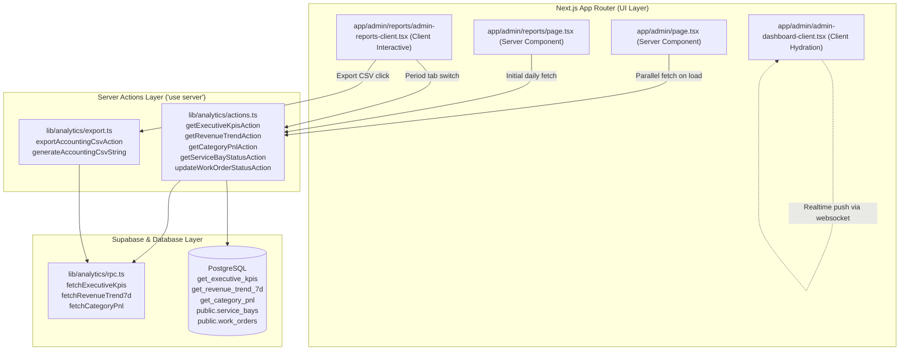

# Research & Architecture Decisions: Executive Analytics Next.js Server Actions, Accounting CSV Dispatcher & UI Wiring

**Feature**: SIAA-69 (STORY-6.9)  
**Parent Epic**: SIAA-6 (EPIC-6: Executive Analytics, Revenue & Profit Margins)  
**Date**: 2026-10-15  

---

## 1. Architectural Overview & Context



---

## 2. Technical Stack Decisions

### 2.1 Next.js App Router Server Actions Pattern
- **Decision**: Define Server Actions in dedicated modules with `'use server'` directive:
  - `lib/analytics/actions.ts`
  - `lib/analytics/export.ts`
- **Rationale**:
  - Encapsulates database communication and Supabase client instantiation on the server.
  - Prevents leaking server secrets or database internal schemas to client bundles.
  - Allows direct invocation from both Server Components (hydration) and Client Components (user interactions).
  - Eliminates the need for boilerplate API route handlers (`/api/analytics/...`).

### 2.2 Date Range Boundary Computations
- **Decision**: Standardize period boundaries in server actions:
  - **Daily**:
    ```typescript
    const now = new Date();
    const start = new Date(now.getFullYear(), now.getMonth(), now.getDate(), 0, 0, 0, 0);
    const end = new Date(now.getFullYear(), now.getMonth(), now.getDate(), 23, 59, 59, 999);
    ```
  - **Weekly**: Rolling 7 days:
    ```typescript
    const end = new Date();
    const start = new Date(end.getTime() - 6 * 24 * 60 * 60 * 1000);
    start.setHours(0, 0, 0, 0);
    ```
  - **Monthly**: Start of current calendar month:
    ```typescript
    const now = new Date();
    const start = new Date(now.getFullYear(), now.getMonth(), 1, 0, 0, 0, 0);
    const end = now;
    ```
- **Rationale**: Guarantees deterministic ISO timestamp passing to `public.get_category_pnl(p_start_date, p_end_date)` matching financial accounting standards.

### 2.3 RFC 4180 Accounting-Grade CSV Generation
- **Decision**: Pure TypeScript CSV sanitizer and formatter in `lib/analytics/export.ts`.
- **Formatting Rules**:
  - Header: `Category,Units Sold,Gross Revenue,COGS,Net Profit,Margin %`
  - Data rows: Numerical amounts formatted to 2 decimals (`0.00`).
  - Escaping: Any text containing `,`, `"`, or `\n` is wrapped in quotes, with quotes doubled (`""`).
  - Summary footer:
    `Total,[total_units],[total_gross],[total_cogs],[total_net],[overall_margin]%`
  - MIME type: `text/csv;charset=utf-8;`.
  - Content-Disposition filename: `swift_financial_report_YYYY-MM-DD.csv`.

### 2.4 Service Bay Query Strategy
- **Decision**:
  - `getServiceBayStatusAction()` queries `public.service_bays` ordered by `display_order ASC`.
  - Joins or fetches active `work_orders` where `bay_id = service_bays.id` and `status IN ('IN PROGRESS', 'QUEUED', 'PENDING_PARTS')`.
  - Maps to `ServiceBayDisplayItem` expected by `ServiceBayStatusCard`.
  - If database is offline or empty, returns deterministic fallback bays (`INITIAL_SERVICE_BAYS`).

### 2.5 SWIFT Design Tokens Adherence
- **Decision**:
  - Table and card backgrounds: `bg-bg-card`, `bg-bg-surface`.
  - High-margin highlighting: Margin $\ge 70\%$ gets `text-success font-bold`.
  - Low-margin alerts: Margin $< 20\%$ gets `text-accent font-semibold`.
  - Borders: `border-border`, `border-border-subtle`.
  - Button states: `bg-primary text-text-light hover:bg-primary-hover`.

---

## 3. Risk Assessment & Mitigations

| Risk | Impact | Mitigation Strategy |
| :--- | :---: | :--- |
| Database connection latency in Server Components | High | Parallel data fetching via `Promise.allSettled`, with fallback zero-data generators. |
| CSV numerical precision floating-point drift | Med | Math rounding to 2 decimal places (`Math.round(val * 100) / 100`). |
| Missing authentication claims in test/demo environments | Low | Graceful fallback checking `session.source === 'demo' || session.isAuthenticated`. |
