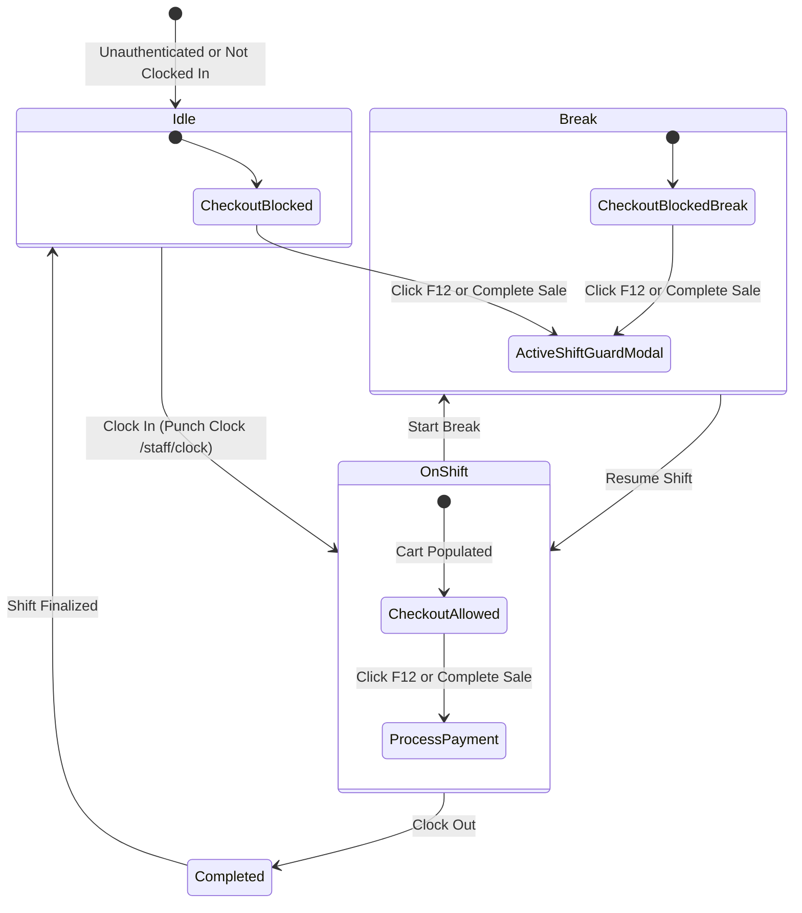

# Data Model: Active Shift Time-In Guard in Staff POS

**Feature**: `070-staff-pos-time-in-guard`  
**Jira Issue**: [SIAA-74](https://the-three-devsketeers.atlassian.net/browse/SIAA-74)  
**Date**: 2026-10-19  

---

## 1. Domain Types & State Machines



---

## 2. Entity Interfaces & DTOs

### ShiftStateStatus (Existing Domain Type in `lib/store/punch-store.ts`)
```ts
export type ShiftStateStatus = 'on_shift' | 'break' | 'completed' | 'idle';
```

### PosShiftGuardEvaluation
```ts
export interface PosShiftGuardEvaluation {
  isAllowed: boolean;
  shiftStatus: ShiftStateStatus;
  currentStaff: string | null;
  reason?: 'NOT_CLOCKED_IN' | 'ON_BREAK' | 'SHIFT_COMPLETED' | 'OK';
  message?: string;
}
```

### PosHotkeyEvaluationResult (Extended in `lib/pos/barcode-scanner.ts`)
```ts
export type PosHotkeyEvaluationResult =
  | {
      action: "CHECKOUT_PAY";
      preventDefault: true;
      canExecute: true;
    }
  | {
      action: "CHECKOUT_PAY";
      preventDefault: true;
      canExecute: false;
      reason: "CART_EMPTY" | "MODAL_ACTIVE" | "SHIFT_INACTIVE";
      message?: string;
    }
  | {
      action: "CLOSE_MODAL";
      preventDefault: boolean;
      canExecute: boolean;
    }
  | {
      action: "NONE";
      preventDefault: false;
      canExecute: false;
    };
```

---

## 3. Transaction Attribution Data Flow

```text
[usePunchStore]
      │ (currentStaff)
      ▼
[StaffPosPage: handleConfirmPayment]
      │ { cashier: currentStaff || "Staff Cashier", cashTendered, ... }
      ▼
[CartStore: checkout()]
      │
      ▼
[pos_transactions table]
      - cashier_name / staff_id
      - line_items
      - total_amount
```
