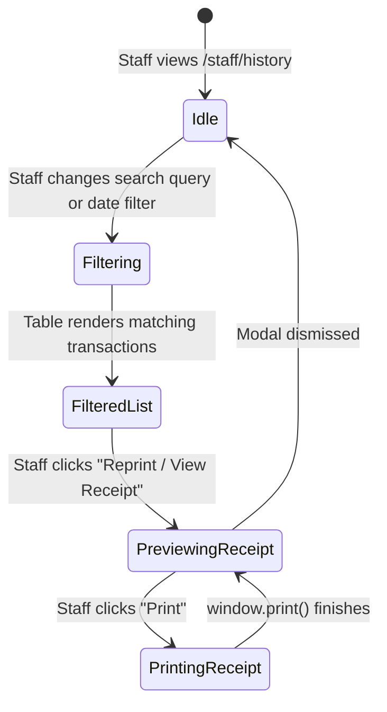

# Data Model: SIAA-73 Staff Purchase History & Receipt Modal Refactoring

**Feature Branch**: `feat/SIAA-73-staff-purchase-history-receipt-modal`  
**Created**: 2026-10-19  

---

## 1. Entity Definitions & DTOs

### 1.1 Warranty Evaluation Model
```typescript
export interface WarrantyStatus {
  /**
   * Whether the transaction timestamp is <= 7 calendar days from current evaluation time
   */
  readonly isValid: boolean;
  /**
   * Calendar days elapsed since transaction creation (rounded down)
   */
  readonly daysElapsed: number;
  /**
   * Days remaining until warranty expires (0 if expired)
   */
  readonly daysRemaining: number;
  /**
   * Human-readable label (e.g. "Warranty Valid (5d left)", "Warranty Expired")
   */
  readonly label: string;
}
```

### 1.2 Purchase History Filter State
```typescript
export type PurchaseHistoryDateFilter = 'all' | 'warranty_eligible' | 'today' | 'last_30_days';

export interface PurchaseHistoryFilters {
  query: string; // Search receipt number, cashier, item SKU/name
  dateRange: PurchaseHistoryDateFilter;
  paymentMethod: string; // 'all' | 'Cash' | 'GCash' | 'Card' | 'Maya'
}
```

### 1.3 Refactored Modal Props
```typescript
export interface ThermalReceiptModalProps {
  readonly isOpen: boolean;
  readonly onClose: () => void;
  readonly onFinish?: () => void;
  readonly receiptData?: ThermalReceiptData | null;
  // initialRollWidth is deprecated and locked to '80mm'
}
```

---

## 2. State Machine & Component Flow


