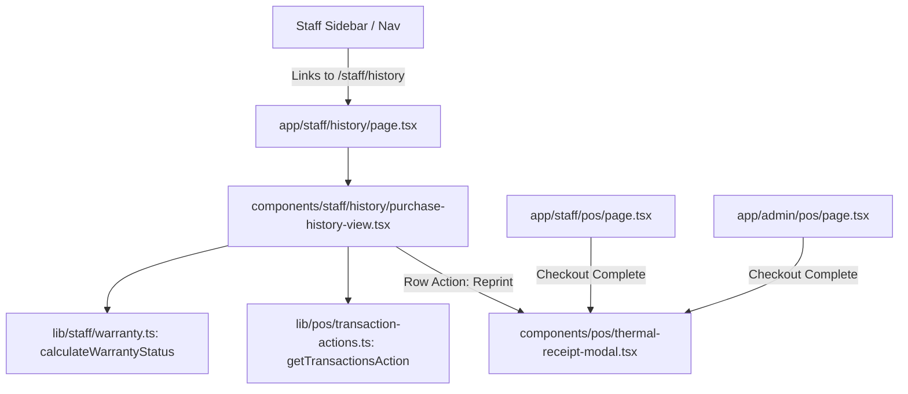

# Implementation Plan: SIAA-73 Staff Purchase History & Thermal Receipt Modal Refactoring

**Feature Branch**: `feat/SIAA-73-staff-purchase-history-receipt-modal`  
**Jira Issue**: [SIAA-73](https://the-three-devsketeers.atlassian.net/browse/SIAA-73)  
**Spec Reference**: `specs/073-staff-purchase-history-receipt-modal/spec.md`  

---

## 1. Architectural Boundaries & Modules

---

## 2. Step-by-Step Implementation Strategy

### Step 1: Domain Logic & Warranty Calculations
- Create `lib/staff/warranty.ts` with pure, deterministic functions:
  - `calculateWarrantyStatus(timestamp: string | Date, now?: Date): WarrantyStatus`
  - Unit tests in `lib/staff/__tests__/warranty.test.ts`.

### Step 2: Staff Navigation Integration
- Add "Purchase History" entry to `STAFF_NAV_ITEMS` in `lib/staff/navigation.ts` with `History` icon.
- Ensure route `/staff/history` resolves nicely in `getStaffViewTitle`.

### Step 3: Refactor `ThermalReceiptModal`
- Modify `components/pos/thermal-receipt-modal.tsx`:
  - Remove lookup query state, lookup error state, and header search form.
  - Remove 58mm/80mm toggle buttons and lock `rollWidth` to `'80mm'`.
  - Remove simulated barcode graphic and `*TX-...*` string from the footer.
  - Keep ESC key handling, print trigger, and clean 80mm layout.

### Step 4: Implement Staff Purchase History View
- Create `components/staff/history/warranty-badge.tsx` for visual status.
- Create `components/staff/history/purchase-history-view.tsx` with search, filtering by date/warranty & payment method, expandable itemized breakdown, and reprint modal integration.
- Create `app/staff/history/page.tsx` server component with page metadata and initial transaction preloading.

### Step 5: Verification & Testing
- Unit tests for warranty status and search filtering.
- TypeScript compiler verification (`npx tsc --noEmit`).
- Full project test suite execution (`npm test`).
- Atomic commits with Jira traceability (`feat(staff): [SIAA-73] ...`).
