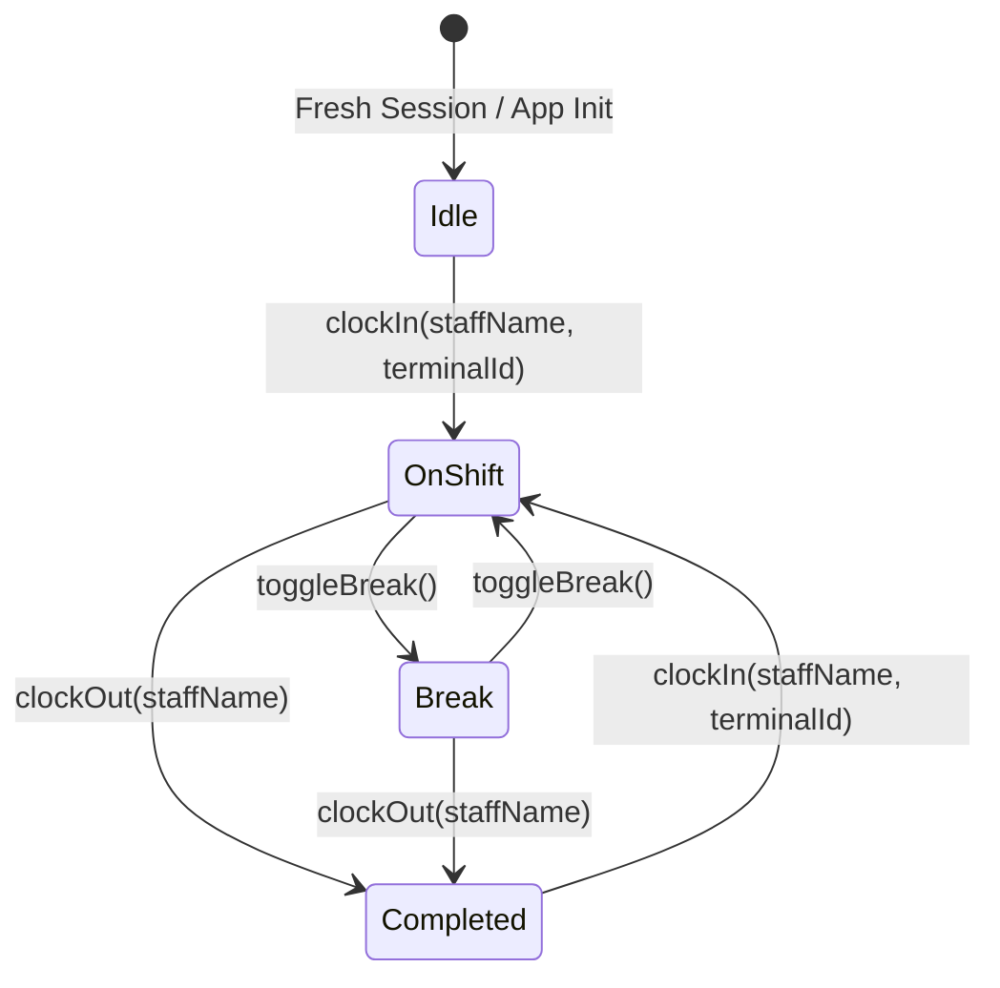

# Data Model: Staff Punch Clock Lifecycle & Attendance History

**Feature**: Staff Punch Clock Shift Lifecycle, Time-Out History Recording, and Route Persistence  
**Spec Directory**: `specs/075-staff-punch-clock-shift-lifecycle-fixes`  
**Jira Issue**: [SIAA-75](https://the-three-devsketeers.atlassian.net/browse/SIAA-75)  

---

## 1. Shift State Machine



### State Machine Invariants
- `idle`: `isShiftActive === false`, `shiftStatus === 'idle'`, `activeShiftId === null`, `shiftSeconds === 0`.
- `on_shift`: `isShiftActive === true`, `shiftStatus === 'on_shift'`, `activeShiftId !== null`, timer increments every second.
- `break`: `isShiftActive === true`, `shiftStatus === 'break'`, `activeShiftId !== null`, timer progression paused.
- `completed`: `isShiftActive === false`, `shiftStatus === 'completed'`, `activeShiftId === null`, timer stops at finalized elapsed seconds.

---

## 2. Store State Model (`PunchStoreState`)

```typescript
export type ShiftStateStatus = 'on_shift' | 'break' | 'completed' | 'idle';

export interface PunchStoreError {
  code: string;
  message: string;
  timestamp: number;
}

export interface PunchStoreState {
  /** Flag denoting whether employee is actively on shift or on break */
  isShiftActive: boolean;
  /** Explicit ID of the active shift row (local PUNCH-* or Supabase UUID) */
  activeShiftId: string | null;
  /** Total elapsed seconds of the current active shift */
  shiftSeconds: number;
  /** Full list of punch logs displayed in attendance timesheet */
  punchLogs: PunchLog[];
  /** Name of the logged-in staff member operating terminal */
  currentStaff: string;
  /** Fine-grained lifecycle status */
  shiftStatus: ShiftStateStatus;
  /** Last error or duplicate punch violation */
  lastError: PunchStoreError | null;
  /** Aggregate count of active staff across floor */
  activeStaffCount: number;
}
```

---

## 3. Punch Log Record Entity (`PunchLog`)

```typescript
export interface PunchLog {
  id?: string;
  date: string;          // ISO Date YYYY-MM-DD
  staff: string;         // Employee full name (e.g. "Mike Morales")
  timeIn: string;        // 12-hour formatted time (e.g. "08:00:15 AM")
  timeOut: string;       // 12-hour formatted time (e.g. "05:01:45 PM") or "-- Active Shift --"
  duration: string;      // Formatted duration "XXh YYm"
  status: string;        // "On Shift" | "Break" | "Completed" | "on_shift" | "break" | "completed"
  terminal?: string;     // Terminal identifier (e.g. "Terminal #01")
}
```

---

## 4. Database Shift Row (`DbStaffShift`)

Derived from `public.staff_shifts`:

```typescript
export interface DbStaffShift {
  id: string;                    // UUID
  staff_id?: string | null;
  staff_name: string;            // Text
  role?: string | null;
  terminal_id: string;           // Text
  clock_in: string;              // ISO timestamp with time zone
  clock_out?: string | null;     // ISO timestamp with time zone
  duration_seconds?: number | null;
  status: 'on_shift' | 'break' | 'completed';
  notes?: string | null;
  created_at: string;
  updated_at: string;
}
```
