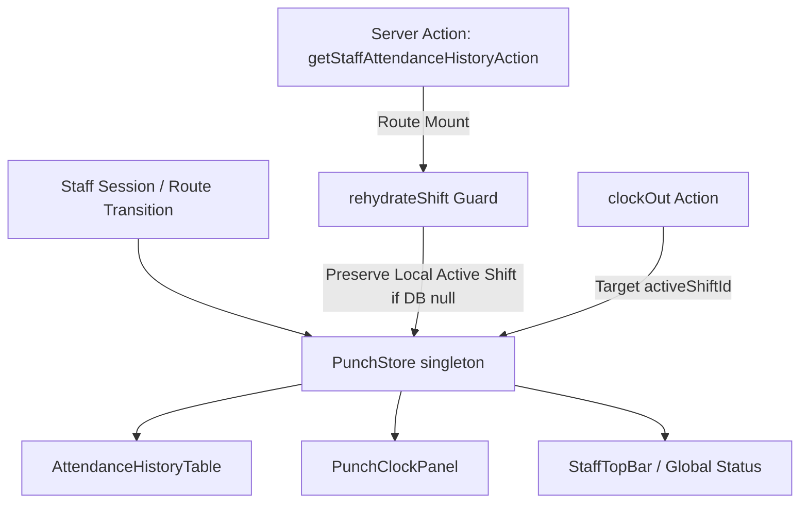

# Technical Implementation Plan: Staff Punch Clock Shift Lifecycle Fixes (SIAA-75)

**Feature**: Fix Staff Punch Clock Shift Lifecycle, Time-Out History Recording, and Route Persistence  
**Spec Directory**: `specs/075-staff-punch-clock-shift-lifecycle-fixes`  
**Jira Issue**: [SIAA-75](https://the-three-devsketeers.atlassian.net/browse/SIAA-75)  

---

## 1. Architectural Strategy & Component Boundaries



### Component Boundaries & Modifications
1. **`lib/mock-data/logs.ts`**:
   - Update `MOCK_PUNCH_LOGS`: change `PUNCH-101` status to `'Completed'` and `timeOut: '12:12:45 PM'` (04h 12m duration) so baseline mock logs do not leave unclosed phantom shifts on initial load.
2. **`lib/store/punch-store.ts`**:
   - Update `PunchStore` constructor:
     - `isShiftActive: false`
     - `activeShiftId: null`
     - `shiftSeconds: 0`
     - `shiftStatus: 'idle'`
   - Update `clockIn`:
     - Assign `activeShiftId = newLog.id`
   - Update `clockOut`:
     - Locate target shift by `activeShiftId` (or fallback to active status if not matched), set `timeOut` to real time string, `duration` to formatted duration, `status` to `'Completed'`.
     - Set `activeShiftId = null`, `isShiftActive = false`, `shiftStatus = 'completed'`.
   - Update `rehydrateShift(activeShift, recentLogs)`:
     - If `activeShift` is null, check if `this.state.isShiftActive` is already true. If so, preserve local active state!
     - If `activeShift` is present from database, set `activeShiftId = activeShift.id`, calculate elapsed duration from `clock_in`, set `isShiftActive = true`.
3. **`components/staff/clock/attendance-history-table.tsx`**:
   - Update `isActive` determination:
     ```tsx
     const isActive =
       isShiftActive &&
       (log.status === "On Shift" || log.status === "on_shift" || log.status === "Break" || log.status === "break") &&
       (log.id === activeShiftId || log.timeOut === "-- Active Shift --");
     ```
   - If not active, unconditionally render recorded `log.timeOut` and `log.duration`.
4. **`components/staff/clock/punch-clock-panel.tsx`**:
   - When clocking in, store the returned shift ID from `clockInShiftAction` if available, or keep local ID.
   - When clocking out, pass `activeShiftId` to `clockOutShiftAction` rather than dummy UUID.
5. **Unit & Integration Tests**:
   - Update `punch-store-guard.test.ts` and `punch-clock-view.test.ts` to expect clean initial `idle` / `CLOCKED OUT` state, and test explicit `clockIn` flow.
   - Add new tests in `punch-store-lifecycle.test.ts` covering:
     - Fresh session idle state
     - Route navigation persistence (rehydrateShift with null does not kill active shift)
     - Time-out history recording (verifies timestamp, duration, Completed status)
     - Safe table row evaluation

---

## 2. Test Plan & TDD Strategy
- **Red Phase**:
  - Write tests verifying that fresh store starts in `idle` / `isShiftActive: false`.
  - Write test verifying that `rehydrateShift(null)` preserves an existing active shift.
  - Write test verifying that `clockOut` updates `timeOut` timestamp and sets `Completed` status in `punchLogs`.
- **Green Phase**:
  - Implement changes across `punch-store.ts`, `attendance-history-table.tsx`, `logs.ts`, and `punch-clock-panel.tsx`.
- **Refactor Phase**:
  - Verify all existing punch clock tests (`punch-clock-view.test.ts`, `punch-store-guard.test.ts`, `attendance-history-table.test.ts`, `punch-store-realtime.test.ts`).
  - Run `npm test` and `npx tsc --noEmit`.

---

## 3. Atomic Commit Mapping
- **Unit 1 (Specs)**: `docs(specs): [SIAA-75] add 8 canonical speckit artifacts for punch clock lifecycle fixes`
- **Unit 2 (Store & Models)**: `feat(staff): [SIAA-75] update punch store with activeShiftId, idle default state, and rehydration guards`
- **Unit 3 (UI Components)**: `feat(staff): [SIAA-75] fix attendance history table row active evaluation and clock panel shift ID wiring`
- **Unit 4 (Tests)**: `test(staff): [SIAA-75] add lifecycle persistence and time-out history tests and update baseline expectations`
