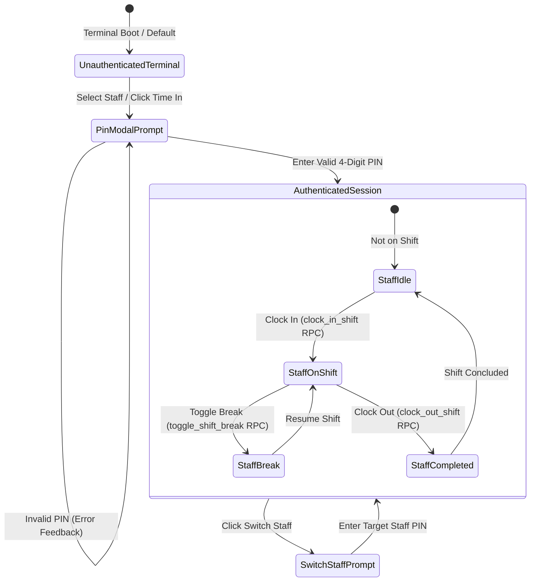

# Data Model: Staff Kiosk Authentication & Database Persistence

**Feature**: `078-staff-kiosk-auth`  
**Jira Issue**: [SIAA-78](https://the-three-devsketeers.atlassian.net/browse/SIAA-78)  
**Date**: 2026-10-20  

---

## 1. Domain Types & State Machines



---

## 2. Entity Interfaces & DTOs

### Staff Kiosk Credentials & Verification DTOs
```ts
export interface StaffKioskProfile {
  id: string; // UUID from public.profiles
  name: string;
  email: string;
  role: 'admin' | 'cashier' | 'mechanic' | 'inventory_clerk' | 'staff';
  roleDisplay: string;
  avatarInitials: string;
  pin?: string;
  isCurrentSession?: boolean;
}

export interface VerifyStaffPinPayload {
  profileId: string;
  pin: string;
}

export interface VerifyStaffPinResult {
  success: boolean;
  profile?: StaffKioskProfile;
  code?: 'INVALID_PIN' | 'PROFILE_NOT_FOUND' | 'DATABASE_ERROR';
  error?: string;
}
```

### Shift Action Requests with Profile Attribution
```ts
export interface ClockInShiftPayload {
  profileId: string;
  terminalId?: string;
  notes?: string;
}

export interface ClockOutShiftPayload {
  shiftId: string;
  profileId?: string;
  notes?: string;
}

export interface ToggleBreakPayload {
  shiftId: string;
  profileId?: string;
}
```

### Multi-Staff Client State (`PunchStoreState`)
```ts
export interface StaffMemberShiftState {
  isShiftActive: boolean;
  shiftStatus: 'on_shift' | 'break' | 'completed' | 'idle';
  shiftSeconds: number;
  shiftId?: string;
  clockInTime?: string;
}

export interface PunchStoreState {
  isShiftActive: boolean;
  shiftSeconds: number;
  punchLogs: PunchLog[];
  currentStaff: string;
  currentProfileId: string;
  shiftStatus: ShiftStateStatus;
  lastError: PunchStoreError | null;
  activeStaffCount: number;
  staffSessions: Record<string, StaffMemberShiftState>; // profileId -> individual shift
}
```

---

## 3. Database Schema Extensions

### `public.profiles` Column Addition
```sql
ALTER TABLE public.profiles
ADD COLUMN IF NOT EXISTS pin_code VARCHAR(10) DEFAULT '1234';

COMMENT ON COLUMN public.profiles.pin_code IS '4-digit PIN for shop floor terminal kiosk clock-in and switching';
```

### Extended RPC Signatures
```sql
-- clock_in_shift:
public.clock_in_shift(
    p_terminal_id TEXT DEFAULT 'Terminal #01',
    p_notes TEXT DEFAULT NULL,
    p_profile_id UUID DEFAULT NULL
) RETURNS JSONB;

-- clock_out_shift:
public.clock_out_shift(
    p_shift_id UUID,
    p_notes TEXT DEFAULT NULL,
    p_profile_id UUID DEFAULT NULL
) RETURNS JSONB;

-- toggle_shift_break:
public.toggle_shift_break(
    p_shift_id UUID,
    p_profile_id UUID DEFAULT NULL
) RETURNS JSONB;
```
