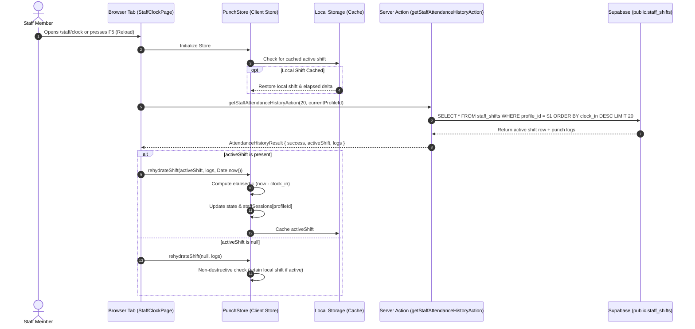

# Data Model: Shift Rehydration & Active Duration Persistence

**Feature**: `079-shift-rehydration`  
**Jira Issue**: [SIAA-79](https://the-three-devsketeers.atlassian.net/browse/SIAA-79)  
**Date**: 2026-10-20  

---

## 1. Domain Types & Rehydration Flow



---

## 2. Entity Interfaces & DTOs

### Rehydration Payload & Contract
```ts
export interface ActiveShiftRehydratePayload {
  activeShift: DbStaffShift | null;
  recentLogs?: PunchLog[];
  nowTimestamp?: number;
  profileId?: string;
}

export interface AttendanceHistoryResult {
  success: boolean;
  logs: PunchLog[];
  activeShift: DbStaffShift | null;
  code?: string;
  error?: string;
}
```

### Store State Machine & Session Entity
```ts
export type ShiftStateStatus = 'on_shift' | 'break' | 'completed' | 'idle';

export interface StaffMemberShiftState {
  isShiftActive: boolean;
  activeShiftId?: string | null;
  shiftStatus: ShiftStateStatus;
  shiftSeconds: number;
  shiftId?: string;
  staffName: string;
  profileId: string;
  clockInTime?: string;
}

export interface PunchStoreState {
  isShiftActive: boolean;
  activeShiftId: string | null;
  shiftSeconds: number;
  punchLogs: PunchLog[];
  currentStaff: string;
  currentProfileId: string;
  shiftStatus: ShiftStateStatus;
  lastError: PunchStoreError | null;
  activeStaffCount: number;
  staffSessions: Record<string, StaffMemberShiftState>;
}
```

---

## 3. Elapsed Duration Calculation Formulas

### Running Shift (`status === 'on_shift'`)
$$\text{elapsedSeconds} = \max\left(0, \left\lfloor \frac{\text{Date.now}() - \text{new Date}(\text{activeShift.clock\_in}).\text{getTime}()}{1000} \right\rfloor\right)$$

### Paused Break (`status === 'break'`)
$$\text{elapsedSeconds} = \text{activeShift.duration\_seconds} \;\; (\text{frozen accumulated time})$$

### Finalized Shift (`status === 'completed'`)
$$\text{isShiftActive} = \text{false}, \;\; \text{shiftStatus} = \text{'completed'}, \;\; \text{shiftSeconds} = \text{activeShift.duration\_seconds}$$
