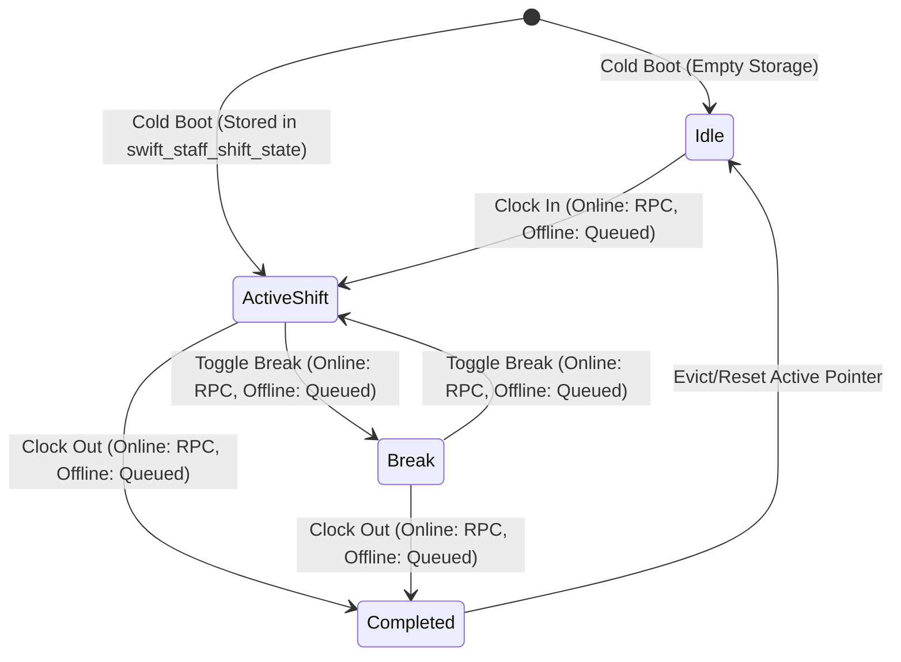
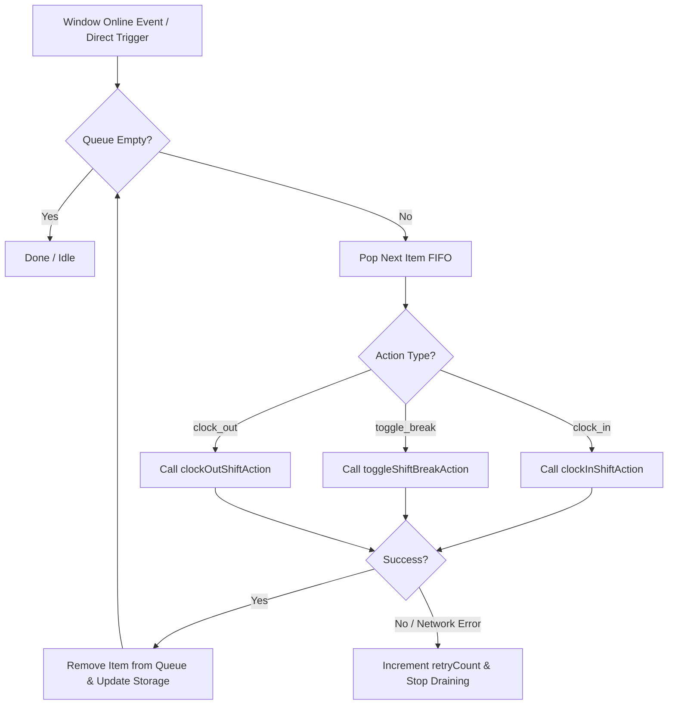

# Data Model: Offline Shift State Resilience & Attendance Sync

**Feature**: `080-offline-shift-sync`  
**Jira Issue**: [SIAA-80](https://the-three-devsketeers.atlassian.net/browse/SIAA-80)  
**Date**: 2026-10-20  

---

## 1. Client Storage Entities (`localStorage`)

### 1.1 Shift State Cache (`swift_staff_shift_state`)

```ts
export interface ActiveShiftCacheItem {
  shiftId: string;
  staffName: string;
  profileId: string;
  clockIn: string; // ISO 8601 string
  status: 'on_shift' | 'break' | 'completed' | 'idle';
  durationSeconds?: number;
}

export interface StoredStaffShiftState {
  version: number;
  lastSavedAt: number; // Unix timestamp ms
  currentStaff: string;
  currentProfileId: string;
  isShiftActive: boolean;
  activeShiftId: string | null;
  shiftStatus: 'on_shift' | 'break' | 'completed' | 'idle';
  shiftSeconds: number;
  activeShift: ActiveShiftCacheItem | null;
  punchLogs: PunchLog[];
  staffSessions: Record<string, StaffMemberShiftState>;
}
```

### 1.2 Offline Punch Action Queue (`swift_offline_punch_queue`)

```ts
export type OfflinePunchActionType = 'clock_in' | 'clock_out' | 'toggle_break';

export interface QueuedPunchAction {
  id: string; // e.g. "OFFLINE-1729401234567-xyz"
  type: OfflinePunchActionType;
  profileId: string;
  staffName: string;
  terminalId: string;
  shiftId?: string; // Authoritative DB UUID or temporary client ID
  timestamp: string; // ISO 8601 string of when punch occurred
  retryCount: number;
  status: 'pending' | 'syncing' | 'failed';
  error?: string;
}
```

---

## 2. State Machine: Offline Shift Lifecycle



---

## 3. Queue Draining & Synchronization Transitions


