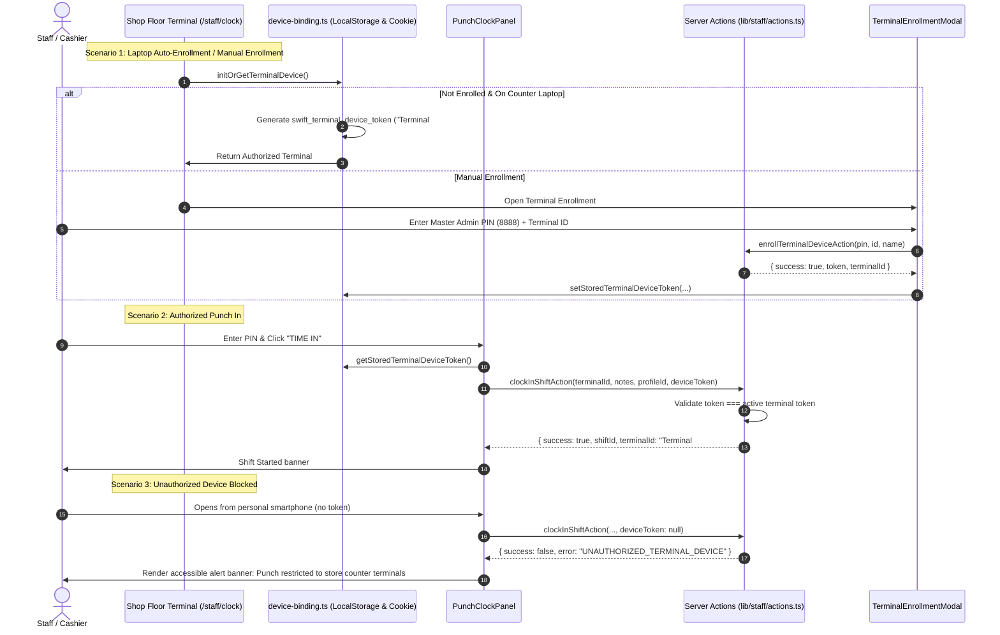

# Technical Implementation Plan: Terminal Device Binding

**Feature**: Terminal Device Binding: Enroll primary counter laptop and restrict remote mobile time-ins  
**Branch**: `feat/SIAA-82-terminal-device-binding`  
**Jira Issue**: [SIAA-82](https://the-three-devsketeers.atlassian.net/browse/SIAA-82)  

---

## 1. Architecture & Boundary Mapping

| Layer | Files | Purpose |
|---|---|---|
| **Contracts & Types** | `lib/terminal/types.ts` `lib/terminal/contracts.ts` | Define `TerminalDevice`, validation results, registration schemas. |
| **Storage & Binding Engine** | `lib/terminal/device-binding.ts` | Client persistence (`swift_terminal_device_token` in localStorage + cookie), auto-enrollment, validation logic. |
| **Server Actions** | `lib/terminal/actions.ts` `lib/staff/actions.ts` | Server-side token validation, enrollment with Master PIN (`8888`), reset actions, and `clockInShiftAction` token enforcement (`UNAUTHORIZED_TERMINAL_DEVICE`). |
| **Client State & Store** | `lib/store/punch-store.ts` | Extend `QueuedPunchAction` to store `deviceToken`, pass token to sync dispatcher. |
| **UI Components** | `components/staff/clock/terminal-enrollment-modal.tsx` `components/staff/clock/punch-clock-panel.tsx` `app/staff/clock/page.tsx` | Render terminal status badge ("Terminal #01 (Authorized)" vs "Unauthorized Remote Device"), handle blocked state, trigger enrollment modal. |
| **Testing** | `lib/terminal/__tests__/terminal-device-binding.test.ts` `lib/staff/__tests__/staff-terminal-binding-actions.test.ts` | Unit and integration test coverage for all 4 Gherkin scenarios. |

---

## 2. Component Hierarchy & Flow

---

## 3. SWIFT Design Tokens Adherence
- Modals, status badges, banners, and buttons strictly use semantic design tokens:
  - Text: `text-text-primary`, `text-text-muted`, `text-text-secondary`, `text-danger`, `text-success`
  - Surfaces: `bg-bg-surface`, `bg-bg-card`, `bg-bg-muted`, `bg-danger-light`, `bg-success-light`
  - Borders: `border-border`, `border-danger`, `border-success`
  - Actions: `bg-primary`, `text-text-light`, `bg-primary-hover`
  - Zero hardcoded hex/rgb values.
