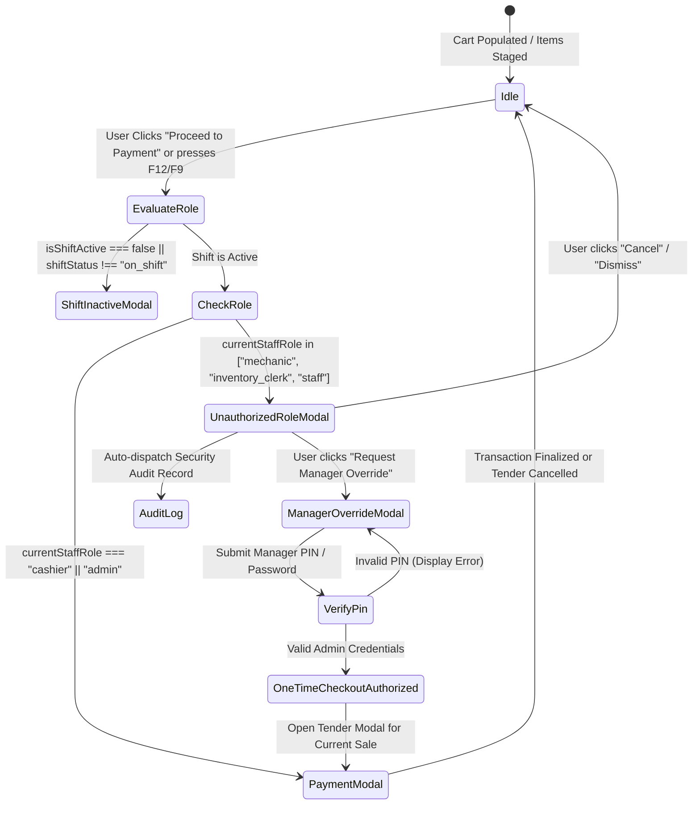

# Data Model: Staff POS Checkout Authorization & Action Guards

**Feature**: `084-staff-pos-checkout-guards`  
**Jira Issue**: [SIAA-84](https://the-three-devsketeers.atlassian.net/browse/SIAA-84)  
**Date**: 2026-10-20  

---

## 1. Domain Entities & Role Models

### 1.1 Staff Role & POS Authorization Matrix

```ts
export type StaffRole = 'admin' | 'cashier' | 'mechanic' | 'inventory_clerk' | 'staff';

export interface PosCheckoutRoleAuthorization {
  role: StaffRole;
  isAuthorizedToCheckout: boolean;
  requiresManagerOverride: boolean;
  actionRule: 'ALLOW_DIRECT' | 'REQUIRE_ELEVATION' | 'DENY';
}

export const POS_CHECKOUT_ROLE_RULES: Record<StaffRole, PosCheckoutRoleAuthorization> = {
  admin: {
    role: 'admin',
    isAuthorizedToCheckout: true,
    requiresManagerOverride: false,
    actionRule: 'ALLOW_DIRECT',
  },
  cashier: {
    role: 'cashier',
    isAuthorizedToCheckout: true,
    requiresManagerOverride: false,
    actionRule: 'ALLOW_DIRECT',
  },
  mechanic: {
    role: 'mechanic',
    isAuthorizedToCheckout: false,
    requiresManagerOverride: true,
    actionRule: 'REQUIRE_ELEVATION',
  },
  inventory_clerk: {
    role: 'inventory_clerk',
    isAuthorizedToCheckout: false,
    requiresManagerOverride: true,
    actionRule: 'REQUIRE_ELEVATION',
  },
  staff: {
    role: 'staff',
    isAuthorizedToCheckout: false,
    requiresManagerOverride: true,
    actionRule: 'REQUIRE_ELEVATION',
  },
};
```

---

## 2. Store State Extensions (`PunchStore`)

### 2.1 Extended `PunchStoreState`
```ts
export interface PunchStoreState {
  isShiftActive: boolean;
  activeShiftId: string | null;
  shiftSeconds: number;
  punchLogs: PunchLog[];
  currentStaff: string;
  currentProfileId: string;
  currentStaffRole: StaffRole; // Added for SIAA-84 checkout guard
  shiftStatus: ShiftStateStatus;
  lastError: PunchStoreError | null;
  activeStaffCount: number;
  staffSessions: Record<string, StaffMemberShiftState>;
}
```

### 2.2 Extended `StaffMemberShiftState`
```ts
export interface StaffMemberShiftState {
  isShiftActive: boolean;
  activeShiftId?: string | null;
  shiftStatus: ShiftStateStatus;
  shiftSeconds: number;
  shiftId?: string;
  staffName: string;
  profileId: string;
  role?: StaffRole; // Persisted role per session
  clockInTime?: string;
}
```

---

## 3. POS Checkout Guard State Machine



---

## 4. Security Audit Log Schema (`public.system_audit_logs`)

```ts
export interface PosSecurityAuditMetadata {
  attemptedAction: 'POS_CHECKOUT_ATTEMPT';
  attemptedRole: StaffRole;
  staffName: string;
  profileId: string;
  cartItemCount: number;
  cartTotalAmount: number;
  terminalId: string;
  overrideRequested?: boolean;
  overrideGrantedBy?: string;
  attemptedAt: string; // ISO 8601
}
```
