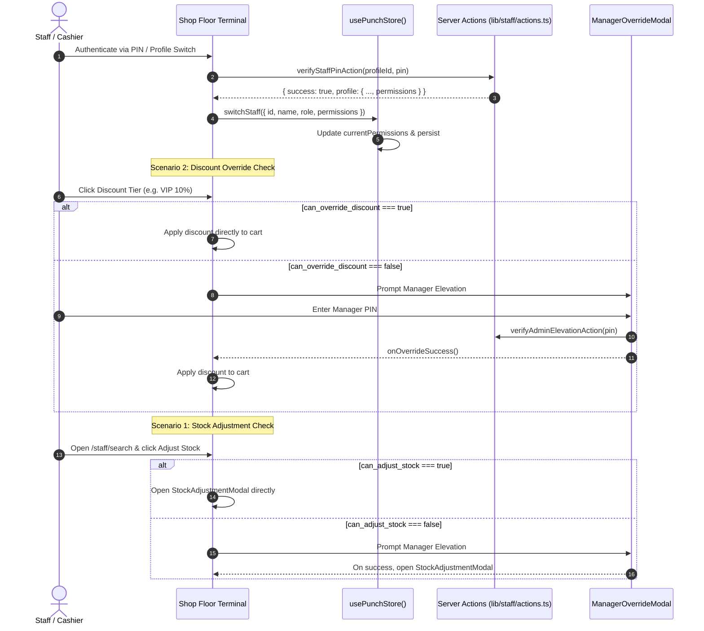

# Technical Implementation Plan: Kiosk Session Granular Permissions

**Feature**: Kiosk Session Granular Permissions: Hydrate custom employee flags and enforce feature capabilities  
**Branch**: `feat/SIAA-86-kiosk-session-granular-permissions`  
**Jira Issue**: [SIAA-86](https://the-three-devsketeers.atlassian.net/browse/SIAA-86)

---

## 1. Architecture & Boundary Mapping

| Layer | Files | Purpose |
|---|---|---|
| **Contracts & Types** | `lib/staff/types.ts` `lib/contracts/kiosk-session-permissions.ts` | Add `permissions` to `StaffKioskProfile`, define `FetchStaffShiftResult`. |
| **Server Actions** | `lib/staff/actions.ts` | Update `verifyStaffPinAction` to select `permissions`; implement `fetchStaffShiftAction`. |
| **Client State** | `lib/store/punch-store.ts` | Add `currentPermissions` to `PunchStoreState`, update `switchStaff`, handle permission storage. |
| **UI Components** | `components/staff/clock/staff-profile-switcher.tsx` `components/pos/hybrid-cart-pane.tsx` `app/staff/search/page.tsx` | Propagate permissions on profile switch, guard discount selection with `ManagerOverrideModal`, and render stock adjustment with permission evaluation. |
| **Testing** | `lib/staff/__tests__/staff-kiosk-permissions.test.ts` | Comprehensive unit & integration tests covering all Gherkin scenarios. |

---

## 2. Component Hierarchy & Flow

---

## 3. SWIFT Design Tokens Adherence
- Zero hardcoded colors.
- Use `text-text-primary`, `bg-bg-surface`, `bg-bg-card`, `border-border`, `text-success`, `text-accent`, `bg-primary`, etc.
