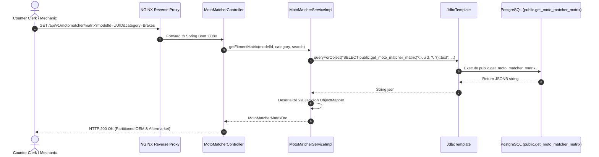
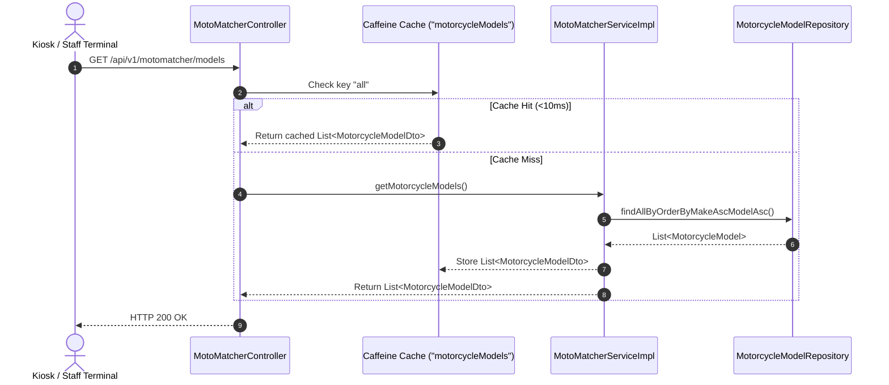
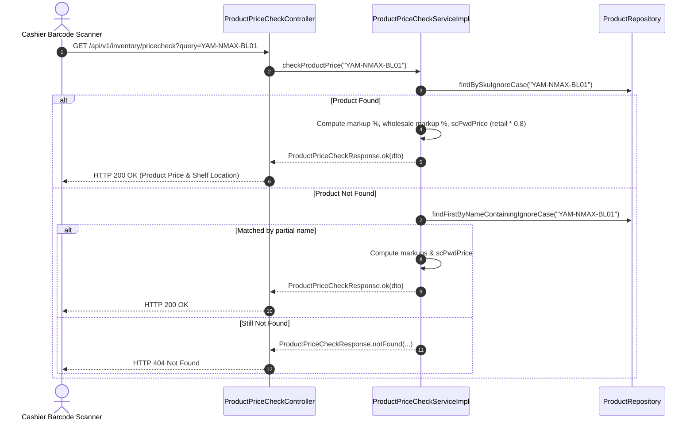

# Technical Implementation Plan: MotoMatcher Vehicle Fitment & Product Price Checker

**Feature**: `specs/090-motomatcher-vehicle-fitment-price-checker`  
**Jira Issue**: [SIAA-90](https://the-three-devsketeers.atlassian.net/browse/SIAA-90)  
**Parent Epic**: [SIAA-87](https://the-three-devsketeers.atlassian.net/browse/SIAA-87)  
**Status**: Ready for Implementation  

---

## 1. Architectural Overview & Component Structure

```
swift-backend/src/main/java/com/swift/
├── config/
│   ├── CacheConfig.java                        <-- Caffeine CacheManager configuration
│   ├── JpaConfig.java
│   ├── OpenApiConfig.java
│   └── SecurityConfig.java                     <-- Permit /api/v1/motomatcher/**, /api/v1/inventory/**
└── modules/
    ├── catalog/
    │   ├── controller/
    │   │   └── ProductPriceCheckController.java <-- GET /api/v1/inventory/pricecheck
    │   ├── dto/
    │   │   ├── ProductPriceCheckItemDto.java
    │   │   └── ProductPriceCheckResponse.java
    │   ├── model/
    │   │   └── Product.java                    <-- public.products JPA entity
    │   ├── repository/
    │   │   └── ProductRepository.java          <-- findBySkuIgnoreCase, findFirstByNameContainingIgnoreCase
    │   └── service/
    │       ├── ProductPriceCheckService.java
    │       └── impl/
    │           └── ProductPriceCheckServiceImpl.java
    └── motomatcher/
        ├── controller/
        │   └── MotoMatcherController.java      <-- GET /models, GET /matrix, POST /rules
        ├── dto/
        │   ├── AddFitmentRuleRequest.java
        │   ├── AddFitmentRuleResponse.java
        │   ├── MotorcycleModelDto.java
        │   ├── MotoMatcherMatrixDto.java
        │   └── MotoMatcherMatrixPartDto.java
        ├── model/
        │   ├── MotorcycleModel.java            <-- public.motorcycle_models JPA entity
        │   └── ProductFitment.java             <-- public.product_fitments JPA entity
        ├── repository/
        │   ├── MotorcycleModelRepository.java  <-- findAllByOrderByMakeAscModelAsc
        │   └── ProductFitmentRepository.java
        └── service/
            ├── MotoMatcherService.java
            └── impl/
                └── MotoMatcherServiceImpl.java <-- JdbcTemplate RPC execution + Caffeine cache
```

---

## 2. Sequence Diagrams

### 2.1 Stored Procedure Execution Sequence (`/api/v1/motomatcher/matrix`)



---

### 2.2 Caffeine Cache Hit Sequence (`/api/v1/motomatcher/models`)



---

### 2.3 Realtime SKU & Barcode Price Check with Margin Engine



---

## 3. Security & Route Configuration

Update `SecurityConfig.java` to configure authorization rules:
- `GET /api/v1/motomatcher/**`: `.permitAll()` (Read-only catalog for touch terminals and shop floor displays).
- `POST /api/v1/motomatcher/rules`: `.hasAnyRole("STAFF", "ADMIN")` or authenticated.
- `GET /api/v1/inventory/pricecheck`: `.permitAll()` (Public/terminal barcode price checker).
