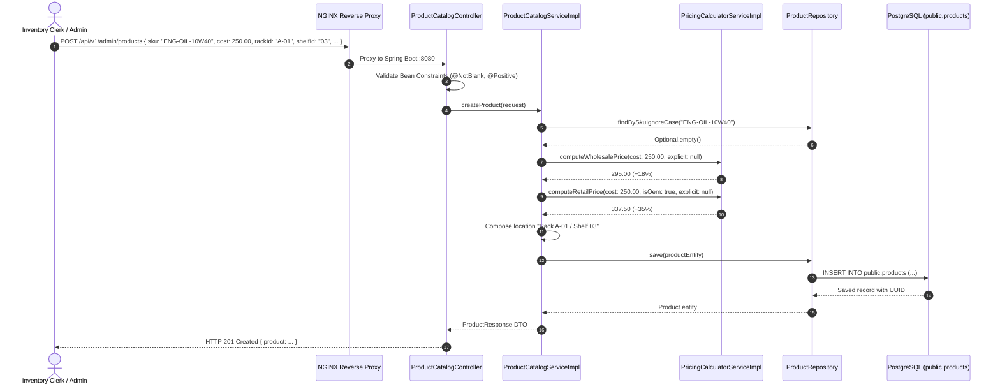
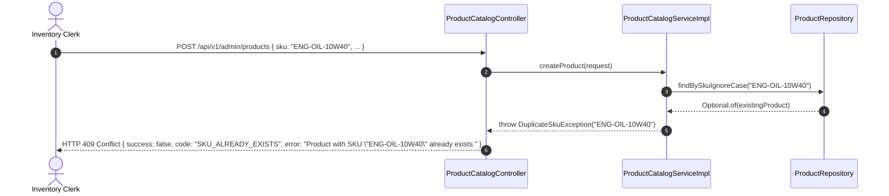

# Technical Implementation Plan: Master Product Catalog & Physical Rack/Shelf Locator

**Feature**: `specs/091-master-product-catalog-rack-shelf-locator`  
**Jira Issue**: [SIAA-91](https://the-three-devsketeers.atlassian.net/browse/SIAA-91)  
**Parent Epic**: [SIAA-87](https://the-three-devsketeers.atlassian.net/browse/SIAA-87)  
**Status**: Ready for Implementation  

---

## 1. Architectural Overview & Component Structure

```
swift-backend/src/main/java/com/swift/
├── config/
│   └── SecurityConfig.java                     <-- Permit /api/v1/admin/products/**
└── modules/
    ├── catalog/
    │   ├── controller/
    │   │   ├── ProductCatalogController.java   <-- GET /api/v1/admin/products, POST /api/v1/admin/products
    │   │   └── ProductPriceCheckController.java
    │   ├── dto/
    │   │   ├── CreateProductRequest.java       <-- Jakarta Bean Validations (@NotBlank, @Positive)
    │   │   ├── ProductResponse.java
    │   │   └── ProductListResponse.java
    │   ├── model/
    │   │   └── Product.java                    <-- Extended with rackId, shelfId, binLocator, location
    │   ├── repository/
    │   │   └── ProductRepository.java          <-- findBySkuIgnoreCase, search/filter methods
    │   └── service/
    │       ├── ProductCatalogService.java
    │       └── impl/
    │           └── ProductCatalogServiceImpl.java
    └── pricing/
        └── service/
            ├── PricingCalculatorService.java   <-- 18% wholesale, 35% OEM retail, 40% aftermarket retail
            └── impl/
                └── PricingCalculatorServiceImpl.java

gateway/
└── nginx-strangler-gateway.conf                 <-- Route /api/v1/admin/products to Spring Boot

supabase/migrations/
└── 20261025000000_product_rack_shelf_locator.sql <-- Add rack_id, shelf_id, bin_locator columns
```

---

## 2. Sequence Diagrams

### 2.1 Product Registration with Automated Markup Calculation (`POST /api/v1/admin/products`)



---

### 2.2 Enforce Unique SKU Constraint (HTTP 409 Conflict)



---

## 3. Boundary & Error Mapping

| Condition | Spring Status | Code | Message / Payload |
| :--- | :--- | :--- | :--- |
| **Missing/Blank SKU** | `400 Bad Request` | `VALIDATION_ERROR` | `{"fieldErrors": {"sku": "SKU is required."}}` |
| **Negative/Zero Cost** | `400 Bad Request` | `VALIDATION_ERROR` | `{"fieldErrors": {"cost": "Unit cost must be greater than 0."}}` |
| **Duplicate SKU** | `409 Conflict` | `SKU_ALREADY_EXISTS` | `{"code": "SKU_ALREADY_EXISTS", "error": "Product with SKU \"...\" already exists."}` |
| **Valid Registration** | `201 Created` | N/A | `ProductResponse` with computed prices and location |
| **Catalog Query** | `200 OK` | N/A | `ProductListResponse` matching search / category filter |

---

## 4. Test Strategy

1. **Unit Testing (`PricingCalculatorServiceTest`)**:
   - Verify 18% wholesale markup calculation on various base costs (e.g. 250.00 -> 295.00).
   - Verify 35% OEM retail markup (250.00 -> 337.50).
   - Verify 40% Aftermarket retail markup (250.00 -> 350.00).
   - Verify explicit wholesale/retail override preservation.
2. **Integration Testing (`ProductCatalogControllerTests`)**:
   - Scenario 1: `POST /api/v1/admin/products` with SKU `"ENG-OIL-10W40"`, cost `250.00`, category `"Oils"`, rack `"A-01"`, shelf `"03"` returns HTTP 201 Created with computed retail `337.50` and wholesale `295.00`.
   - Scenario 2: Duplicate registration with same SKU returns HTTP 409 Conflict with code `"SKU_ALREADY_EXISTS"`.
   - Scenario 3: `GET /api/v1/admin/products` lists saved products with rack/shelf attributes.
   - Scenario 4: Validation error (blank name or non-positive cost) returns HTTP 400 Bad Request.
