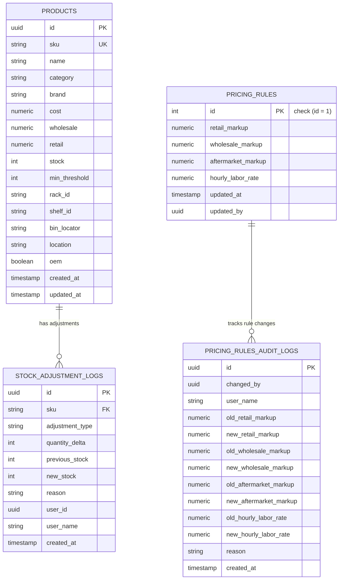

# Data Model Specification: Transactional Stock Adjustment Engine & Pricing Markup Rules

**Feature**: `specs/092-transactional-stock-adjustment-pricing-rules`  
**Jira Issue**: [SIAA-92](https://the-three-devsketeers.atlassian.net/browse/SIAA-92)  
**Parent Epic**: [SIAA-87](https://the-three-devsketeers.atlassian.net/browse/SIAA-87)  

---

## 1. Domain Entities & Database Schema Mapping



---

## 2. Java Domain Models

### `StockAdjustmentLog.java`
```java
package com.swift.modules.inventory.model;

import jakarta.persistence.*;
import java.time.OffsetDateTime;
import java.util.UUID;

@Entity
@Table(name = "stock_adjustment_logs")
public class StockAdjustmentLog {

    @Id
    @GeneratedValue(strategy = GenerationType.AUTO)
    private UUID id;

    @Column(nullable = false)
    private String sku;

    @Column(name = "adjustment_type", nullable = false)
    private String adjustmentType;

    @Column(name = "quantity_delta", nullable = false)
    private Integer quantityDelta;

    @Column(name = "previous_stock", nullable = false)
    private Integer previousStock;

    @Column(name = "new_stock", nullable = false)
    private Integer newStock;

    @Column
    private String reason;

    @Column(name = "user_id")
    private UUID userId;

    @Column(name = "user_name", nullable = false)
    private String userName = "Staff Member";

    @Column(name = "created_at", nullable = false)
    private OffsetDateTime createdAt = OffsetDateTime.now();

    // Getters, Setters, Constructors
}
```

### `PricingRules.java`
```java
package com.swift.modules.pricing.model;

import jakarta.persistence.*;
import java.math.BigDecimal;
import java.time.OffsetDateTime;
import java.util.UUID;

@Entity
@Table(name = "pricing_rules")
public class PricingRules {

    @Id
    private Long id = 1L;

    @Column(name = "retail_markup", nullable = false)
    private BigDecimal retailMarkup = new BigDecimal("35.00");

    @Column(name = "wholesale_markup", nullable = false)
    private BigDecimal wholesaleMarkup = new BigDecimal("18.00");

    @Column(name = "aftermarket_markup", nullable = false)
    private BigDecimal aftermarketMarkup = new BigDecimal("40.00");

    @Column(name = "hourly_labor_rate", nullable = false)
    private BigDecimal hourlyLaborRate = new BigDecimal("450.00");

    @Column(name = "updated_at", nullable = false)
    private OffsetDateTime updatedAt = OffsetDateTime.now();

    @Column(name = "updated_by")
    private UUID updatedBy;

    // Getters, Setters, Constructors
}
```

### `PricingRulesAuditLog.java`
```java
package com.swift.modules.pricing.model;

import jakarta.persistence.*;
import java.math.BigDecimal;
import java.time.OffsetDateTime;
import java.util.UUID;

@Entity
@Table(name = "pricing_rules_audit_logs")
public class PricingRulesAuditLog {

    @Id
    @GeneratedValue(strategy = GenerationType.AUTO)
    private UUID id;

    @Column(name = "changed_by")
    private UUID changedBy;

    @Column(name = "user_name")
    private String userName = "Admin";

    @Column(name = "old_retail_markup", nullable = false)
    private BigDecimal oldRetailMarkup;

    @Column(name = "new_retail_markup", nullable = false)
    private BigDecimal newRetailMarkup;

    @Column(name = "old_wholesale_markup", nullable = false)
    private BigDecimal oldWholesaleMarkup;

    @Column(name = "new_wholesale_markup", nullable = false)
    private BigDecimal newWholesaleMarkup;

    @Column(name = "old_aftermarket_markup", nullable = false)
    private BigDecimal oldAftermarketMarkup;

    @Column(name = "new_aftermarket_markup", nullable = false)
    private BigDecimal newAftermarketMarkup;

    @Column(name = "old_hourly_labor_rate", nullable = false)
    private BigDecimal oldHourlyLaborRate;

    @Column(name = "new_hourly_labor_rate", nullable = false)
    private BigDecimal newHourlyLaborRate;

    @Column
    private String reason;

    @Column(name = "created_at", nullable = false)
    private OffsetDateTime createdAt = OffsetDateTime.now();

    // Getters, Setters, Constructors
}
```

---

## 3. Data Transfer Objects (DTOs)

### `StockAdjustmentRequest.java`
```java
public record StockAdjustmentRequest(
    @NotBlank(message = "SKU is required")
    String sku,

    @NotNull(message = "Quantity delta is required")
    Integer quantityDelta,

    String adjustmentType,
    String reason,
    String userName
) {}
```

### `StockAdjustmentResponse.java`
```java
public record StockAdjustmentResponse(
    boolean success,
    String sku,
    Integer previousStock,
    Integer newStock,
    Integer quantityDelta,
    String adjustmentType,
    String logId,
    String userName,
    String error,
    String code
) {}
```

### `PricingRulesDto.java`
```java
public record PricingRulesDto(
    Long id,
    BigDecimal retailMarkup,
    BigDecimal wholesaleMarkup,
    BigDecimal aftermarketMarkup,
    BigDecimal hourlyLaborRate,
    OffsetDateTime updatedAt,
    UUID updatedBy
) {}
```

### `UpdatePricingRulesRequest.java`
```java
public record UpdatePricingRulesRequest(
    @DecimalMin(value = "0.01", message = "Retail markup must be greater than 0")
    @DecimalMax(value = "200.00", message = "Retail markup cannot exceed 200")
    BigDecimal retailMarkup,

    @DecimalMin(value = "0.01", message = "Wholesale markup must be greater than 0")
    @DecimalMax(value = "200.00", message = "Wholesale markup cannot exceed 200")
    BigDecimal wholesaleMarkup,

    @DecimalMin(value = "0.01", message = "Aftermarket markup must be greater than 0")
    @DecimalMax(value = "200.00", message = "Aftermarket markup cannot exceed 200")
    BigDecimal aftermarketMarkup,

    @DecimalMin(value = "0.00", message = "Hourly labor rate cannot be negative")
    BigDecimal hourlyLaborRate,

    String userName,
    String reason
) {}
```
