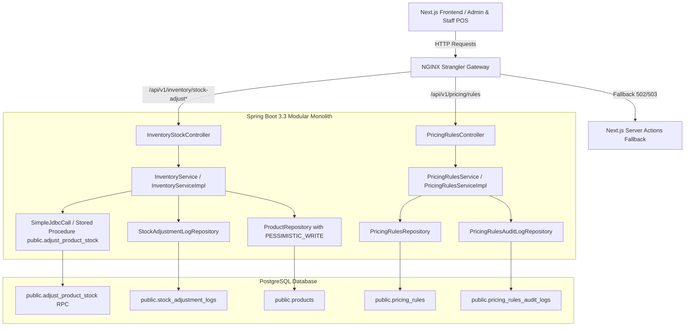

# Implementation Plan: Transactional Stock Adjustment Engine & Pricing Markup Rules

**Feature**: `specs/092-transactional-stock-adjustment-pricing-rules`  
**Jira Issue**: [SIAA-92](https://the-three-devsketeers.atlassian.net/browse/SIAA-92)  
**Parent Epic**: [SIAA-87](https://the-three-devsketeers.atlassian.net/browse/SIAA-87)  
**Status**: Ready for Implementation  

---

## 1. Architectural Boundary & Package Mapping



---

## 2. File Organization

```
swift-backend/src/
├── main/java/com/swift/
│   ├── config/
│   │   └── SecurityConfig.java                         # Permit / authenticate inventory & pricing routes
│   └── modules/
│       ├── inventory/
│       │   ├── controller/
│       │   │   └── InventoryStockController.java       # POST stock-adjust, GET logs, GET export-csv
│       │   ├── dto/
│       │   │   ├── StockAdjustmentRequest.java
│       │   │   ├── StockAdjustmentResponse.java
│       │   │   ├── StockAuditLogsResponse.java
│       │   │   └── StockAuditSummaryMetricsDto.java
│       │   ├── model/
│       │   │   └── StockAdjustmentLog.java
│       │   ├── repository/
│       │   │   └── StockAdjustmentLogRepository.java
│       │   └── service/
│       │       ├── InventoryService.java
│       │       └── impl/InventoryServiceImpl.java      # SimpleJdbcCall + fallback row-locking
│       └── pricing/
│           ├── controller/
│           │   └── PricingRulesController.java         # GET / PUT /api/v1/pricing/rules
│           ├── dto/
│           │   ├── PricingRulesDto.java
│           │   └── UpdatePricingRulesRequest.java
│           ├── model/
│           │   ├── PricingRules.java
│           │   └── PricingRulesAuditLog.java
│           ├── repository/
│           │   ├── PricingRulesRepository.java
│           │   └── PricingRulesAuditLogRepository.java
│           └── service/
│               ├── PricingRulesService.java
│               └── impl/PricingRulesServiceImpl.java
└── test/java/com/swift/
    ├── modules/
    │   ├── inventory/
    │   │   ├── InventoryStockControllerTests.java      # Scenarios 1, 3, 5 tests
    │   │   └── InventoryConcurrencyTests.java          # Scenario 2: 10 parallel adjustment threads
    │   └── pricing/
    │       └── PricingRulesControllerTests.java        # Scenario 4: Query & update pricing rules
gateway/
└── nginx-strangler-gateway.conf                        # Strangler routes for inventory & pricing
```

---

## 3. Test Plan

1. **Unit & Controller Integration Tests (`InventoryStockControllerTests.java`)**:
   - `POST /api/v1/inventory/stock-adjust`:
     - Test normal negative delta (Scenario 1): SKU 50 -> -5 -> stock becomes 45 with audit entry.
     - Test zero delta rejection: returns HTTP 400 `ZERO_DELTA_NOT_ALLOWED`.
     - Test insufficient stock rejection (Scenario 5): stock 5 -> -10 -> returns HTTP 400/422 `INSUFFICIENT_STOCK`.
     - Test non-existent SKU: returns HTTP 404 `PRODUCT_NOT_FOUND`.
   - `GET /api/v1/inventory/stock-adjust/logs`:
     - Test pagination, filtering by SKU, adjustment type, and metrics calculations.
   - `GET /api/v1/inventory/stock-adjust/export-csv` (Scenario 3):
     - Test streamed response with `StreamingResponseBody`, verifying CSV headers and formatted rows.

2. **Concurrency Integration Test (`InventoryConcurrencyTests.java`)** (Scenario 2):
   - Multi-threaded test with 10 threads concurrently updating the same SKU.
   - Assert zero lost updates; final stock equals exact sum of deltas.

3. **Pricing Rules Controller Test (`PricingRulesControllerTests.java`)** (Scenario 4):
   - `GET /api/v1/pricing/rules`: Returns default active rules.
   - `PUT /api/v1/pricing/rules`: Updates retail markup and hourly labor rate, verifies database update and audit log creation.
   - Validation tests: rejects negative rates or markup > 200%.
