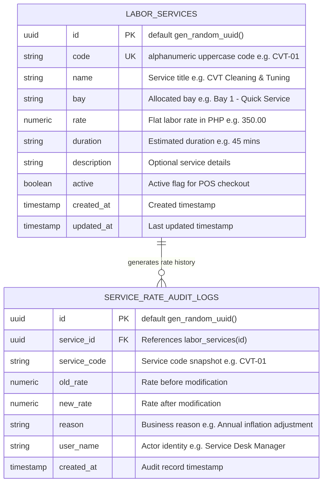

# Data Model Specification: Workshop Bay Labor Rates & Flat-Rate Service Schedule

**Feature**: `specs/093-workshop-bay-labor-rates-service-schedule`  
**Jira Issue**: [SIAA-93](https://the-three-devsketeers.atlassian.net/browse/SIAA-93)  
**Parent Epic**: [SIAA-87](https://the-three-devsketeers.atlassian.net/browse/SIAA-87)  

---

## 1. Domain Entities & Database Schema Mapping



---

## 2. Java Domain Models

### `LaborServiceEntity.java`
```java
package com.swift.modules.services.model;

import jakarta.persistence.*;
import lombok.*;
import org.hibernate.annotations.CreationTimestamp;
import org.hibernate.annotations.UpdateTimestamp;

import java.math.BigDecimal;
import java.time.OffsetDateTime;
import java.util.UUID;

@Entity
@Table(name = "labor_services", indexes = {
    @Index(name = "idx_labor_services_code", columnList = "code"),
    @Index(name = "idx_labor_services_active", columnList = "active")
})
@Getter
@Setter
@NoArgsConstructor
@AllArgsConstructor
@Builder
public class LaborServiceEntity {

    @Id
    @GeneratedValue(strategy = GenerationType.UUID)
    private UUID id;

    @Column(nullable = false, unique = true, length = 64)
    private String code;

    @Column(nullable = false, length = 255)
    private String name;

    @Column(nullable = false, length = 100)
    private String bay;

    @Column(nullable = false, precision = 10, scale = 2)
    private BigDecimal rate;

    @Column(nullable = false, length = 50)
    private String duration;

    @Column(columnDefinition = "TEXT")
    private String description;

    @Column(nullable = false)
    @Builder.Default
    private Boolean active = true;

    @CreationTimestamp
    @Column(name = "created_at", nullable = false, updatable = false)
    private OffsetDateTime createdAt;

    @UpdateTimestamp
    @Column(name = "updated_at", nullable = false)
    private OffsetDateTime updatedAt;
}
```

### `ServiceRateAuditLogEntity.java`
```java
package com.swift.modules.services.model;

import jakarta.persistence.*;
import lombok.*;
import org.hibernate.annotations.CreationTimestamp;

import java.math.BigDecimal;
import java.time.OffsetDateTime;
import java.util.UUID;

@Entity
@Table(name = "service_rate_audit_logs", indexes = {
    @Index(name = "idx_rate_audit_service_id", columnList = "service_id"),
    @Index(name = "idx_rate_audit_created_at", columnList = "created_at")
})
@Getter
@Setter
@NoArgsConstructor
@AllArgsConstructor
@Builder
public class ServiceRateAuditLogEntity {

    @Id
    @GeneratedValue(strategy = GenerationType.UUID)
    private UUID id;

    @Column(name = "service_id", nullable = false)
    private UUID serviceId;

    @Column(name = "service_code", nullable = false, length = 64)
    private String serviceCode;

    @Column(name = "old_rate", nullable = false, precision = 10, scale = 2)
    private BigDecimal oldRate;

    @Column(name = "new_rate", nullable = false, precision = 10, scale = 2)
    private BigDecimal newRate;

    @Column(nullable = false, length = 255)
    @Builder.Default
    private String reason = "";

    @Column(name = "user_name", nullable = false, length = 100)
    @Builder.Default
    private String userName = "Service Desk Manager";

    @CreationTimestamp
    @Column(name = "created_at", nullable = false, updatable = false)
    private OffsetDateTime createdAt;
}
```

---

## 3. Data Transfer Objects (DTOs)

### `LaborServiceResponse.java`
```java
package com.swift.modules.services.dto;

import java.math.BigDecimal;
import java.time.OffsetDateTime;
import java.util.UUID;

public record LaborServiceResponse(
    UUID id,
    String code,
    String name,
    String bay,
    BigDecimal rate,
    String duration,
    String description,
    boolean active,
    OffsetDateTime createdAt,
    OffsetDateTime updatedAt
) {}
```

### `CreateLaborServiceRequest.java`
```java
package com.swift.modules.services.dto;

import jakarta.validation.constraints.*;
import java.math.BigDecimal;

public record CreateLaborServiceRequest(
    @NotBlank(message = "Service code is required.")
    @Pattern(regexp = "^[A-Za-z0-9_-]+$", message = "Service code must contain only alphanumeric characters, dashes, or underscores.")
    String code,

    @NotBlank(message = "Service title is required.")
    String name,

    @NotBlank(message = "Repair bay allocation is required.")
    String bay,

    @NotNull(message = "Flat labor rate is required.")
    @DecimalMin(value = "0.01", message = "Flat labor rate must be greater than ₱0.00.")
    BigDecimal rate,

    @NotBlank(message = "Estimated duration is required.")
    String duration,

    String description,

    Boolean active
) {}
```

### `UpdateLaborServiceRequest.java`
```java
package com.swift.modules.services.dto;

import jakarta.validation.constraints.DecimalMin;
import java.math.BigDecimal;

public record UpdateLaborServiceRequest(
    String name,
    String bay,
    @DecimalMin(value = "0.01", message = "Flat labor rate must be greater than ₱0.00.")
    BigDecimal rate,
    String duration,
    String description,
    Boolean active,
    String reason,
    String userName
) {}
```

### `UpdateLaborServiceStatusRequest.java`
```java
package com.swift.modules.services.dto;

import jakarta.validation.constraints.NotNull;

public record UpdateLaborServiceStatusRequest(
    @NotNull(message = "Active status is required.")
    Boolean active
) {}
```

### `ServiceRateAuditLogResponse.java`
```java
package com.swift.modules.services.dto;

import java.math.BigDecimal;
import java.time.OffsetDateTime;
import java.util.UUID;

public record ServiceRateAuditLogResponse(
    UUID id,
    UUID serviceId,
    String serviceCode,
    BigDecimal oldRate,
    BigDecimal newRate,
    String reason,
    String userName,
    OffsetDateTime createdAt
) {}
```
