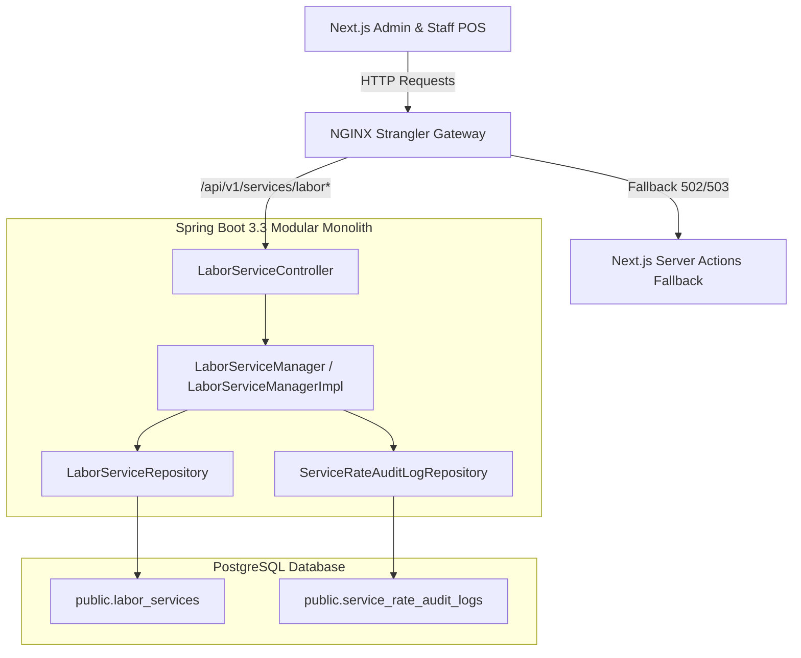

# Implementation Plan: Workshop Bay Labor Rates & Flat-Rate Service Schedule

**Feature**: `specs/093-workshop-bay-labor-rates-service-schedule`  
**Jira Issue**: [SIAA-93](https://the-three-devsketeers.atlassian.net/browse/SIAA-93)  
**Parent Epic**: [SIAA-87](https://the-three-devsketeers.atlassian.net/browse/SIAA-87)  
**Status**: Ready for Implementation  

---

## 1. Architectural Boundary & Package Mapping



---

## 2. File Organization

```
swift-backend/src/
├── main/java/com/swift/
│   ├── config/
│   │   └── SecurityConfig.java                         # Permit / authenticate /api/v1/services/labor/**
│   └── modules/
│       └── services/
│           ├── controller/
│           │   └── LaborServiceController.java         # CRUD + status toggle + audit logs
│           ├── dto/
│           │   ├── LaborServiceResponse.java
│           │   ├── CreateLaborServiceRequest.java
│           │   ├── UpdateLaborServiceRequest.java
│           │   ├── UpdateLaborServiceStatusRequest.java
│           │   └── ServiceRateAuditLogResponse.java
│           ├── model/
│           │   ├── LaborServiceEntity.java
│           │   └── ServiceRateAuditLogEntity.java
│           ├── repository/
│           │   ├── LaborServiceRepository.java
│           │   └── ServiceRateAuditLogRepository.java
│           └── service/
│               ├── LaborServiceManager.java
│               └── impl/LaborServiceManagerImpl.java   # Business logic, audit trigger, identifier resolution
└── test/java/com/swift/modules/services/
    └── LaborServiceControllerTests.java                # Comprehensive MockMvc integration tests
gateway/
└── nginx-strangler-gateway.conf                         # Upstream routing for /api/v1/services/labor
```

---

## 3. Legacy Actions Replaced (6)

1. `getAdminLaborServicesAction` ➔ `GET /api/v1/services/labor`
2. `createLaborServiceAction` ➔ `POST /api/v1/services/labor`
3. `updateLaborServiceAction` ➔ `PUT /api/v1/services/labor/{id}`
4. `toggleServiceStatusAction` ➔ `PATCH /api/v1/services/labor/{id}/status`
5. `deleteLaborServiceAction` ➔ `DELETE /api/v1/services/labor/{id}`
6. `getServiceRateAuditLogsAction` ➔ `GET /api/v1/services/labor/audit-logs`

---

## 4. Test Strategy & Verification Gates

- **Unit & Integration Tests (`LaborServiceControllerTests`)**:
  - Test 1: Create flat-rate labor service with rate, bay, duration, and verify HTTP 201 response.
  - Test 2: Update flat-rate labor service rate and verify `ServiceRateAuditLogEntity` is created with previous and new rates.
  - Test 3: Deactivate labor service via status PATCH and verify exclusion from active query (`active=true`).
  - Test 4: Verify duplicate service code returns HTTP 409 Conflict with `DUPLICATE_CODE`.
  - Test 5: Verify negative or zero labor rate returns HTTP 400 Bad Request with field validation error.
  - Test 6: Verify retrieval by UUID and uppercase business code (dual identifier resolution).
  - Test 7: Verify audit logs listing filtered by service ID/code.
- **Verification Commands**:
  - `mvn clean test -Dtest=LaborServiceControllerTests` inside `swift-backend`.
