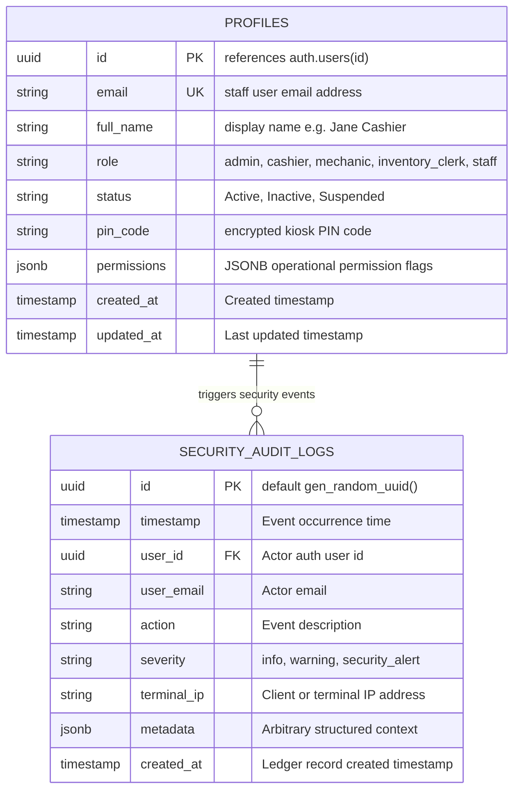

# Data Model Specification: Staff Account Provisioning, Granular RBAC & Security Audit Trail

**Feature**: `specs/094-staff-account-provisioning-rbac-audit-trail`  
**Jira Issue**: [SIAA-94](https://the-three-devsketeers.atlassian.net/browse/SIAA-94)  
**Parent Epic**: [SIAA-87](https://the-three-devsketeers.atlassian.net/browse/SIAA-87)  

---

## 1. Domain Entities & Database Schema Mapping



---

## 2. Java Domain Models

### `StaffProfile.java` (`com.swift.modules.auth.model`)
Mapped to `public.profiles`:
```java
@Entity
@Table(name = "profiles", schema = "public")
public class StaffProfile {
    @Id
    @Column(name = "id", nullable = false)
    private UUID id;

    @Column(name = "email", nullable = false, unique = true)
    private String email;

    @Column(name = "full_name")
    private String fullName;

    @Column(name = "role", nullable = false)
    private String role; // "admin", "cashier", "mechanic", "inventory_clerk", "staff"

    @Column(name = "status", nullable = false)
    private String status = "Active";

    @Column(name = "pin_code", length = 100)
    private String pinCode;

    @JdbcTypeCode(SqlTypes.JSON)
    @Column(name = "permissions", columnDefinition = "jsonb")
    private StaffPermissions permissions;

    @Column(name = "created_at")
    private OffsetDateTime createdAt;

    @Column(name = "updated_at")
    private OffsetDateTime updatedAt;
}
```

### `SecurityAuditLog.java` (`com.swift.modules.auth.model`)
Mapped to `public.security_audit_logs`:
```java
@Entity
@Table(name = "security_audit_logs", schema = "public")
public class SecurityAuditLog {
    @Id
    @GeneratedValue(strategy = GenerationType.UUID)
    @Column(name = "id", nullable = false)
    private UUID id;

    @Column(name = "timestamp", nullable = false)
    private OffsetDateTime timestamp = OffsetDateTime.now();

    @Column(name = "user_id")
    private UUID userId;

    @Column(name = "user_email", nullable = false)
    private String userEmail;

    @Column(name = "action", nullable = false)
    private String action;

    @Column(name = "severity", nullable = false)
    private String severity; // "info", "warning", "security_alert"

    @Column(name = "terminal_ip")
    private String terminalIp;

    @JdbcTypeCode(SqlTypes.JSON)
    @Column(name = "metadata", columnDefinition = "jsonb")
    private Map<String, Object> metadata;

    @Column(name = "created_at", nullable = false)
    private OffsetDateTime createdAt = OffsetDateTime.now();
}
```

### `StaffPermissions.java` (`com.swift.modules.auth.model`)
Granular JSONB structure:
- `can_adjust_stock` (boolean)
- `can_override_discount` (boolean)
- `can_manage_pricing` (boolean)
- `can_view_reports` (boolean)

---

## 3. Data Transfer Objects (DTOs)

### Staff User DTOs (`com.swift.modules.admin.dto`)
- **`StaffUserResponse`**:
  - `id`: String (UUID)
  - `email`: String
  - `fullName`: String
  - `role`: String (`admin`, `cashier`, `mechanic`, `inventory_clerk`, `staff`)
  - `roleDisplay`: String (`Admin`, `Cashier`, `Mechanic`, `Inventory Clerk`, `Staff`)
  - `status`: String (`Active`, `Inactive`, `Suspended`)
  - `permissions`: `StaffPermissions`
  - `createdAt`: String (ISO-8601)
  - `updatedAt`: String (ISO-8601)
- **`ProvisionStaffUserRequest`**:
  - `email`: String (required, valid email)
  - `fullName`: String (required, min 1)
  - `role`: String (required, valid role enum)
  - `password`: String (optional, defaults to generated secure credential)
  - `permissions`: `StaffPermissions` (optional, merged with role defaults)
- **`UpdateStaffUserRequest`**:
  - `fullName`: String (optional)
  - `role`: String (optional)
  - `permissions`: `StaffPermissions` (optional)
- **`UpdateUserPermissionsRequest`**:
  - `permissions`: `StaffPermissions` (required)
- **`UpdateUserStatusRequest`**:
  - `status`: String (`Active`, `Inactive`, `Suspended`)

### Security Audit DTOs (`com.swift.modules.admin.dto`)
- **`SecurityAuditLogResponse`**:
  - `id`: String (UUID)
  - `timestamp`: String
  - `userId`: String (UUID, nullable)
  - `userEmail`: String
  - `action`: String
  - `severity`: String (`info`, `warning`, `security_alert`)
  - `terminalIp`: String (nullable)
  - `metadata`: Map<String, Object>
  - `createdAt`: String (ISO-8601)
- **`LogSecurityEventRequest`**:
  - `action`: String (required)
  - `severity`: String (optional, default: "info")
  - `terminalIp`: String (optional)
  - `metadata`: Map<String, Object> (optional)
  - `userEmail`: String (optional)

---

## 4. Stored Procedure Interface

```sql
public.log_security_event(
    p_action TEXT,
    p_severity TEXT DEFAULT 'info',
    p_terminal_ip TEXT DEFAULT NULL,
    p_metadata JSONB DEFAULT '{}'::jsonb
) RETURNS UUID;
```
Called via Spring JDBC `SimpleJdbcCall`:
```java
SimpleJdbcCall call = new SimpleJdbcCall(jdbcTemplate)
    .withSchemaName("public")
    .withFunctionName("log_security_event");
```
