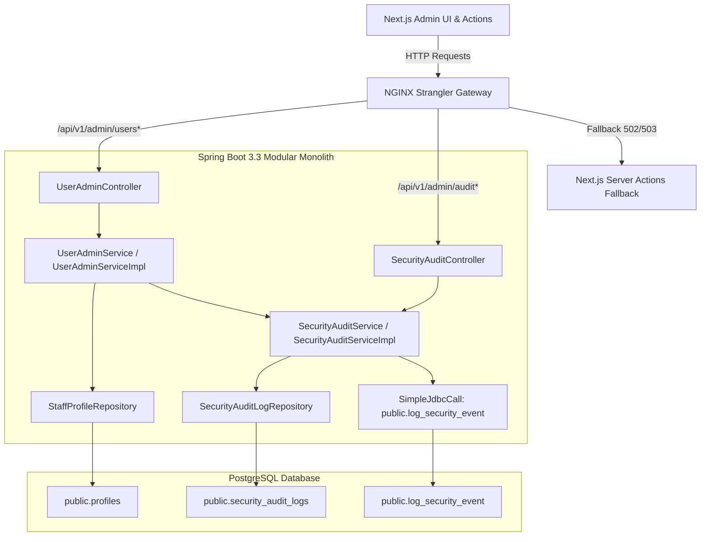

# Implementation Plan: Staff Account Provisioning, Granular RBAC & Security Audit Trail

**Feature**: `specs/094-staff-account-provisioning-rbac-audit-trail`  
**Jira Issue**: [SIAA-94](https://the-three-devsketeers.atlassian.net/browse/SIAA-94)  
**Parent Epic**: [SIAA-87](https://the-three-devsketeers.atlassian.net/browse/SIAA-87)  
**Status**: Ready for Implementation  

---

## 1. Architectural Boundary & Package Mapping



---

## 2. File Organization

```
swift-backend/src/
├── main/java/com/swift/
│   ├── config/
│   │   └── SecurityConfig.java                         # Secures /api/v1/admin/** requiring ROLE_ADMIN
│   └── modules/
│       ├── admin/
│       │   ├── controller/
│       │   │   ├── UserAdminController.java            # Endpoints: /api/v1/admin/users/**
│       │   │   └── SecurityAuditController.java        # Endpoints: /api/v1/admin/audit/security/**
│       │   ├── dto/
│       │   │   ├── StaffUserResponse.java
│       │   │   ├── ProvisionStaffUserRequest.java
│       │   │   ├── UpdateStaffUserRequest.java
│       │   │   ├── UpdateUserPermissionsRequest.java
│       │   │   ├── UpdateUserStatusRequest.java
│       │   │   ├── SecurityAuditLogResponse.java
│       │   │   └── LogSecurityEventRequest.java
│       │   ├── exception/
│       │   │   ├── SelfLockoutException.java           # 400 Bad Request: SELF_LOCKOUT_PREVENTED
│       │   │   └── DuplicateEmailException.java        # 409 Conflict: DUPLICATE_EMAIL
│       │   └── service/
│       │       ├── UserAdminService.java
│       │       ├── SecurityAuditService.java
│       │       └── impl/
│       │           ├── UserAdminServiceImpl.java       # User CRUD, password hashing, self-lockout guard
│       │           └── SecurityAuditServiceImpl.java   # Stored procedure SimpleJdbcCall & CSV export
│       └── auth/
│           └── model/
│               ├── StaffProfile.java                   # Domain entity mapping to public.profiles
│               ├── SecurityAuditLog.java               # Domain entity mapping to public.security_audit_logs
│               └── StaffPermissions.java               # JSONB granular permission flags
└── test/java/com/swift/modules/admin/
    ├── UserAdminControllerTests.java                   # Scenario 1, 2, 4 integration tests
    └── SecurityAuditControllerTests.java               # Scenario 3, 5, 6 integration tests
gateway/
└── nginx-strangler-gateway.conf                         # Upstream routing for /api/v1/admin/users and /api/v1/admin/audit
```

---

## 3. Legacy Actions Replaced (8)

1. `listStaffUsersAction` ➔ `GET /api/v1/admin/users`
2. `provisionStaffUserAction` ➔ `POST /api/v1/admin/users`
3. `updateStaffUserAction` ➔ `PUT /api/v1/admin/users/{id}`
4. `updateUserPermissionsAction` ➔ `PATCH /api/v1/admin/users/{id}/permissions`
5. `toggleUserStatusAction` ➔ `PATCH /api/v1/admin/users/{id}/status`
6. `getSecurityAuditLogsAction` ➔ `GET /api/v1/admin/audit/security`
7. `logSecurityEventAction` ➔ `POST /api/v1/admin/audit/security`
8. `exportSecurityAuditLogsAction` ➔ `GET /api/v1/admin/audit/security/export`
9. Stored Procedure Replaced: `public.log_security_event`

---

## 4. Test Strategy & Verification Gates

- **UserAdminControllerTests**:
  - Test 1: Provision staff user with custom permissions (Scenario 1) ➔ HTTP 201 Created, `USER_PROVISIONED` audit record.
  - Test 2: Prevent administrative self-lockout on status PATCH (Scenario 2) ➔ HTTP 400 Bad Request with "Self-deactivation is prohibited".
  - Test 3: Prevent administrative self-demotion on PUT (Scenario 4) ➔ HTTP 400 Bad Request with "Admin self-demotion is prohibited".
  - Test 4: Duplicate email returns HTTP 409 Conflict (`DUPLICATE_EMAIL`).
  - Test 5: List staff users returns full profile summaries with roleDisplay and permissions.
  - Test 6: Direct permissions PATCH updates JSONB column.
- **SecurityAuditControllerTests**:
  - Test 1: Record security event via stored procedure (Scenario 3) ➔ HTTP 201 Created.
  - Test 2: Query audit logs with severity filter (`security_alert`) and search query (Scenario 5).
  - Test 3: Stream and download RFC 4180 CSV export (Scenario 6).
- **Verification Command**:
  - `mvn clean test -Dtest=UserAdminControllerTests,SecurityAuditControllerTests`
