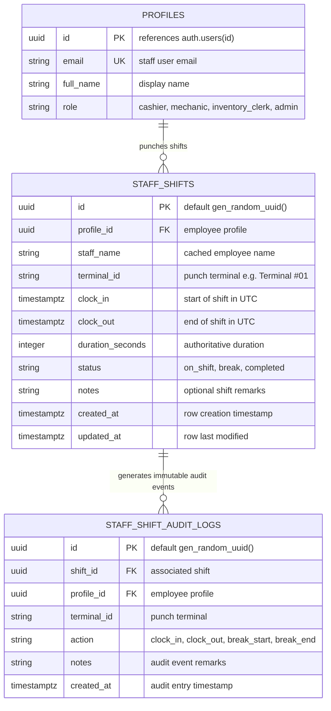
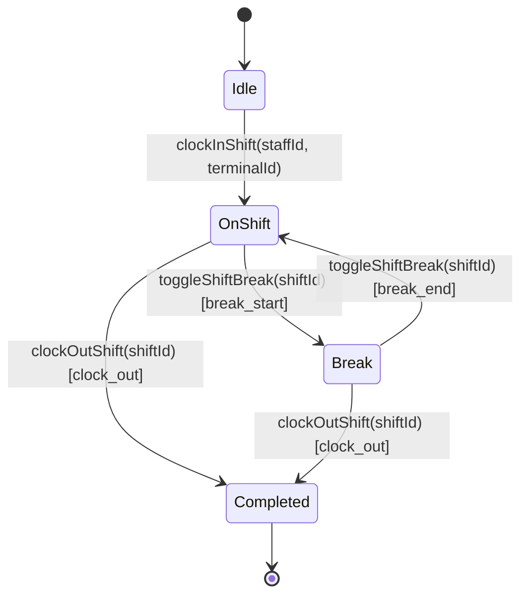

# Data Model Specification: Employee Shift Attendance & Digital Punch Clock Lifecycle

**Feature**: `specs/095-employee-shift-attendance-punch-clock-lifecycle`  
**Jira Issue**: [SIAA-95](https://the-three-devsketeers.atlassian.net/browse/SIAA-95)  
**Parent Epic**: [SIAA-87](https://the-three-devsketeers.atlassian.net/browse/SIAA-87)  

---

## 1. Domain Entities & Database Schema Mapping



---

## 2. Shift State Machine



### State Transition Invariants:
1. **Clock-In**: Permitted only when no shift for `profile_id` exists with status in `('on_shift', 'break')`.
2. **Break Toggle**: Alternates strictly between `'on_shift'` and `'break'`. Fails if status is `'completed'`.
3. **Clock-Out**: Calculates duration from `clock_in` to UTC `now()`, marks status `'completed'`, and records `clock_out`. Cannot be performed on `'completed'` shifts.

---

## 3. Java Domain Models

### `StaffShift.java` (`com.swift.modules.shift.model`)
```java
@Entity
@Table(name = "staff_shifts", schema = "public")
public class StaffShift {

    @Id
    @GeneratedValue(strategy = GenerationType.UUID)
    @Column(name = "id", nullable = false)
    private UUID id;

    @Column(name = "profile_id", nullable = false)
    private UUID profileId;

    @Column(name = "staff_name", nullable = false)
    private String staffName;

    @Column(name = "terminal_id", nullable = false)
    private String terminalId = "Terminal #01";

    @Column(name = "clock_in", nullable = false)
    private Instant clockIn = Instant.now();

    @Column(name = "clock_out")
    private Instant clockOut;

    @Column(name = "duration_seconds")
    private Integer durationSeconds = 0;

    @Column(name = "status", nullable = false)
    private String status = "on_shift";

    @Column(name = "notes")
    private String notes;

    @Column(name = "created_at", nullable = false, updatable = false)
    private Instant createdAt = Instant.now();

    @Column(name = "updated_at", nullable = false)
    private Instant updatedAt = Instant.now();

    // Getters, Setters, Constructors
}
```

### `StaffShiftAuditLog.java` (`com.swift.modules.shift.model`)
```java
@Entity
@Table(name = "staff_shift_audit_logs", schema = "public")
public class StaffShiftAuditLog {

    @Id
    @GeneratedValue(strategy = GenerationType.UUID)
    @Column(name = "id", nullable = false)
    private UUID id;

    @Column(name = "shift_id", nullable = false)
    private UUID shiftId;

    @Column(name = "profile_id", nullable = false)
    private UUID profileId;

    @Column(name = "terminal_id", nullable = false)
    private String terminalId;

    @Column(name = "action", nullable = false)
    private String action;

    @Column(name = "notes")
    private String notes;

    @Column(name = "created_at", nullable = false, updatable = false)
    private Instant createdAt = Instant.now();

    // Getters, Setters, Constructors
}
```

---

## 4. DTO Transfer Objects (`com.swift.modules.shift.dto`)

### `ClockInRequest.java`
```java
public record ClockInRequest(
    @NotNull(message = "Staff profile ID is required")
    UUID staffId,
    String terminalId,
    String notes
) {}
```

### `ClockOutRequest.java`
```java
public record ClockOutRequest(
    @NotNull(message = "Shift ID is required")
    UUID shiftId,
    UUID staffId,
    String notes
) {}
```

### `ToggleBreakRequest.java`
```java
public record ToggleBreakRequest(
    @NotNull(message = "Shift ID is required")
    UUID shiftId,
    UUID staffId
) {}
```

### `ShiftResponse.java`
```java
public record ShiftResponse(
    UUID id,
    UUID staffId,
    String staffName,
    String terminalId,
    Instant clockIn,
    Instant clockOut,
    Integer durationSeconds,
    String durationFormatted,
    String status,
    String notes,
    Instant createdAt
) {}
```

### `ActiveShiftResponse.java`
```java
public record ActiveShiftResponse(
    boolean hasActiveShift,
    ShiftResponse shift,
    Long activeDurationSeconds,
    String activeDurationFormatted
) {}
```

### `AttendanceHistoryResponse.java`
```java
public record AttendanceHistoryResponse(
    List<ShiftResponse> shifts,
    ShiftResponse activeShift,
    long totalMinutesWorked,
    int page,
    int size,
    long totalElements,
    int totalPages
) {}
```
