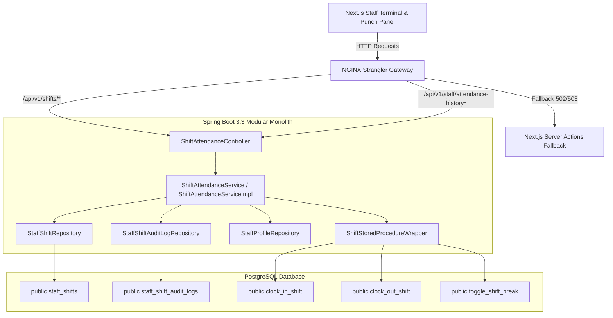

# Implementation Plan: Employee Shift Attendance & Digital Punch Clock Lifecycle

**Feature**: `specs/095-employee-shift-attendance-punch-clock-lifecycle`  
**Jira Issue**: [SIAA-95](https://the-three-devsketeers.atlassian.net/browse/SIAA-95)  
**Parent Epic**: [SIAA-87](https://the-three-devsketeers.atlassian.net/browse/SIAA-87)  
**Status**: Ready for Implementation  

---

## 1. Architectural Boundary & Package Mapping



---

## 2. File Organization

```
swift-backend/src/
├── main/java/com/swift/
│   ├── config/
│   │   └── SecurityConfig.java                         # Permit /api/v1/shifts/** for floor terminals
│   └── modules/
│       └── shift/
│           ├── controller/
│           │   └── ShiftAttendanceController.java      # REST endpoints: /api/v1/shifts/** and /api/v1/staff/attendance-history
│           ├── dto/
│           │   ├── ClockInRequest.java
│           │   ├── ClockOutRequest.java
│           │   ├── ToggleBreakRequest.java
│           │   ├── ShiftResponse.java
│           │   ├── ActiveShiftResponse.java
│           │   └── AttendanceHistoryResponse.java
│           ├── exception/
│           │   ├── ActiveShiftConflictException.java   # 409 Conflict: ACTIVE_SHIFT_EXISTS
│           │   ├── ShiftNotFoundException.java         # 404 Not Found: SHIFT_NOT_FOUND
│           │   └── ShiftNotActiveException.java        # 400 Bad Request: SHIFT_NOT_ACTIVE
│           ├── model/
│           │   ├── StaffShift.java                     # Entity for public.staff_shifts
│           │   └── StaffShiftAuditLog.java             # Entity for public.staff_shift_audit_logs
│           ├── repository/
│           │   ├── StaffShiftRepository.java           # JPA repository with active shift queries
│           │   └── StaffShiftAuditLogRepository.java   # JPA repository for punch audit events
│           └── service/
│               ├── ShiftAttendanceService.java         # Service interface
│               ├── ShiftAttendanceServiceImpl.java     # Implementation wrapping stored procedures & fallbacks
│               └── ShiftStoredProcedureWrapper.java    # Stored procedure invoker via JdbcTemplate/SimpleJdbcCall
└── test/java/com/swift/modules/shift/
    └── ShiftAttendanceControllerTests.java             # MockMvc integration tests for all 7 scenarios
```

---

## 3. Implementation Steps

1. **Entities & Repositories**:
   - Create `StaffShift` and `StaffShiftAuditLog` entities.
   - Create `StaffShiftRepository` with queries:
     - `findActiveShiftByProfileId(UUID profileId)`
     - `existsActiveShiftByProfileId(UUID profileId)`
     - `findByProfileIdOrderByClockInDesc(...)`
   - Create `StaffShiftAuditLogRepository`.
2. **Exceptions & Global Handler**:
   - Create `ActiveShiftConflictException` (409), `ShiftNotFoundException` (404), `ShiftNotActiveException` (400).
   - Register exception handling in `@RestControllerAdvice` or `GlobalExceptionHandler`.
3. **Stored Procedure Wrapper & Service**:
   - Implement `ShiftStoredProcedureWrapper` to invoke `public.clock_in_shift`, `clock_out_shift`, `toggle_shift_break`.
   - Implement `ShiftAttendanceServiceImpl` handling:
     - `clockIn(ClockInRequest)`
     - `clockOut(ClockOutRequest)`
     - `toggleBreak(ToggleBreakRequest)`
     - `getActiveShift(UUID staffId)`
     - `getAttendanceHistory(UUID staffId, LocalDate startDate, LocalDate endDate, Pageable pageable)`
4. **REST Controller**:
   - Implement `ShiftAttendanceController` with OpenAPI annotations.
5. **Security & Gateway**:
   - Update `SecurityConfig.java` to allow authenticated and kiosk staff access to `/api/v1/shifts/**` and `/api/v1/staff/attendance-history`.
   - Update `gateway/nginx-strangler-gateway.conf` with proxy routes for `/api/v1/shifts/` and `/api/v1/staff/attendance-history` with `@fallback_to_nextjs`.
6. **Integration Tests**:
   - Comprehensive test suite in `ShiftAttendanceControllerTests` verifying:
     - Clock-in returns 200 with shift ID and timestamp
     - Duplicate clock-in returns 409 `ACTIVE_SHIFT_EXISTS`
     - Rehydration returns active shift with dynamic duration
     - Toggle break transitions `on_shift` <-> `break`
     - Clock out returns 200 with calculated duration and `completed` status
     - Clock out on finalized shift returns 400 `SHIFT_NOT_ACTIVE`
     - Clock out on non-existent shift returns 404 `SHIFT_NOT_FOUND`
     - Attendance history returns paginated shifts and active shift
