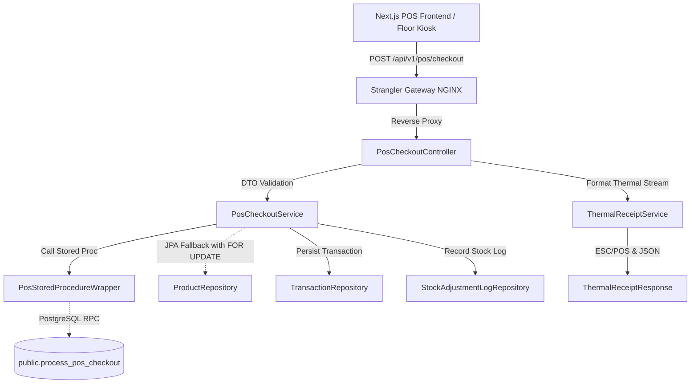

# Implementation Plan: High-Concurrency POS Checkout Orchestration & Thermal Receipts

**Feature**: `specs/096-pos-checkout-orchestration-thermal-receipts`  
**Jira Issue**: [SIAA-96](https://the-three-devsketeers.atlassian.net/browse/SIAA-96)  
**Parent Epic**: [SIAA-87](https://the-three-devsketeers.atlassian.net/browse/SIAA-87)  
**Status**: Ready for Execution  

---

## 1. Architectural Boundaries & Component Hierarchy

---

## 2. Component Directory Layout

### Spring Boot Backend (`swift-backend/src/main/java/com/swift/modules/pos/`)
- `model/`
  - `Transaction.java`: Master transaction entity mapping `public.transactions`
  - `TransactionItem.java`: Line item entity mapping `public.transaction_items`
- `repository/`
  - `TransactionRepository.java`: JPA repository with receipt number lookups and descending order queries
  - `TransactionItemRepository.java`: JPA repository for item lines
- `dto/`
  - `PosCheckoutRequest.java`: Java 21 record with Jakarta validation annotations
  - `PosCheckoutItemDto.java`: Item line record
  - `PosCheckoutResponse.java`: Transaction outcome DTO
  - `ThermalReceiptResponse.java`: Structured receipt DTO with ESC/POS payload
  - `ThermalReceiptItemDto.java`: Receipt line item DTO
- `service/`
  - `PosCheckoutService.java`: Interface defining checkout and transaction query operations
  - `impl/PosCheckoutServiceImpl.java`: Orchestration service enforcing cash tender validation, change calculation, and inventory locking
  - `PosStoredProcedureWrapper.java`: Component wrapping `public.process_pos_checkout` via Spring JDBC
  - `ThermalReceiptService.java`: Interface for generating thermal receipt payloads
  - `impl/ThermalReceiptServiceImpl.java`: Formats ESC/POS raw bytes/text and structured receipt metadata
- `controller/`
  - `PosCheckoutController.java`: REST controller exposing `/api/v1/pos/**` endpoints
- `exception/`
  - `InsufficientStockException.java`: Thrown on negative stock, mapped to HTTP 409 / 400
  - `InsufficientCashException.java`: Thrown on underpayment, mapped to HTTP 400

### Gateway (`gateway/nginx-strangler-gateway.conf`)
- Configure `/api/v1/pos/` location block routing to `http://springboot_backend` with `@fallback_to_nextjs`.

### Test Suite (`swift-backend/src/test/java/com/swift/modules/pos/`)
- `PosCheckoutControllerTests.java`: REST unit/mock tests for checkout, cash validations, change calculations, and receipt retrieval.
- `PosConcurrencyTests.java`: Multi-threaded stress test simulating 50 concurrent cashiers checking out simultaneously without deadlocks.

---

## 3. Verification & Acceptance Criteria Matrix

| Scenario | Test Method | Expected Outcome |
| :--- | :--- | :--- |
| **Atomic Checkout** | `PosCheckoutControllerTests#testSuccessfulCheckout` | HTTP 200, receipt number returned, stock decremented, transaction created. |
| **Cash Tender Validation** | `PosCheckoutControllerTests#testInsufficientCash` | HTTP 400 with "Insufficient cash tendered" error message. |
| **Exact Change Calculation** | `PosCheckoutControllerTests#testExactChangeCalculation` | Tendered 500.00, bill 450.00 -> changeDue is exactly 50.00. |
| **Thermal Receipt Lookup** | `PosCheckoutControllerTests#testThermalReceiptGeneration` | HTTP 200, contains store header, line items, and non-empty ESC/POS commands. |
| **50-Thread Concurrency** | `PosConcurrencyTests#test50ConcurrentCashiers` | 50 concurrent checkouts on stock of 50 succeed with 0 deadlocks, stock drops to 0. |
