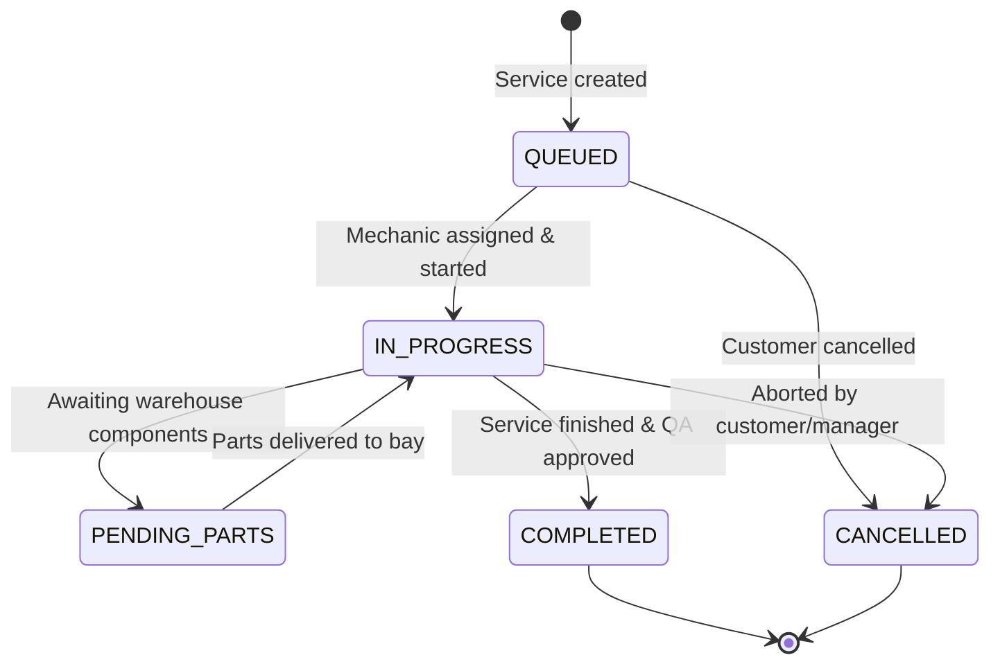

# Data Model: High-Performance Executive Analytics Virtual Threads & Streamed Accounting CSV

**Feature**: `specs/097-executive-analytics-virtual-threads-streamed-csv`  
**Jira Issue**: [SIAA-97](https://the-three-devsketeers.atlassian.net/browse/SIAA-97)  
**Parent Epic**: [SIAA-87](https://the-three-devsketeers.atlassian.net/browse/SIAA-87)  
**Status**: Approved Architecture  

---

## 1. Relational Entities (JPA / PostgreSQL)

### Entity: `ServiceBay` (`public.service_bays`)
Represents physical motorcycle repair and service stalls in the workshop.

```sql
CREATE TABLE public.service_bays (
    id VARCHAR(64) PRIMARY KEY,
    name VARCHAR(100) NOT NULL,
    bay_type VARCHAR(50) NOT NULL DEFAULT 'General Service',
    status VARCHAR(30) NOT NULL DEFAULT 'AVAILABLE',
    display_order INT NOT NULL DEFAULT 1,
    created_at TIMESTAMP WITH TIME ZONE DEFAULT CURRENT_TIMESTAMP,
    updated_at TIMESTAMP WITH TIME ZONE DEFAULT CURRENT_TIMESTAMP
);
```

### Entity: `WorkOrder` (`public.work_orders`)
Represents customer motorcycle service jobs routed through workshop bays.

```sql
CREATE TABLE public.work_orders (
    id VARCHAR(64) PRIMARY KEY,
    bay_id VARCHAR(64) REFERENCES public.service_bays(id) ON DELETE SET NULL,
    vehicle_model VARCHAR(150) NOT NULL,
    service_name VARCHAR(150) NOT NULL,
    status VARCHAR(30) NOT NULL DEFAULT 'QUEUED',
    notes TEXT,
    created_at TIMESTAMP WITH TIME ZONE DEFAULT CURRENT_TIMESTAMP,
    updated_at TIMESTAMP WITH TIME ZONE DEFAULT CURRENT_TIMESTAMP,
    completed_at TIMESTAMP WITH TIME ZONE
);
```

---

## 2. Work Order State Machine



---

## 3. Java 21 DTO Records & Classes

### 1. `ExecutiveKpiDto`
```java
public record ExecutiveKpiDto(
    BigDecimal grossRevenueToday,
    BigDecimal grossRevenueYesterday,
    BigDecimal revenueGrowthPct,
    Integer activeWorkOrdersCount,
    Integer pendingPartsCount,
    BigDecimal netProfitMarginPct,
    BigDecimal grossProfitAmount,
    Integer criticalLowStockCount
) {}
```

### 2. `RevenueTrendDayDto` & `WeeklyRevenueDto`
```java
public record RevenueTrendDayDto(
    String date,
    String dayLabel,
    BigDecimal partsAmount,
    String partsDisplay,
    BigDecimal laborAmount,
    String laborDisplay,
    BigDecimal totalAmount,
    Double partsHeightPercent,
    Double laborHeightPercent
) {}

public record WeeklyRevenueDto(
    List<RevenueTrendDayDto> days,
    BigDecimal peakDayAmount,
    BigDecimal totalPartsWeekly,
    BigDecimal totalLaborWeekly,
    BigDecimal totalWeeklyRevenue
) {}
```

### 3. `CategoryPnlItemDto` & `CategoryPnlDto`
```java
public record CategoryPnlItemDto(
    String category,
    Integer unitsSold,
    BigDecimal grossRevenue,
    BigDecimal cogs,
    BigDecimal netProfit,
    Double marginPct
) {}

public record CategoryPnlSummaryDto(
    Integer totalUnitsSold,
    BigDecimal totalGrossRevenue,
    BigDecimal totalCogs,
    BigDecimal totalNetProfit,
    Double overallMarginPct
) {}

public record CategoryPnlDto(
    List<CategoryPnlItemDto> categories,
    CategoryPnlSummaryDto summary
) {}
```

### 4. `ServiceBayDisplayDto`
```java
public record ServiceBayDisplayDto(
    String id,
    String bayName,
    String status,
    String vehicleService,
    String mechanicInfo
) {}
```

### 5. `ExecutiveDashboardResponseDto`
Aggregated container populated concurrently via `StructuredTaskScope.ShutdownOnFailure`:
```java
public record ExecutiveDashboardResponseDto(
    ExecutiveKpiDto kpis,
    WeeklyRevenueDto revenueTrend,
    CategoryPnlDto categoryPnl,
    List<ServiceBayDisplayDto> serviceBays
) {}
```

### 6. `UpdateWorkOrderStatusRequest` & `UpdateWorkOrderResponseDto`
```java
public record UpdateWorkOrderStatusRequest(
    @NotBlank String status,
    String notes
) {}

public record UpdateWorkOrderResponseDto(
    boolean success,
    String orderId,
    String status,
    String updatedAt,
    String error
) {}
```

---

## 4. Stored Procedure Signatures

### 1. `public.get_executive_kpis(p_date DATE)`
Returns single row containing aggregated daily performance counters.

### 2. `public.get_revenue_trend_7d(p_end_date DATE)`
Returns 7 rows containing daily date, day of week, parts total, and labor total.

### 3. `public.get_category_pnl(p_start_date TIMESTAMPTZ, p_end_date TIMESTAMPTZ)`
Returns JSON or tabular rows detailing units sold, gross sales, cost of goods sold, and margin per product category.
