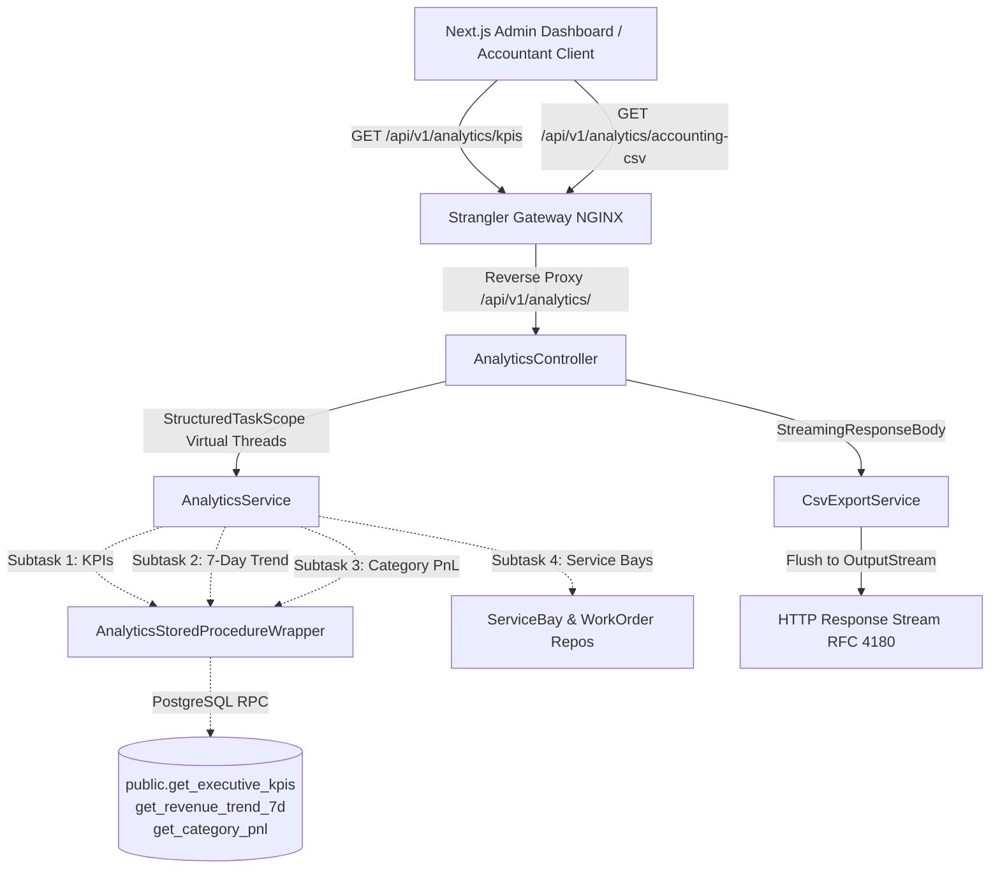

# Implementation Plan: High-Performance Executive Analytics Virtual Threads & Streamed Accounting CSV

**Feature**: `specs/097-executive-analytics-virtual-threads-streamed-csv`  
**Jira Issue**: [SIAA-97](https://the-three-devsketeers.atlassian.net/browse/SIAA-97)  
**Parent Epic**: [SIAA-87](https://the-three-devsketeers.atlassian.net/browse/SIAA-87)  
**Status**: Ready for Execution  

---

## 1. Architectural Boundaries & Component Hierarchy

---

## 2. Component Directory Layout

### Spring Boot Backend (`swift-backend/src/main/java/com/swift/modules/analytics/`)
- `model/`
  - `ServiceBay.java`: JPA entity mapping `public.service_bays`
  - `WorkOrder.java`: JPA entity mapping `public.work_orders`
- `repository/`
  - `ServiceBayRepository.java`: JPA repository for active and ordered service bays
  - `WorkOrderRepository.java`: JPA repository for active and completed work orders
- `dto/`
  - `ExecutiveKpiDto.java`: Record for executive KPI aggregates
  - `RevenueTrendDayDto.java`: Single day trend breakdown record
  - `WeeklyRevenueDto.java`: 7-day trend collection record
  - `CategoryPnlItemDto.java`: Individual product category financial record
  - `CategoryPnlSummaryDto.java`: Overall P&L total summary record
  - `CategoryPnlDto.java`: Container record for category lines and totals
  - `ServiceBayDisplayDto.java`: Workshop bay card display record
  - `ExecutiveDashboardResponseDto.java`: Full aggregated dashboard response record
  - `UpdateWorkOrderStatusRequest.java`: DTO with validation for work order status updates
  - `UpdateWorkOrderResponseDto.java`: DTO response for status mutation
- `service/`
  - `AnalyticsService.java`: Interface defining dashboard telemetry and query operations
  - `impl/AnalyticsServiceImpl.java`: Orchestrates `StructuredTaskScope.ShutdownOnFailure` parallel query execution on virtual threads
  - `CsvExportService.java`: Interface for generating streamed CSV responses
  - `impl/CsvExportServiceImpl.java`: Non-blocking chunked streaming using `StreamingResponseBody`
  - `AnalyticsStoredProcedureWrapper.java`: Spring JDBC wrapper for PostgreSQL stored procedures with in-memory fallbacks
- `controller/`
  - `AnalyticsController.java`: REST controller exposing `/api/v1/analytics/**` endpoints

### Gateway (`gateway/nginx-strangler-gateway.conf`)
- Configure `/api/v1/analytics/` location block routing to `http://springboot_backend` with `@fallback_to_nextjs`.

### Test Suite (`swift-backend/src/test/java/com/swift/modules/analytics/`)
- `AnalyticsControllerTests.java`: REST controller unit and mock tests for all endpoints and error states.
- `VirtualThreadsStructuredScopeTests.java`: Concurrency test verifying parallel execution, timeout handling, and sub-150ms resolution.
- `CsvStreamingMemoryBenchmarkTests.java`: Benchmark test validating constant O(1) heap memory consumption during 100,000+ row export streams.

---

## 3. Verification & Acceptance Criteria Matrix

| Scenario | Test Method | Expected Outcome |
| :--- | :--- | :--- |
| **Virtual Thread Parallel Query** | `VirtualThreadsStructuredScopeTests#testParallelDashboardAggregation` | HTTP 200, resolves under 150ms, all 4 subtasks return non-null payloads. |
| **Fail-Fast Scope Cancellation** | `VirtualThreadsStructuredScopeTests#testFailFastScopeShutdown` | Subtask failure triggers `scope.shutdown()` and cleanly cancels sibling virtual threads. |
| **Streamed Accounting CSV** | `AnalyticsControllerTests#testStreamedAccountingCsvExport` | HTTP 200, Content-Type `text/csv; charset=UTF-8`, Content-Disposition `attachment; filename=...`, valid RFC 4180 format. |
| **100k Row Memory Stability** | `CsvStreamingMemoryBenchmarkTests#test100kRowsMemoryStability` | 100,000 rows streamed without heap allocation spike or `OutOfMemoryError`. |
| **Work Order Status Update** | `AnalyticsControllerTests#testUpdateWorkOrderStatus` | PATCH `/api/v1/analytics/work-orders/{id}/status` returns HTTP 200, bay utilization reflects completed state. |
