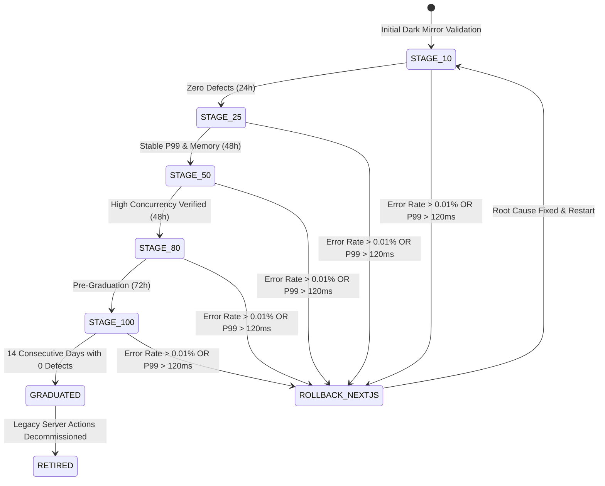

# Data Model & Schema Specification: Dark Traffic Shadowing, Canary Traffic Ramping & Next.js Backend Decommissioning

**Feature**: `098-dark-traffic-shadowing-canary-ramping-decommissioning`  
**Jira Issue**: [SIAA-98](https://the-three-devsketeers.atlassian.net/browse/SIAA-98)  
**Parent Epic**: [SIAA-87](https://the-three-devsketeers.atlassian.net/browse/SIAA-87)  
**Phase**: Phase 6 (Shadow Parity & Cutover)

---

## 1. Domain Entities & State Models

### 1.1 Canary Stage State Machine

Canary deployment follows a strict unidirectional progression with automated rollback safeguard:



```typescript
export type CanaryStage = 
  | 'STAGE_10'   // 10% Spring Boot, 90% Next.js
  | 'STAGE_25'   // 25% Spring Boot, 75% Next.js
  | 'STAGE_50'   // 50% Spring Boot, 50% Next.js
  | 'STAGE_80'   // 80% Spring Boot, 20% Next.js
  | 'STAGE_100'  // 100% Spring Boot, Next.js fallback only
  | 'GRADUATED'  // 14 days zero-defect criteria fulfilled
  | 'ROLLBACK';  // Reverted to 100% Next.js due to SLA breach
```

---

### 1.2 Parity Diff Verification Models

```typescript
export interface ParityDiffReport {
  timestamp: string;               // ISO 8601 UTC
  totalEndpointsChecked: number;   // 46 endpoints
  passedCount: number;
  failedCount: number;
  overallParityPercentage: number; // e.g. 100.0%
  results: EndpointParityResult[];
}

export interface EndpointParityResult {
  endpoint: string;                // e.g. "/api/v1/motomatcher/models"
  method: 'GET' | 'POST' | 'PUT' | 'PATCH' | 'DELETE';
  status: 'PASS' | 'FAIL' | 'SKIPPED';
  springBootStatusCode: number;
  nextJsStatusCode: number;
  durationMs: {
    springBoot: number;
    nextJs: number;
    deltaMs: number;
  };
  mismatches: FieldMismatch[];
}

export interface FieldMismatch {
  path: string;                    // JSONPath, e.g. "$.models[0].brand"
  expected: unknown;               // Next.js golden master value
  actual: unknown;                 // Spring Boot response value
  severity: 'CRITICAL' | 'WARNING' | 'IGNORED';
  ruleApplied?: string;            // e.g. "TIMESTAMP_TOLERANCE", "UUID_MASK"
}
```

---

### 1.3 Canary Telemetry & Graduation Health Snapshot

```typescript
export interface CanaryHealthSnapshot {
  evaluatedAt: string;             // ISO 8601 UTC
  currentStage: CanaryStage;
  consecutiveDefectFreeDays: number;
  graduationTargetDays: number;    // 14 days
  isEligibleForGraduation: boolean;
  metrics: {
    totalRequests: number;
    errorCount5xx: number;
    errorRatePercentage: number;   // Must be < 0.01%
    p95LatencyMs: number;
    p99LatencyMs: number;          // Must be < 120ms
    rollbackCount: number;         // Must be exactly 0
    activeSpringConnections: number;
  };
  checks: {
    noRollbacksPass: boolean;
    errorRatePass: boolean;
    latencyP99Pass: boolean;
    durationPass: boolean;
  };
}
```

---

### 1.4 Complete 46 Server Action Decommissioning Inventory

| Domain | Server Action | Spring Boot REST Equivalent | HTTP Method | Migration Status |
| :--- | :--- | :--- | :---: | :---: |
| **Catalog** | `searchPartsAction` | `/api/v1/catalog/search` | `GET` | `CANARY_ROUTED` |
| **Catalog** | `getProductByIdAction` | `/api/v1/catalog/{id}` | `GET` | `CANARY_ROUTED` |
| **Catalog** | `lookupShelfLocationAction` | `/api/v1/catalog/{id}/location` | `GET` | `CANARY_ROUTED` |
| **Catalog** | `priceCheckBarcodeAction` | `/api/v1/catalog/pricecheck` | `GET` | `CANARY_ROUTED` |
| **Inventory** | `adjustStockAction` | `/api/v1/inventory/stock-adjust` | `POST` | `CANARY_ROUTED` |
| **Inventory** | `getProductInventoryAuditAction`| `/api/v1/inventory/audit/{id}` | `GET` | `CANARY_ROUTED` |
| **Inventory** | `getLowStockAlertsAction` | `/api/v1/inventory/low-stock` | `GET` | `CANARY_ROUTED` |
| **Inventory** | `registerProductAction` | `/api/v1/admin/products` | `POST` | `CANARY_ROUTED` |
| **MotoMatcher** | `getMotorcycleModelsAction` | `/api/v1/motomatcher/models` | `GET` | `CANARY_ROUTED` |
| **MotoMatcher** | `getDisplacementsAction` | `/api/v1/motomatcher/displacements` | `GET` | `CANARY_ROUTED` |
| **MotoMatcher** | `getUniversalFitmentPartsAction`| `/api/v1/motomatcher/universal` | `GET` | `CANARY_ROUTED` |
| **MotoMatcher** | `getCompatibilityMatrixAction` | `/api/v1/motomatcher/matrix` | `GET` | `CANARY_ROUTED` |
| **MotoMatcher** | `checkMotoMatcherPartAction` | `/api/v1/motomatcher/compat-check` | `GET` | `CANARY_ROUTED` |
| **Pricing** | `getPricingRulesAction` | `/api/v1/pricing/rules` | `GET` | `CANARY_ROUTED` |
| **Pricing** | `updatePricingRuleAction` | `/api/v1/pricing/rules/{id}` | `PUT` | `CANARY_ROUTED` |
| **Pricing** | `calculateCustomerDiscountAction`| `/api/v1/pricing/calculate-discount`| `POST` | `CANARY_ROUTED` |
| **Workshop** | `getLaborServicesAction` | `/api/v1/services/labor` | `GET` | `CANARY_ROUTED` |
| **Workshop** | `saveLaborServiceAction` | `/api/v1/services/labor` | `POST` | `CANARY_ROUTED` |
| **Workshop** | `deleteLaborServiceAction` | `/api/v1/services/labor/{id}` | `DELETE` | `CANARY_ROUTED` |
| **Workshop** | `getWorkshopLaborScheduleAction`| `/api/v1/services/labor/schedule` | `GET` | `CANARY_ROUTED` |
| **Attendance** | `clockInAction` | `/api/v1/shifts/clock-in` | `POST` | `CANARY_ROUTED` |
| **Attendance** | `clockOutAction` | `/api/v1/shifts/clock-out` | `POST` | `CANARY_ROUTED` |
| **Attendance** | `toggleShiftBreakAction` | `/api/v1/shifts/{id}/toggle-break`| `POST` | `CANARY_ROUTED` |
| **Attendance** | `getActiveShiftAction` | `/api/v1/shifts/active/{staffId}` | `GET` | `CANARY_ROUTED` |
| **Attendance** | `getAttendanceHistoryAction` | `/api/v1/staff/attendance-history`| `GET` | `CANARY_ROUTED` |
| **Attendance** | `verifyStaffPinAction` | `/api/v1/auth/staff/verify-pin` | `POST` | `CANARY_ROUTED` |
| **POS** | `processCheckoutAction` | `/api/v1/pos/checkout` | `POST` | `CANARY_ROUTED` |
| **POS** | `getTransactionsAction` | `/api/v1/pos/transactions` | `GET` | `CANARY_ROUTED` |
| **POS** | `getTransactionByReceiptAction`| `/api/v1/pos/receipt/{receiptNo}` | `GET` | `CANARY_ROUTED` |
| **POS** | `getThermalReceiptByReceiptAction`| `/api/v1/pos/receipt/{receiptNo}/thermal`| `GET`| `CANARY_ROUTED` |
| **POS** | `rehydratePosCartAction` | `/api/v1/pos/cart/rehydrate` | `POST` | `CANARY_ROUTED` |
| **Analytics** | `getExecutiveKpisAction` | `/api/v1/analytics/kpis` | `GET` | `CANARY_ROUTED` |
| **Analytics** | `getRevenueTrendAction` | `/api/v1/analytics/revenue-trend` | `GET` | `CANARY_ROUTED` |
| **Analytics** | `getCategoryPnlAction` | `/api/v1/analytics/category-pnl` | `GET` | `CANARY_ROUTED` |
| **Analytics** | `getCategoryPnlBreakdownAction` | `/api/v1/analytics/category-pnl/breakdown`| `GET` | `CANARY_ROUTED` |
| **Analytics** | `getServiceBayStatusAction` | `/api/v1/analytics/service-bays` | `GET` | `CANARY_ROUTED` |
| **Analytics** | `updateWorkOrderStatusAction` | `/api/v1/analytics/work-orders/{id}/status`| `PATCH` | `CANARY_ROUTED` |
| **Analytics** | `exportAccountingCsvAction` | `/api/v1/analytics/accounting-csv`| `GET` | `CANARY_ROUTED` |
| **User Admin** | `getUsersAction` | `/api/v1/admin/users` | `GET` | `CANARY_ROUTED` |
| **User Admin** | `createUserAction` | `/api/v1/admin/users` | `POST` | `CANARY_ROUTED` |
| **User Admin** | `updateUserRoleAction` | `/api/v1/admin/users/{id}/role` | `PATCH` | `CANARY_ROUTED` |
| **User Admin** | `toggleUserStatusAction` | `/api/v1/admin/users/{id}/status`| `PATCH` | `CANARY_ROUTED` |
| **User Admin** | `getForensicAuditLogsAction` | `/api/v1/admin/audit` | `GET` | `CANARY_ROUTED` |
| **Auth** | `loginAction` | `/api/v1/auth/login` | `POST` | `CANARY_ROUTED` |
| **Auth** | `logoutAction` | `/api/v1/auth/logout` | `POST` | `CANARY_ROUTED` |
| **Auth** | `getSessionAction` | `/api/v1/auth/session` | `GET` | `CANARY_ROUTED` |
