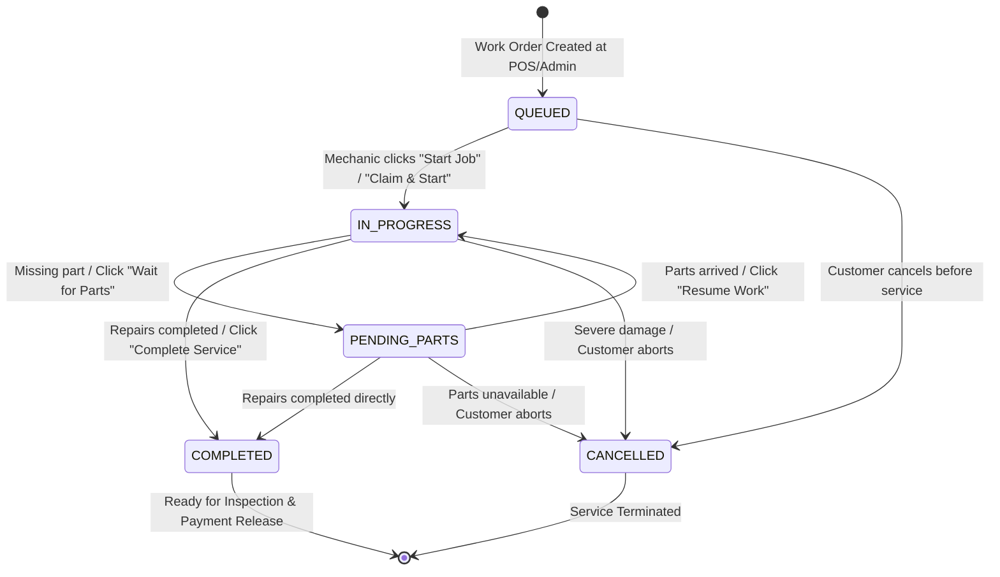

# Data Model & State Architecture: Dedicated Mechanic Workshop Queue

**Feature**: `099-mechanic-workshop-queue`  
**Jira Ticket**: [SIAA-99](https://the-three-devsketeers.atlassian.net/browse/SIAA-99)  

---

## 1. Domain Entities & Storage Schemas

### WorkOrder Entity (PostgreSQL `public.work_orders` Table)

| Field | Type | Constraints | Description |
| :--- | :--- | :--- | :--- |
| `id` | UUID | PRIMARY KEY | Unique identifier for work order |
| `order_number` | TEXT | UNIQUE, NOT NULL | Human-readable identifier (e.g. `WO-2026-0001`) |
| `bay_id` | UUID | NULLABLE, FK `service_bays(id)` | Physical service bay assigned |
| `customer_name` | TEXT | NOT NULL | Customer full name |
| `vehicle_model` | TEXT | NOT NULL | Motorcycle make, model & displacement (e.g., `Yamaha NMAX 155`) |
| `plate_number` | TEXT | NOT NULL | Vehicle license plate / registration |
| `service_code` | TEXT | NOT NULL | Primary labor service code (e.g., `SRV-OIL-01`) |
| `service_name` | TEXT | NOT NULL | Descriptive service title (e.g., `Standard Oil & Gear Oil Change`) |
| `mechanic_id` | UUID | NULLABLE, FK `profiles(id)` | Assigned mechanic profile ID |
| `status` | TEXT | NOT NULL | State: `QUEUED`, `IN PROGRESS`, `PENDING_PARTS`, `COMPLETED`, `CANCELLED` |
| `estimated_duration_minutes` | INT | NOT NULL, DEFAULT 30 | Expected labor duration in minutes |
| `started_at` | TIMESTAMPTZ | NULLABLE | Timestamp when mechanic clicked "Start Job" |
| `completed_at` | TIMESTAMPTZ | NULLABLE | Timestamp when mechanic clicked "Complete Service" |
| `notes` | TEXT | NULLABLE | Customer complaints, inspection findings, mechanic remarks |
| `created_at` | TIMESTAMPTZ | NOT NULL | Order creation timestamp |
| `updated_at` | TIMESTAMPTZ | NOT NULL | Last modified timestamp |

---

### ServiceBay Entity (PostgreSQL `public.service_bays` Table)

| Field | Type | Constraints | Description |
| :--- | :--- | :--- | :--- |
| `id` | UUID | PRIMARY KEY | Unique identifier for service bay |
| `name` | TEXT | UNIQUE, NOT NULL | Bay title (e.g., `Bay 1 (Quick Bay)`) |
| `bay_type` | TEXT | NOT NULL | Specialized type (`Express`, `Scooter`, `Diagnostic`, `Overhaul`) |
| `status` | TEXT | NOT NULL | Bay condition (`AVAILABLE`, `OCCUPIED`, `MAINTENANCE`, `QUEUED`) |
| `display_order` | INT | NOT NULL, DEFAULT 0 | Ordering sequence on workshop monitors |

---

### Extended Frontend Domain Models (Enriched for Workshop Floor)

```typescript
export interface WorkOrderLaborTask {
  id: string;
  description: string;
  completed: boolean;
  notes?: string;
}

export interface WorkOrderRequiredPart {
  sku: string;
  partName: string;
  quantityNeeded: number;
  stockAvailable: number;
  shelfLocation: string; // e.g. "Rack A, Shelf 2"
  isAvailable: boolean;  // stockAvailable >= quantityNeeded
}

export interface DetailedWorkOrder extends WorkOrder {
  bayName?: string;
  mechanicName?: string;
  laborTasks?: WorkOrderLaborTask[];
  requiredParts?: WorkOrderRequiredPart[];
  customerPhone?: string;
  remainingMinutes?: number;
}
```

---

## 2. Work Order Progression State Machine



### Transition Invariants

1. **Terminal States**: `COMPLETED` and `CANCELLED` are terminal. They cannot transition to any active state.
2. **Bay Status Recalculation**:
   - Transitioning into `IN PROGRESS` sets the linked `service_bays.status` to `OCCUPIED`.
   - Transitioning into `PENDING_PARTS` leaves the bay as `OCCUPIED` (or `QUEUED` if pulled off bay).
   - Transitioning into `COMPLETED` or `CANCELLED` frees the bay (`AVAILABLE`) if no other active jobs share the bay.
3. **Timestamp Recording**:
   - Transition to `IN PROGRESS`: Sets `started_at = now()` if previously null.
   - Transition to `COMPLETED`: Sets `completed_at = now()`.

---

## 3. Data Transfer Objects (DTOs) & Validation Schemas

### Status Update Payload (Server Action & REST API)

```typescript
export const updateWorkOrderStatusSchema = z.object({
  status: z.enum(['QUEUED', 'IN PROGRESS', 'PENDING_PARTS', 'COMPLETED', 'CANCELLED']),
  notes: z.string().max(1000).optional(),
});

export type UpdateWorkOrderStatusDto = z.infer<typeof updateWorkOrderStatusSchema>;
```

### Claim Job Payload (Self-Assignment)

```typescript
export const claimWorkOrderSchema = z.object({
  orderId: z.string().uuid(),
  mechanicId: z.string().uuid(),
  mechanicName: z.string().min(1),
  autoStart: z.boolean().default(false),
});

export type ClaimWorkOrderDto = z.infer<typeof claimWorkOrderSchema>;
```
