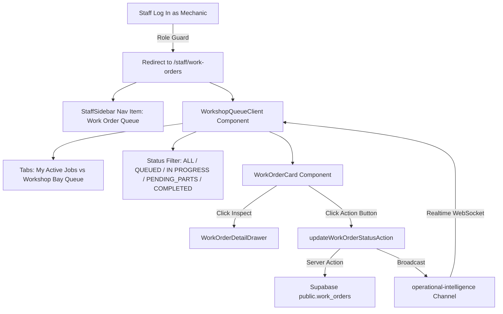

# Research & Architecture Decisions: Dedicated Mechanic Workshop Queue & Work Order Progression Page

**Feature**: `099-mechanic-workshop-queue`  
**Jira Ticket**: [SIAA-99](https://the-three-devsketeers.atlassian.net/browse/SIAA-99)  
**Parent Epic**: [SIAA-5](https://the-three-devsketeers.atlassian.net/browse/SIAA-5)  

---

## Technical Context & Ecosystem Constraints

### 1. Framework & Runtime Standards
- **Next.js 15+ App Router**: Route page at `app/staff/work-orders/page.tsx`. Server Component wrapper for initial session verification, passing hydrated data down to `"use client"` interactive client boundaries (`WorkshopQueueClient`).
- **Tailwind CSS v4 & SWIFT Tokens**: Strict utilization of CSS variables defined in `app/globals.css` and tokens in `lib/tokens.ts`:
  - Cards: `bg-bg-card border-border text-text-primary shadow-xs`
  - Badges: `getWorkOrderStatusBadgeClass` (`bg-accent-light text-accent border border-accent/30` for `IN PROGRESS`, `bg-success-light text-success` for `COMPLETED`, `bg-bg-muted text-text-secondary` for `QUEUED`)
  - No arbitrary hex/rgb values.
- **Tailwind v4 Conventions**: Use `aspect-16/9`, `bg-linear-to-r`, and canonical utilities as enforced by `.agents/rules/tailwind-v4.md`.

### 2. State Management & Real-Time Sync
- **Current Staff & Role**: `usePunchStore` (`lib/store/punch-store.ts`) provides client-side active employee context (`currentStaff`, `currentStaffRole`, `isShiftActive`).
- **Supabase Realtime**:
  - Leverages postgres changes on `public.work_orders` table and broadcast events on `operational-intelligence`.
  - Reuses or extends `useExecutiveRealtime` patterns to provide seamless optimistic updates with rollback resilience.

### 3. Server Actions & API Endpoint Parity
- **Server Action**: `updateWorkOrderStatusAction(orderId, status, notes)` in `lib/analytics/actions.ts` already handles Supabase database mutation and path revalidations.
- **REST API Route**: Next.js route handler at `app/api/v1/analytics/work-orders/[id]/status/route.ts` supporting `PATCH` requests to satisfy parity diff engine and Java gateway routing checks.
- **Service Bay State Synchronization**: When a work order transitions from `IN PROGRESS` to `COMPLETED`, the linked service bay automatically updates to `AVAILABLE`, and when an order starts, the bay becomes `OCCUPIED`.

---

## Architectural Mapping



---

## Component Hierarchy & Directory Plan

```text
app/
  staff/
    work-orders/
      page.tsx                          # Server component wrapper & metadata
  api/
    v1/
      analytics/
        work-orders/
          [id]/
            status/
              route.ts                  # REST API Route for PATCH status

components/
  staff/
    workshop/
      workshop-queue-client.tsx         # Main interactive client view (tabs, filters, state)
      work-order-card.tsx               # Individual job card with status badges & quick actions
      work-order-detail-drawer.tsx      # Slide-over modal with checklist & parts inventory badges
      workshop-queue-header.tsx         # Summary stats (Active Jobs, Bay Utilization, Turnaround)
      workshop-empty-state.tsx          # Clean empty state when no jobs match current tab/filter

lib/
  staff/
    navigation.ts                       # Update ROLE_ROUTE_CONFIG & STAFF_NAV_ITEMS
    workshop-mock-data.ts               # Authoritative workshop demo work orders & parts data
    workshop-actions.ts                 # Dedicated workshop actions & claim job helper
  types/
    workshop.ts                         # Detailed work order item, part requirement, and checklist types
```

---

## Decision Matrix & Trade-offs

| Decision | Chosen Approach | Alternative Considered | Rationale |
| :--- | :--- | :--- | :--- |
| **Mechanic Landing Route** | `/staff/work-orders` | Keep `/staff/compat` | Directly satisfies SIAA-99 Scenario 1. Mechanics belong in workshop queues, not general fitment lookup. |
| **Drawer vs Full-Page Detail** | Slide-Over Drawer (`WorkOrderDetailDrawer`) | Dedicated `/staff/work-orders/[id]` page | Mechanics need quick inspection without losing queue context or scroll position on workshop tablets. |
| **Stock Status on Parts** | Live Inventory Badge with Shelf Locator (`Rack A, Shelf 2`) | Plain text SKU list | Mechanics need to immediately know where parts are and if they can start teardown immediately. |
| **Dual Mutation Strategy** | Server Action + `PATCH` API Route | Server Action only | Supports both direct Next.js client invocation and strangler gateway / curl / parity test verification. |
