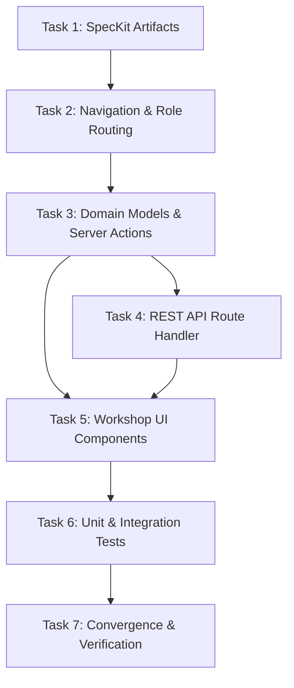

# Implementation Tasks: Dedicated Mechanic Workshop Queue & Work Order Progression Page

**Feature**: `099-mechanic-workshop-queue`  
**Jira Ticket**: [SIAA-99](https://the-three-devsketeers.atlassian.net/browse/SIAA-99)  
**Branch**: `feat/SIAA-99-mechanic-workshop-queue`  

---

## Task Overview & Dependency Graph

---

## Phase 1: Specifications & Contracts (Unit 1)

- [ ] **TASK-01**: Author canonical 8 SpecKit artifacts in `specs/099-mechanic-workshop-queue/`
  - **Files**: `spec.md`, `research.md`, `data-model.md`, `contracts/workshop-contracts.ts`, `checklists/requirements.md`, `plan.md`, `quickstart.md`, `tasks.md`
  - **Verification**: All 8 artifacts present, self-consistent, zero unfilled placeholders.

---

## Phase 2: Navigation & Role Routing (Unit 2)

- [ ] **TASK-02**: Update Staff Navigation Configuration for Mechanic Landing & Sidebar Menu
  - **Files**: `lib/staff/navigation.ts`, `components/staff/staff-sidebar.tsx`
  - **Changes**:
    - Update `ROLE_ROUTE_CONFIG.mechanic` to point to `/staff/work-orders` with descriptive notification message.
    - Add `{ id: "work-orders", label: "Work Order Queue", href: "/staff/work-orders", allowedRoles: ["mechanic", "admin"], icon: ClipboardList }` to `STAFF_NAV_ITEMS`.
    - Ensure active state matches `/staff/work-orders`.
  - **Verification**: `npx tsc --noEmit` compiles cleanly.

---

## Phase 3: Workshop Domain Models, Data & Server Actions (Unit 3)

- [ ] **TASK-03**: Implement Workshop Domain Types, Mock Data & Server Actions
  - **Files**:
    - `lib/types/workshop.ts`: Interfaces for `DetailedWorkOrder`, `WorkOrderLaborTask`, `WorkOrderRequiredPart`.
    - `lib/workshop/workshop-mock-data.ts`: Authoritative mock work orders, vehicle profiles, labor tasks, and required parts with shelf locator tags and stock quantities.
    - `lib/workshop/workshop-actions.ts`: Server actions for `fetchWorkshopOrdersAction`, `updateWorkOrderStatusAction`, and `claimWorkOrderAction`.
  - **Verification**: Pure functions and server actions pass unit tests.

- [ ] **TASK-04**: Implement Next.js REST API Route Handler for Status Updates
  - **Files**: `app/api/v1/analytics/work-orders/[id]/status/route.ts`
  - **Changes**: Provide HTTP `PATCH` endpoint validating status payload with Zod and mutating Supabase / in-memory store.
  - **Verification**: Tested via curl or mocked request handler.

---

## Phase 4: Workshop UI Components & Route Integration (Unit 4)

- [ ] **TASK-05**: Implement Workshop UI Presentation Components
  - **Files**:
    - `components/staff/workshop/workshop-queue-header.tsx`: Header with active orders count, bay capacity badge, and quick refresh button.
    - `components/staff/workshop/work-order-card.tsx`: High-contrast card with vehicle badge, bay tag, status badge, estimated turnaround, and quick action buttons (`Start Job`, `Wait for Parts`, `Complete Service`).
    - `components/staff/workshop/work-order-detail-drawer.tsx`: Slide-over modal with customer notes, labor tasks checklist, and parts inventory with shelf locator tags.
    - `components/staff/workshop/workshop-empty-state.tsx`: Clean empty state component when no jobs match active filter.
    - `components/staff/workshop/workshop-queue-client.tsx`: Container component with tabs ("My Active Jobs" vs "Workshop Bay Queue"), status filter pills, search input, and Supabase Realtime subscription.

- [ ] **TASK-06**: Assemble Route View at `/staff/work-orders`
  - **Files**: `app/staff/work-orders/page.tsx`
  - **Changes**: Server component root verifying session and rendering `WorkshopQueueClient`.
  - **Verification**: Page loads with zero console errors and full theme token compliance.

---

## Phase 5: Automated Test Suite (Unit 5)

- [ ] **TASK-07**: Implement Automated Unit Tests for Navigation, State Transitions, and Parts Stock
  - **Files**:
    - `lib/staff/__tests__/workshop-navigation.test.ts`: Verify mechanic landing route and sidebar visibility.
    - `lib/workshop/__tests__/status-transition.test.ts`: Verify valid and invalid work order state machine transitions.
    - `lib/workshop/__tests__/parts-availability.test.ts`: Verify stock availability checks and shelf locator rendering.
  - **Verification**: `npm test` executes and passes all test suites.

---

## Phase 6: Convergence, Verification & Atomic Commits (Unit 6)

- [ ] **TASK-08**: Run Complete Verification Gates & Graphify Auto-Sync
  - **Commands**:
    - `npx tsc --noEmit`
    - `npm run lint`
    - `npm test`
  - **Commits**: Execute layer-by-layer atomic commits matching Conventional Commits and Jira key `[SIAA-99]`.
  - **PR**: Push branch `feat/SIAA-99-mechanic-workshop-queue` and prepare review-ready Pull Request.
