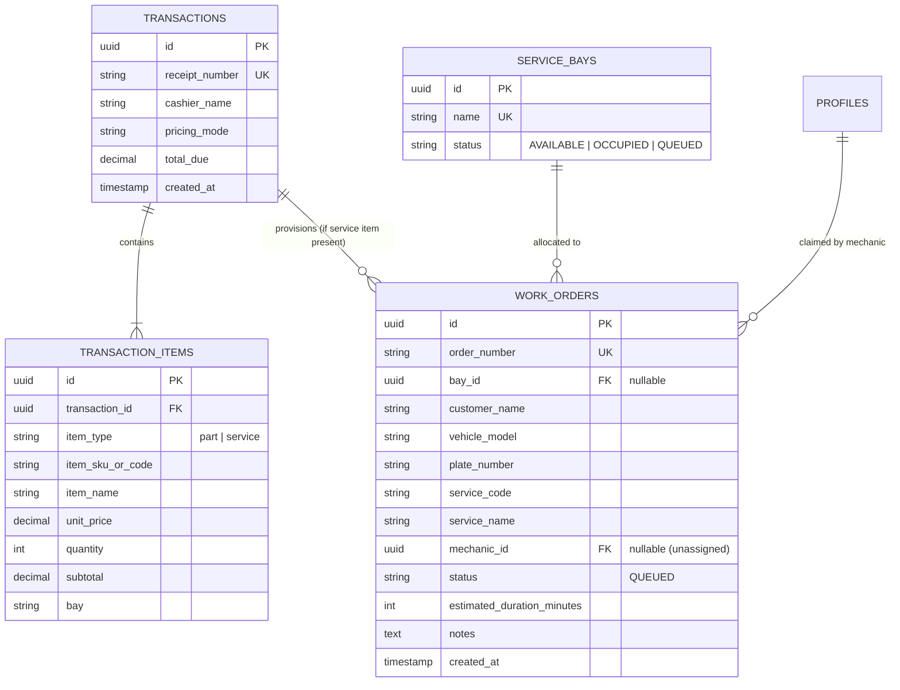
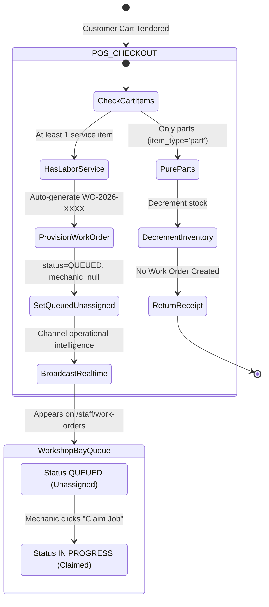

# Data Model & State Architecture: Automatic POS Labor Checkout to Service Bay Work Order Queue Bridge

**Feature**: `100-pos-labor-checkout-work-order-bridge`  
**Jira Ticket**: [SIAA-100](https://the-three-devsketeers.atlassian.net/browse/SIAA-100)  

---

## 1. Domain Entities & Storage Schemas

### POS Transaction to Work Order Bridge Mapping



---

### Extended Data Transfer Objects (DTOs)

#### 1. Checkout Customer Intake Details (`CheckoutIntakePayload`)

```typescript
export interface CheckoutIntakePayload {
  customerName?: string;
  vehicleModel?: string;
  plateNumber?: string;
  technicianNotes?: string;
}
```

#### 2. Extended `CheckoutPayload` (`lib/types/transaction.ts`)

```typescript
export interface CheckoutPayload extends CheckoutIntakePayload {
  receiptNumber?: string;
  cashierId?: string | null;
  cashierName?: string;
  pricingMode: PricingMode;
  subtotal: number;
  discountType?: TransactionDiscountType | null;
  discountRate: number;
  discountAmount: number;
  totalDue: number;
  cashTendered: number;
  changeDue: number;
  paymentMethod: TransactionPaymentMethod;
  items: CheckoutItemPayload[];
}
```

#### 3. Extended `CheckoutActionResult` (`lib/types/transaction.ts`)

```typescript
export type CheckoutActionResult =
  | {
      success: true;
      transactionId: string;
      receiptNumber: string;
      itemsCount: number;
      partsDecremented: number;
      workOrdersCreated: number;
      workOrderNumbers: string[];
      createdAt: string;
    }
  | {
      success: false;
      code: 'INSUFFICIENT_STOCK' | 'PRODUCT_NOT_FOUND' | 'VALIDATION_ERROR' | 'CHECKOUT_FAILED';
      sku?: string;
      error: string;
    };
```

---

## 2. Work Order Lifecycle & Bridge State Machine



---

## 3. Data Invariants

1. **Service Item Detection**: A work order is ONLY provisioned when `items.some(i => i.itemType === 'service')` evaluates to true.
2. **Order Number Uniqueness**: `order_number` MUST follow the format `WO-YYYY-XXXX` and maintain unique constraint in `public.work_orders`.
3. **Unassigned Invariant**: New work orders MUST have `mechanic_id = null` and `status = 'QUEUED'`.
4. **Resilient Non-Blocking Bridge**: If work order broadcast or insertion encounters a recoverable error, financial checkout MUST NOT be reverted unless the entire transaction fails.
