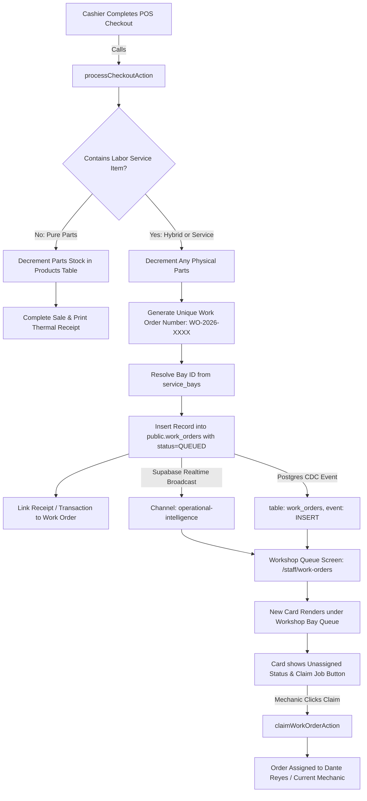

# Research & Architecture Decisions: Automatic POS Labor Checkout to Service Bay Work Order Queue Bridge

**Feature**: `100-pos-labor-checkout-work-order-bridge`  
**Jira Ticket**: [SIAA-100](https://the-three-devsketeers.atlassian.net/browse/SIAA-100)  
**Parent Epic**: [SIAA-5](https://the-three-devsketeers.atlassian.net/browse/SIAA-5)  

---

## Technical Context & Ecosystem Constraints

### 1. Framework & Runtime Standards
- **Next.js 15+ App Router**:
  - `processCheckoutAction` in `lib/pos/actions.ts` serves as the central server action orchestrating POS checkout.
  - Server-side invocation coordinates database atomic commits, in-memory fallbacks, security audit logging, and cache revalidation.
- **Tailwind CSS v4 & SWIFT Tokens**:
  - Pure adherence to `lib/tokens.ts` and `app/globals.css`.
  - Zero hardcoded colors; all badges, buttons, and drawer states consume semantic tokens.
  - Tailwind v4 rules: `aspect-16/9`, `bg-linear-to-r`, etc.

### 2. POS Checkout Orchestration & Service Identification
- In `lib/pos/actions.ts`:
  - Items are partitioned by `itemType`:
    - `itemType === 'part'`: Triggers stock verification and inventory decrement in `products` / `stock_adjustment_logs`.
    - `itemType === 'service'`: Triggers auto-provisioning of `work_orders` in `public.work_orders`.
- Auto-provisioning logic generates:
  - `order_number`: Alphanumeric tracking string (e.g., `WO-YYYYMMDD-XXXX` or `WO-2026-XXXX`).
  - `bay_id`: Resolves the service bay UUID from `service_bays` where bay name matches the service's bay string (e.g. `"Bay 1 / Quick Bay"`), or `null` if unallocated.
  - `customer_name`: Passed in checkout payload or defaulted to `"Walk-in Customer"`.
  - `vehicle_model`: Passed in checkout payload or defaulted to `"Motorcycle (General)"`.
  - `plate_number`: Passed in checkout payload or defaulted to `"FOR-REG"`.
  - `service_code`: `item.itemSkuOrCode` (e.g. `SRV-OIL-01`).
  - `service_name`: `item.itemName`.
  - `status`: `'QUEUED'`.
  - `mechanic_id`: `null` (unassigned).
  - `estimated_duration_minutes`: 30.
  - `notes`: Intake complaint notes entered at POS or default.

### 3. Dual-Layer Execution & Resilient Fallback
- **PostgreSQL / Supabase Production Layer**:
  - Direct insert into `public.work_orders`.
  - `public.process_pos_checkout` can be executed, followed by work order bridge insertion with foreign key or transaction receipt link.
  - Trigger Supabase Realtime broadcast on `operational-intelligence` channel and table change events on `work_orders`.
- **In-Memory / Test / Demo Fallback Layer**:
  - When Supabase is offline or during Jest / Vitest test execution, `executeMockCheckout` in `lib/pos/actions.ts` invokes `autoProvisionMockWorkOrders` which appends new orders to `inMemoryOrders` in `lib/workshop/workshop-actions.ts`.
  - Dispatches browser event `swift:pos:workorder-created` so active client listeners update instantaneously.

### 4. Real-Time WebSocket Synchronization
- In `components/staff/workshop/workshop-queue-client.tsx`:
  - Currently `useExecutiveRealtime` listens for `work_orders` changes:
    ```ts
    channel.on('postgres_changes', { event: '*', schema: 'public', table: 'work_orders' }, ...)
    ```
  - When an `INSERT` event occurs, the queue client must handle inserting the new order into local state:
    - If `ord` is not present in existing `orders`, prepend it to the queue with smooth entrance animation.
  - In addition, a custom broadcast event `WORK_ORDER_CREATED` on `operational-intelligence` ensures low latency (<500ms).

---

## Architectural Mapping



---

## Component & Module Directory Plan

```text
lib/
  pos/
    actions.ts                          # Updated processCheckoutAction with work order auto-provisioner
    contracts.ts                        # Extended checkout payload schema with optional intake fields
    work-order-bridge.ts                # Dedicated helper to auto-provision work orders from labor items
    __tests__/
      pos-labor-bridge.test.ts          # Comprehensive unit & integration tests for auto-provisioning
  types/
    transaction.ts                      # Extended CheckoutPayload with customer intake fields & result metadata
  workshop/
    workshop-actions.ts                 # Export helper to push new orders to in-memory store in dev/test mode

components/
  staff/
    workshop/
      workshop-queue-client.tsx         # Updated real-time listener to prepend newly created work orders on INSERT
```

---

## Decision Matrix & Trade-offs

| Decision | Chosen Approach | Alternative Considered | Rationale |
| :--- | :--- | :--- | :--- |
| **Intake Details Capture** | Optional fields on `CheckoutPayload` with smart defaults | Strict mandatory modal popup | In fast-lane counter POS, forcing cashiers to enter 4 intake fields on every single oil change slows down the line. Smart defaults allow zero-friction checkouts while allowing custom intake when provided. |
| **Order Number Generation** | Format `WO-YYYY-XXXX` (e.g. `WO-2026-1041`) | Raw UUIDs | Mechanics and cashiers need human-readable identifiers to call out numbers across the shop floor. |
| **Realtime Mechanism** | Dual: Postgres CDC on `work_orders` + Broadcast on `operational-intelligence` | Periodic polling (`setInterval`) | Satisfies <500ms latency requirement without unnecessary database load or polling battery drain on tablets. |
| **Pure Parts Guard** | Filter `items.filter(i => i.itemType === 'service')`; abort bridge if count === 0 | Create dummy "Parts Pick" work order | Retail counter sales must never clutter the mechanic bay queue. |
