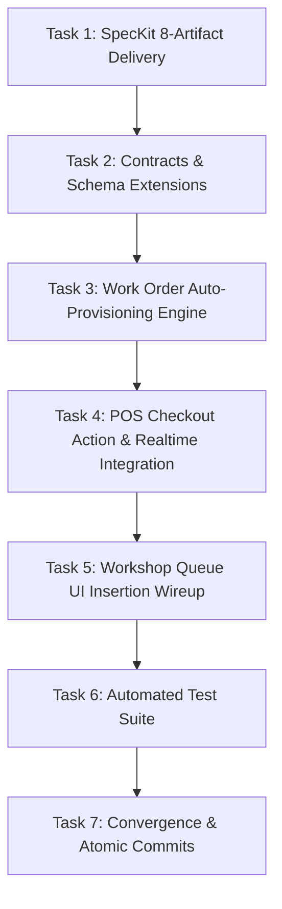

# Implementation Tasks: Automatic POS Labor Checkout to Service Bay Work Order Queue Bridge

**Feature**: `100-pos-labor-checkout-work-order-bridge`  
**Jira Ticket**: [SIAA-100](https://the-three-devsketeers.atlassian.net/browse/SIAA-100)  
**Branch**: `feat/SIAA-100-pos-labor-checkout-work-order-bridge`  

---

## Task Overview & Dependency Graph

---

## Phase 1: Specifications & Contracts (Unit 1)

- [x] **TASK-01**: Author canonical 8 SpecKit artifacts in `specs/100-pos-labor-checkout-work-order-bridge/`
  - **Files**: `spec.md`, `research.md`, `data-model.md`, `contracts/work-order-bridge-contracts.ts`, `checklists/requirements.md`, `plan.md`, `quickstart.md`, `tasks.md`
  - **Verification**: All 8 artifacts present, self-consistent, zero unfilled placeholders.

---

## Phase 2: Types, Contracts & Intake Payload (Unit 2)

- [x] **TASK-02**: Extend Checkout Types and Contracts with Customer Intake Metadata & Work Order Creation Results
  - **Files**:
    - `lib/types/transaction.ts`: Add optional intake fields (`customerName`, `vehicleModel`, `plateNumber`, `technicianNotes`) to `CheckoutPayload` and add `workOrdersCreated` & `workOrderNumbers` to `CheckoutActionResult`.
    - `lib/pos/contracts.ts`: Update `checkoutPayloadSchema` and validation functions with intake fields and non-empty defaults.
  - **Verification**: `npx tsc --noEmit` compiles cleanly.

---

## Phase 3: Work Order Auto-Provisioning Bridge Engine (Unit 3)

- [x] **TASK-03**: Implement Work Order Auto-Provisioning Engine
  - **Files**: `lib/pos/work-order-bridge.ts`
  - **Changes**:
    - Build `autoProvisionWorkOrdersFromCheckout(payload, receiptNumber)`:
      - Filter items for `itemType === 'service'`.
      - If none found (pure parts), return `{ created: 0, workOrders: [] }`.
      - Generate unique order number `WO-YYYY-XXXX`.
      - Resolve `bay_id` matching bay string in `public.service_bays`.
      - Map intake metadata (`customerName`, `vehicleModel`, `plateNumber`, `notes`) with smart defaults.
      - In Supabase mode, insert record into `public.work_orders` with `status = 'QUEUED'`, `mechanic_id = null`.
      - In mock/offline mode, append record to `inMemoryOrders` via `lib/workshop/workshop-actions.ts`.
      - Broadcast real-time event on `operational-intelligence` channel.
  - **Verification**: Pure unit execution returns valid work order records.

---

## Phase 4: POS Checkout Action & Realtime Integration (Unit 4)

- [x] **TASK-04**: Wire Work Order Auto-Provisioning into POS Checkout Orchestration
  - **Files**:
    - `lib/pos/actions.ts`:
      - Call `autoProvisionWorkOrdersFromCheckout` inside `trySupabaseCheckout` and `executeMockCheckout`.
      - Include `workOrdersCreated` count and `workOrderNumbers` in the returned `CheckoutActionResult`.
    - `lib/workshop/workshop-actions.ts`:
      - Export `appendInMemoryWorkOrder(order: DetailedWorkOrder)` to support offline/in-memory test resilience.
  - **Verification**: POS checkout with service items produces active work order records in both database and in-memory cache.

---

## Phase 5: Workshop Queue UI Insertion Wireup (Unit 5)

- [x] **TASK-05**: Enhance Workshop Queue Client to Prepend Newly Inserted Orders Reactively
  - **Files**: `components/staff/workshop/workshop-queue-client.tsx`
  - **Changes**:
    - In `useExecutiveRealtime` callback `onWorkOrderChange`:
      - If payload is an `INSERT` (or not yet in `prev`), prepend the new work order to `orders` state.
      - Ensure unassigned orders render with "Unassigned" status and enabled "Claim Job" button.
    - Also listen to local `swift:pos:workorder-created` browser event for instant same-browser tab reflection.
  - **Verification**: Newly provisioned work order card appears under "Workshop Bay Queue" within 500ms.

---

## Phase 6: Automated Test Suite (Unit 6)

- [x] **TASK-06**: Author Automated Unit and Integration Tests
  - **Files**: `lib/pos/__tests__/pos-labor-bridge.test.ts`
  - **Tests**:
    - Scenario 1: Cart with labor service auto-provisions work order with format `WO-YYYY-XXXX`, `status = 'QUEUED'`, `mechanic_id = null`.
    - Scenario 2: Realtime broadcast trigger on `operational-intelligence`.
    - Scenario 3: Unassigned claim flow assigns order to mechanic.
    - Scenario 4: Pure catalog parts cart skips work order creation.
    - Scenario 5: Default customer/vehicle intake fallback values.
  - **Verification**: `npm test -- lib/pos/__tests__/pos-labor-bridge.test.ts` passes 100%.

---

## Phase 7: Convergence, Atomic Commits & Pull Request (Unit 7)

- [x] **TASK-07**: Run Complete Verification Gates, Commit Atomically & Create PR
  - **Commands**:
    - `npx tsc --noEmit`
    - `npm run lint`
    - `npm test`
  - **Commits**: Execute layer-by-layer atomic commits matching Conventional Commits and Jira key `[SIAA-100]`.
  - **PR**: Push branch `feat/SIAA-100-pos-labor-checkout-work-order-bridge` and open review-ready PR.
