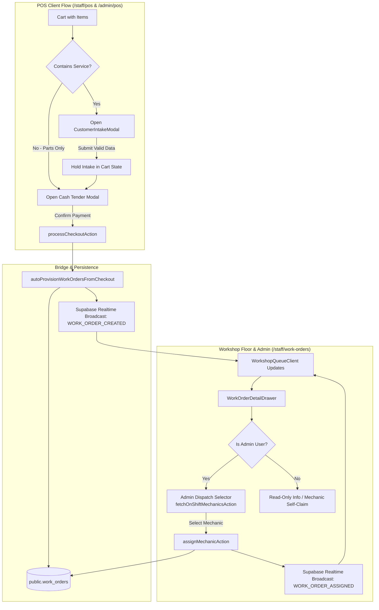

# Implementation Plan: POS Customer & Complaint Intake Prompt with Admin On-Shift Mechanic Dispatch

**Feature**: `specs/101-pos-customer-intake-admin-mechanic-dispatch/spec.md`  
**Date**: 2026-10-26  
**Jira Ticket**: [SIAA-101](https://the-three-devsketeers.atlassian.net/browse/SIAA-101)  

---

## 1. Architecture Overview & Component Boundaries

---

## 2. File Modification & Creation Roadmap

### 2.1 Contracts & Types
- Update `lib/types/transaction.ts`: Add `customerPhone?: string` to `CheckoutPayload`.
- Update `lib/pos/contracts.ts`: Add `customerPhone` validation to `checkoutPayloadSchema`.
- Create `lib/workshop/intake-dispatch-contracts.ts` (exporting `customerIntakeSchema`, `assignMechanicSchema`, etc.).

### 2.2 Bridge & Actions Layer
- Update `lib/pos/work-order-bridge.ts`:
  - Accept and persist `customerPhone` into `DetailedWorkOrder` and `public.work_orders`.
  - Fall back to defaults only if intake values are completely absent.
- Update `lib/workshop/workshop-actions.ts`:
  - Implement `fetchOnShiftMechanicsAction()`: Queries `public.staff_shifts` + `public.profiles` for active mechanics, with mock fallback.
  - Implement `assignMechanicAction(orderId, mechanicId, mechanicName)`: Updates DB and memory, broadcasts `WORK_ORDER_ASSIGNED` over `operational-intelligence`, calls `safeRevalidatePaths()`.

### 2.3 Store & UI Components Layer
- Create `components/pos/customer-intake-modal.tsx`:
  - Accessible modal dialog using SWIFT design tokens (`bg-bg-card`, `border-border`, `text-text-primary`, etc.).
  - Philippine mobile regex validation, required input indicators, inline validation feedback.
- Update `app/staff/pos/page.tsx` & `app/admin/pos/page.tsx`:
  - Integrate `CustomerIntakeModal` before payment opening if `items.some(i => i.type === 'service')`.
- Update `components/staff/workshop/work-order-detail-drawer.tsx`:
  - Support `isAdmin` prop (or session-derived).
  - Add interactive on-shift mechanic dispatch dropdown when admin.
  - Ensure real customer phone and complaints render cleanly.
- Update `components/staff/workshop/workshop-queue-client.tsx`:
  - Handle `WORK_ORDER_ASSIGNED` realtime events.
  - Wire `isAdmin` detection from user session / punch store.

---

## 3. Test & Verification Plan

### 3.1 Unit & Contract Tests
- `lib/pos/__tests__/customer-intake-contracts.test.ts`:
  - Validate `customerIntakeSchema` with valid/invalid Philippine phone numbers.
  - Validate required fields (customerName, vehicleModel, plateNumber, complaints).
- `lib/workshop/__tests__/mechanic-dispatch.test.ts`:
  - Test `fetchOnShiftMechanicsAction` returns only mechanics with active clock-in.
  - Test `assignMechanicAction` correctly updates work order `mechanic_id`, `mechanicName`, and handles missing order.
- `lib/pos/__tests__/pos-intake-bridge.test.ts`:
  - Verify `autoProvisionWorkOrdersFromCheckout` persists exact intake fields (`customer_name`, `customer_phone`, `notes`, `vehicle_model`, `plate_number`).

### 3.2 Static Verification
- Run `npm run typecheck` (`tsc --noEmit`) to verify zero TypeScript errors.
- Run `npm run lint` to verify code quality standards.
- Run `npm test` across all new test suites.
